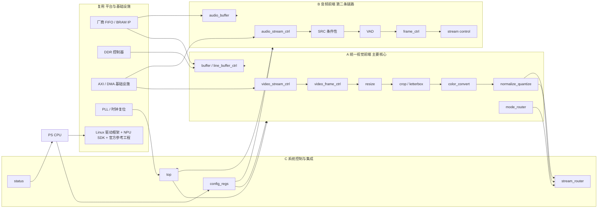

# FPGA自研模块清单

本页回答一个问题：**PL 里到底要我们自己写哪些 RTL、每个模块的职责边界在哪、什么算完成。**
本页不写排期与任务卡（见 [[任务卡与台账规范]]、[[排期与分工]]），不写用户可见行为与对外口径（场景判据见 [[2-CPU可用链#3. 场景 S1~S5（此后所有回归都跑这 5 条）|2-CPU可用链——3. 场景 S1~S5（此后所有回归都跑这 5 条）]]，能力边界见 [[风险与完成判据#5. 已知限制与范围外（对外唯一口径）|风险与完成判据——5. 已知限制与范围外（对外唯一口径）]]）。

## 范围声明（已确认）

| 项 | 结论 | 依据 |
|---|---|---|
| 主要 FPGA 成果 | **统一视觉前端**（A 组）：连续像素流的实时预处理，可测吞吐／延迟／资源／CPU 占用 | 状态源第一、三节 |
| 第二条必要链路 | **音频前端**（B 组）：边界更小——流控、分帧、VAD、必要缓存；SRC 条件性 | 状态源第三、五节 |
| 公共控制与集成 | config_regs／stream_router/status/top（C 组） | 状态源第三节 C |
| 不在自研范围 | FPGA JPEG、FPGA TTS 后端、TOE 网络卸载、H.264／H.265、任何神经网络本体、DDR 控制器、通用 AXI 基础设施 | 状态源第三、五节（冲突消解见下） |

**冲突消解说明**：旧版《开发流程与生命周期管理》第 8 节与《立项说明》第四节把下沉清单写成"AFPGA → VFPGA → JPEG → TTS → TOE 五件套"，并把音频排在下沉顺序第 1。**按冲突消解规则以项目状态源为准**：JPEG／TTS／TOE 三项在本周期记为**范围外（下版 backlog）**，推进顺序是**图像重点、音频也做**。旧文档的阶段权重与门禁编号已随决策 D-12 撤销，14 周排期降级为参考；本模块清单与 A1–A9 任务卡的对应关系见 [[进度计算与实时看板#2. 任务卡集合（进度分母）|进度计算与实时看板——2. 任务卡集合（进度分母）]]，模块级的完成状态只记在 [[任务卡与台账规范]] 4.5 的 RTL 台账与看板总账里。

## 模块地图

这张图回答：**18 个模块条目如何分成 A／B／C 三组，以及它们和复用的平台 IP 之间的边界在哪。**

> 图中箭头只表达"归属与主要数据方向"，精确握手时序以 [[接口契约与数据通路]] 为准。

## A 统一视觉前端（主要 FPGA 核心）

**目标（已确认）**：形成**多模型共享、可配置**的视觉预处理加速器，而不是为每个模型重复写一套专用前端。OCR 与人脸识别共用同一前端。

| 模块 | 职责 | 关键设计点 | 状态 | 对应下沉子模块（容限见 [[3-FPGA组件下沉#6. 下沉范围与误差容限预置（按子模块，第 ① 步冻结）\|3-FPGA组件下沉——6. 下沉范围与误差容限预置（按子模块，第 ① 步冻结）]]） |
|---|---|---|---|---|
| video_stream_ctrl | 接收和调度视频数据流，处理 valid／ready 与背压 | 与 DMA／AXI4-Stream 对齐的入流节拍；背压不丢帧；上游停顿时的保持语义 | 🔄（1-entry 握手缓存 ✅，模块本体 ⬜） | VFPGA-流控 |
| video_frame_ctrl | 维护像素、行、帧边界和分辨率状态 | 行／帧计数器 + 边界事件；输入分辨率与目标分辨率的一致性检查 | ⬜ | VFPGA-流控（需扩行） |
| resize | 摄像头分辨率 → 模型输入尺寸 | 先做**可验证版本**（最近邻／简单方案），再决定是否升级为双线性等更复杂实现；不为展示技术提前上并行度 | ⬜ | VFPGA-Resize |
| crop／letterbox | 按目标模型要求裁剪、补边、生成 ROI | 裁剪坐标由 CPU 配置；letterbox 填充值与对齐方式须与模型预处理一致；ROI 语义与 mode 绑定 | ⬜ | VFPGA-Crop |
| color_convert | RGB／BGR／YUV 等格式转换 | 像素级规则计算、定点系数；颜色顺序由配置决定而非硬编码 | ⬜ | VFPGA-色彩转换 |
| normalize_quantize | 归一化、定点化、INT8 量化前处理 | mean／std 的定点表示与舍入策略；量化 scale／zero-point 由配置下发；**必须与 NPU 侧要求逐位对齐** | ⬜ | VFPGA-Normalize／VFPGA-Quantize |
| buffer／line_buffer_ctrl | 组织行缓存与阶段间缓存 | **存储本体优先使用厂商 BRAM／FIFO IP**，自研部分只写控制逻辑与地址生成；满空与水位上报 | 🔄（概念学习完成，缺口是项目应用） | VFPGA-流控（需扩行：缓存） |
| mode_router | 按 CPU 配置在 FACE／OCR／VLM 等模式间切换处理参数与输出去向 | 模式切换的帧边界原子性（不在帧中途改参数）；参数表按模式分组下发 | ⬜ | 需扩行（功能等价） |

## B 音频前端（第二条必要链路）

**边界（已确认）**：至少完成**流控、分帧、VAD 和必要缓存**；SRC 由真实采样率需求决定，**不为展示技术而强行增加无需求的并行度**。

| 模块 | 职责 | 关键设计点 | 状态 | 对应下沉子模块（容限见 [[3-FPGA组件下沉#6. 下沉范围与误差容限预置（按子模块，第 ① 步冻结）\|3-FPGA组件下沉——6. 下沉范围与误差容限预置（按子模块，第 ① 步冻结）]]） |
|---|---|---|---|---|
| audio_stream_ctrl | 接收 PCM 数据流，处理握手、背压和节拍 | 与 ALSA 周期缓冲对齐；采样对齐（不切断样本对）；停顿时的数据保持 | 🔄（1-entry 握手缓存 ✅，模块本体 ⬜） | AFPGA-流控（需扩行） |
| SRC | 实际采样率与 ASR 输入采样率不一致时做采样率转换 | **条件项**，见下节专述；首选固定倍率 FIR（如 48 kHz→16 kHz）；是否需并行／多通道由真实输入决定 | ⬜（条件 P0） | AFPGA-SRC |
| VAD | 基于能量与状态机判断开始／持续／结束说话 | 能量统计窗 + FSM 三段状态；挂起（hangover）与阈值由配置下发；误触发时备选 WebRTC VAD／NN VAD | ⬜ | AFPGA-VAD |
| frame_ctrl | 按模型要求分帧并产生帧边界信号 | 帧长／帧移可配；与 ASR 前端输入格式严格一致；帧边界与 VAD 事件的先后关系明确 | ⬜ | AFPGA-分帧／缓冲 |
| audio_buffer | 缓存音频样本与帧数据 | **FIFO／BRAM 本体优先使用厂商 IP**；深度由最大抖动与下游停顿容忍度决定 | ⬜ | AFPGA-分帧／缓冲 |
| stream control | 连接采集、预处理与 NPU ASR | 核心判据：**不丢失、不重复、不乱序**；异常（溢出／下溢／乱序）必须可被 status 观测到 | ⬜ | 需扩行（功能等价） |

### SRC 的条件性（要突出的一条边界）

| 情形 | 结论 | 行动 |
|---|---|---|
| 麦克风可直接输出 ASR 所需采样率 | ~~删掉 SRC~~ → **这一档已排除**（10-05 实测：MCP01 **只有 48000 Hz 一档**，描述符 `bSamFreqType=1 Discrete`，给不出 16 kHz） | 判据见 [[音频#2.1 采样格式\|音频——2.1]]，不要再按"可能不用做 SRC"排期 |
| 只有一档固定倍率不一致（**现在就是这种**：48 kHz→16 kHz） | 做**固定倍率 FIR**，参数写死、系数表入库（3 倍抽取，比率是整数） | **升为确定项**：倍率与输入格式都由实测钉死了 |
| 同时存在多档采样率或需任意比率 | 升级**多相 FIR** | **不做**——外设不存在这一档 |
| FPGA 时间不足 | **CPU SRC**（PS 软件重采样）兜底，链路仍可用 | 退路的代价已量化（A）：板端 `plughw` 层重采样，15 s 采集里 `arecord` 自身只吃掉 **单核 0.17 %**（1 tick/6 s 窗口），且是在推理满载时测的 → 见 [[音频#四、测试记录\|音频——T17]] |

> SRC 的条件性**收掉一半**（10-05）：麦克风格式那半已经实测完（48 k 单档／S16_LE／录音单声道），所以"要不要做"不再有悬念，只剩"16 kHz 是不是 ASR 真要的输入速率"这一半**待核对**（那是模型侧的事，板子给不了答案）。CPU 兜底不再是空口退路，代价有数。

## C 系统控制与集成

| 模块 | 职责 | 关键设计点 | 状态 |
|---|---|---|---|
| config_regs | 由 CPU 配置模式、尺寸、裁剪坐标、颜色顺序、归一化参数、音频阈值、启动／停止 | 字段清单与读写属性见 [[接口契约与数据通路]]；**映射表为设计提案，尚未冻结** | ⬜ |
| stream_router | 把处理后的音视频数据送往对应 NPU 模型、内存或抓拍路径 | 与 mode_router 的分工：mode 决定"参数与语义"，router 决定"去向与通路" | ⬜ |
| status | 向 CPU 报告帧状态、缓存状态、错误与处理完成事件 | 必须可轮询也可中断；计数不清零语义便于事后取证 | ⬜ |
| top | 集成视觉前端、音频前端、配置、状态与平台接口 | 时钟／复位域划分**待验证**（须照官方参考工程核对）；端口一旦外引即成契约 | ⬜ |

## D 自研与复用边界

### D1 直接复用的成熟 IP 与框架（已确认）

PLL、BRAM／FIFO、DDR 控制器、AXI／DMA 基础设施、FFT 等基础 IP；同时复用 Linux 驱动框架、NPU SDK 与官方参考工程接口。

### D2 对复用 IP 的学习要求（只要求"会用"，不计入核心 RTL）

| 要求 | 具体动作 |
|---|---|
| 理解功能与适用边界 | 说清这颗 IP 解决什么问题、什么情况下不该用它 |
| 能完成选型与参数配置 | 位宽、深度、通道数、时钟比等参数的确定依据 |
| 能完成接口连接 | 握手信号、valid／ready／tlast 等时序对齐 |
| 能处理时钟与复位 | 时钟域归属、复位同步、跨域禁令 |
| 能写约束并跑仿真 | 约束文件位置、testbench 接法 |
| 能解读报告 | 资源占用、时序裕量、编译告警的含义 |

> **不要求从底层重写**，其内部实现**不计入团队核心 RTL**。同步 FIFO 即属此类：概念学习已完成，当前缺口是**在项目里调用厂商 FIFO／BRAM IP** 完成配置、接口连接与边界验证，而不是再手写一遍内核。

### D3 必须由团队掌握并能答辩的内容

系统架构、视觉与音频数据通路、算法硬件化方式、流水线与定点设计、模块间协议、控制逻辑、验证方法、系统集成、性能优化。

### D4 暂不自研（已确认）

| 项 | 归属 | 原因 |
|---|---|---|
| 完整 OCR 神经网络、YOLO／人脸／ASR 网络、LLM | NPU 或云端 | 不用 RTL 重写神经网络 |
| DDR 控制器、通用 AXI 基础设施 | 复用平台 IP | 成熟基础设施，不造轮子 |
| 自研神经网络加速器 | 不做 | 已有 NPU |
| CustomOP 自定义硬算子 | **条件项**，非预设必做 | 仅当 iCraft 编译／profiling 暴露值得硬件化的瓶颈才评估（见 [[算子缺口处理]]） |

**"这一周期不做的四项"（H.264／H.265、FPGA JPEG、FPGA TTS 后端、TOE 网络卸载）不在本表逐条重述**：它们的态度、替代方案与"什么条件下会变成做"的唯一出处是 [[组件选型与复用边界#十一、明确不采用／暂不采用的技术（负面清单）|组件选型与复用边界——十一、明确不采用／暂不采用的技术（负面清单）]]，决策依据是 [[状态源与决策记录#D-02 · 收缩 FPGA 下沉范围（本 Wiki 编制时消解的最大冲突）|状态源与决策记录——D-02]] D-02。本表只登记"跟 FPGA 自研边界直接相关"的那几条。

### D5 工作量口径

- 工作量**以功能与验证为准，不以 RTL 文件数或代码行数作 KPI**。
- 状态源口径：预计**约 15 个有实际内容的 RTL 模块或子模块**，最终按实现拆分调整。
- 本页台账按状态源第三节逐项列出 18 个条目；**条目数 ≠ 最终 RTL 文件数**（buffer／audio_buffer 的主体由厂商 IP 承担，C 组可能合入 top）。

## 模块台账

优先级：P0 当前必须 / P1 计划内后置 / P2 可选 / 条件 P0 由实测决定是否做。
状态只用 ⬜🔄⛔✅，且 **✅ 必须有可复核证据**（见 [[验证方法学]]）。

**误差容限不在本表写数值**：逐子模块的冻结值只登记在 [[3-FPGA组件下沉#6. 下沉范围与误差容限预置（按子模块，第 ① 步冻结）|3-FPGA组件下沉——6. 下沉范围与误差容限预置（按子模块，第 ① 步冻结）]]一处，本表「验证方法」列只写比什么、怎么比。

| 模块 | 归属 | 优先级 | 状态 | 验证方法 | 黄金参考 |
|---|---|---|---|---|---|
| video_stream_ctrl | A | P0 | 🔄（基础握手缓存 ✅，本体 ⬜） | 与软件 golden model 逐像素比较 + 协议边界自检 | M2 冻结的 CPU 参考实现 + 测试向量 |
| video_frame_ctrl | A | P0 | ⬜ | 帧／行／像素计数比对；边界（首帧、末行、分辨率切换）自检 | CPU 参考 + 测试向量 |
| resize | A | P0 | ⬜ | 与软件 golden model 逐像素比较 | CPU 参考（最近邻）+ 小尺寸图像集 |
| crop／letterbox | A | P0 | ⬜ | 逐像素比较 + ROI 坐标正确性 | CPU／OpenCV 参考（仅比对用，不上实时链路） |
| color_convert | A | P0 | ⬜ | 逐像素比较；RGB／BGR／YUV 各组合 | 定点软件参考模型 |
| normalize_quantize | A | P0 | ⬜ | 逐样本比对（Normalize 与 Quantize 各自按冻结容限判定） | 定点仿真（下沉循环第③步产物） |
| buffer／line_buffer_ctrl | A | P0 | 🔄（FIFO 概念已学，待调 IP） | 满／空／同时读写边界 + 不丢不重不乱序 | 厂商 IP 仿真模型 + 自检 testbench |
| mode_router | A | P1 | ⬜ | 功能等价；模式切换在帧边界生效 | 配置表 + 场景用例 |
| audio_stream_ctrl | B | P0 | 🔄（基础握手缓存 ✅，本体 ⬜） | 不丢、不重、不乱序 + 背压保持 | CPU 侧 PCM 参考流 |
| SRC | B | **条件 P0** | ⬜（是否做取决于实测采样率） | 逐样本比较 | 定点 FIR 软件模型 + 系数表 |
| VAD | B | P0 | ⬜ | 能量与状态机判定比对；起停边界 | 软件能量 VAD 参考 |
| frame_ctrl | B | P0 | ⬜ | 帧长／帧移与帧边界时序正确 | CPU 分帧参考 |
| audio_buffer | B | P0 | ⬜ | 深度／满空／水位 + 不丢不重不乱序 | 厂商 FIFO IP + 自检 testbench |
| stream control（音频） | B | P0 | ⬜ | 端到端流完整性（不丢不重不乱序）与边界条件 | 采集原始流作为基准 |
| config_regs | C | P0 | ⬜（映射表 ⬜ 待冻结） | 读写属性回归 + 复位默认值检查 | 冻结后的寄存器表（唯一依据） |
| stream_router | C | P0 | ⬜ | 去向正确性与切换原子性 | 场景用例 |
| status | C | P0 | ⬜ | 事件计数与标志位一致性 | 自检 testbench 注入错误 |
| top | C | P0 | ⬜（板端集成 ⛔ 未到板） | 综合／时序报告 + 上板冒烟 | 官方参考工程接口基线 |

**当前唯一 ✅ 的自研条目**：1-entry valid／ready 握手缓存 RTL + 自检 testbench。它的五项自动检查、命令与实测读数只写在 [[验证方法学#七、本地参考实例：1-entry 握手缓存的 5 项自动检查（样板）|验证方法学——七、本地参考实例：1-entry 握手缓存的 5 项自动检查（样板）]]一处，本行不复制。它作为 A／B 两侧流控的基础构件计入上面 `video_stream_ctrl`、`audio_stream_ctrl` 两行的 🔄，不单独占一行台账。

## 推进顺序（P0）与验证方法

### 视觉推进顺序

| 步 | 动作 | 完成判据 |
|---|---|---|
| 1 | 建立软件参考结果（golden model + 测试图像） | 参考输出入库、误差容限冻结 |
| 2 | 小尺寸图像起步：frame control | 计数与边界全对，逐像素一致 |
| 3 | crop／letterbox | 逐像素比对照第 6 节冻结容限 |
| 4 | 色彩转换 | 同上 |
| 5 | normalize／quantize | 同上（Quantize 为位精确级） |
| 6 | resize | 同上，再评估是否升级双线性 |
| 7 | 可配置 mode_router + 接入 NPU 人脸／目标识别 | 第一版视觉链路闭环 |

验证方法固定为**与软件 golden model 逐像素比较**；每步都要有可自动输出 PASS／FAIL 的 testbench。

### 音频推进顺序

| 步 | 动作 | 完成判据 |
|---|---|---|
| 1 | 确认麦克风真实格式与 ASR 输入要求 | SRC 是否必需有结论（⛔ 需板卡／外设实测） |
| 2 | PCM 流控 | 不丢、不重、不乱序 |
| 3 | 分帧 | 帧边界与参考一致 |
| 4 | VAD | 起／续／停判定与软件参考一致 |
| 5 | 必要缓存 | 满空边界与水位上报正确 |
| 6 | （条件）SRC | 按容限判定，或整块不做 |
| 7 | 接入 NPU ASR | 第一版音频链路闭环 |

验证方法固定为**流完整性判据**：不丢、不重、不乱序，外加复位／溢出／下游停顿等边界条件。

### 两条共同铁律

1. **没有误差容限就不开工**——容限与黄金参考在下沉循环第①步一起冻结（见 [[3-FPGA组件下沉]]）。
2. **没有运行时开关就不算完成**——每个下沉组件必须可一键切回 CPU 通路。

## 相关页面

[[接口契约与数据通路]] · [[验证方法学]] · [[组件选型与复用边界]] · [[板级管线详图]] · [[系统架构总览]] · [[3-FPGA组件下沉]] · [[能力与学习进度]]
