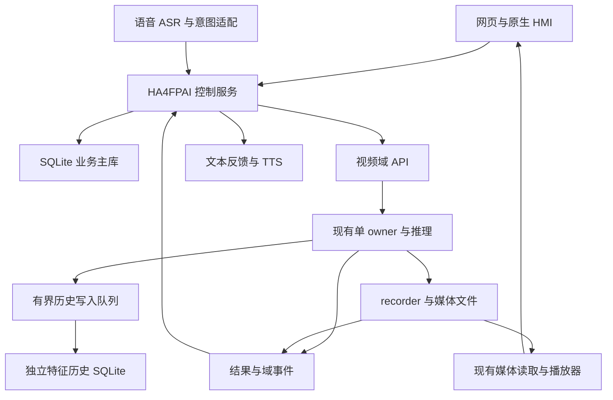

# HA4FPAI与视频联合总规划

## 规划范围与状态

目标是把 HA4FPAI 建成统一的控制、资料与交互中心，把现有视频能力接成可追溯的完整系统。用户可在同一入口查看画面、管理人员、登记人脸和声纹、查询录像，也可用语音触发同一组受控动作。

本组文档是**目标设计与实施依据，尚未实施**。2026-11-05 只读核对当前源码及视频交付快照，未连板、未迁移数据、未安装或启用服务。长期约束登记在 [[状态源与决策记录#D-1793832873 · HA4FPAI与视频联合规划采用统一身份与SQLite数据归属|状态源与决策记录——D-1793832873]]。现有整机能力边界继续以 [[风险与完成判据#5. 已知限制与范围外（对外唯一口径）|风险与完成判据——5. 已知限制与范围外]] 为准。

这次直接确定长期归属：**SQLite 业务主库＋独立特征历史库＋文件媒体**。JSON 只作兼容导出，YAML 保留启动、硬件和默认配置；不设“先用 JSON 主存储、未来再迁”的过渡产品。

| 阅读目的 | 正本 |
|---|---|
| 看模块、部署和资源边界 | 本页 |
| 看统一身份、表结构、模板、设置和时间关联 | [[联合人员与业务数据设计#数据归属总表\|联合人员与业务数据设计——数据归属总表]] |
| 看命令、语音、视频页面、媒体及事件接口 | [[联合控制接口与视频接入#统一执行路径\|联合控制接口与视频接入——统一执行路径]] |
| 看旧资料如何导入、切换、备份和恢复 | [[联合存储迁移与恢复方案#迁移输入与清单\|联合存储迁移与恢复方案——迁移输入与清单]] |
| 看实施依赖、交付物及验收 | [[联合实施路线与验收#实施顺序与依赖\|联合实施路线与验收——实施顺序与依赖]] |

以上各页分别拥有自己的设计事实，不另建一套人员字段表、接口表或进度百分比。

## 已核对的起点

下列证据都是本地文件或带日期的记录；交付快照、开发树和当前板端目录是三个对象。真正实施前先核对版本、哈希和实际启动路径。

| 已有资产或缺口 | 证据与对规划的影响 |
|---|---|
| 视频交付快照有独立 app、recorder、模型、BOOT 和新板安装说明 | [交付入口](../../repos/FPAI30TAI图像FPGA/yuanma/submission/README.md#L10)。本次优先对照 `reference_release` 与其配套 `source/fpga_project`，不把别处开发树的变化自动算入发布版 |
| 交付人员库仍为 schema 2 JSON | [PersistentGallery](../../repos/FPAI30TAI图像FPGA/yuanma/submission/reference_release/app/persistent_gallery.py#L48)：人员／样本 ID、revision、pipeline_id、原图哈希、挂载 UUID 和原子写入须一起迁移 |
| 源码有独立 SQLite 特征历史模块 | [FaceHistoryStore](../../repos/FPAI30TAI图像FPGA/yuanma/submission/source/fpga_project/model_backend/face_history/store.py#L24)。有模块不等于交付人员库已经使用它；登记模板与历史检测不能混为一张表 |
| 录像已有配额、回收站和恢复规则 | [RecordingLibrary](../../repos/FPAI30TAI图像FPGA/yuanma/submission/reference_release/recorder/recording_library.py#L29)。迁移元数据须保留媒体和既有生命周期约束 |
| 控制台已嵌入视频页面并有部分动作 | [console](../../repos/HA4FPAI/boards/console.py#L375)、[executor](../../repos/HA4FPAI/klar/klar_executor.py#L523)。接入不是从零做播放器，而是补齐统一执行、状态和结果闭环 |
| 语音路由与独立执行器并非同一协议 | [路由配置](../../repos/HA4FPAI/lang/config/klar.yaml#L34)。须适配 klar V2 嵌套结果和设备执行，不能只改请求路径 |
| 有两套不兼容的声纹库 | [旧 voiceprint](../../repos/HA4FPAI/boards/voiceprint.py#L25)、[新 spk 后端](../../repos/HA4FPAI/lang/server/backends/spk.py#L71)。按名称单向量与多样本字典不能靠共用文件路径归并 |
| 融合开门目前不能证明同一主体 | [door_unlock](../../repos/HA4FPAI/boards/door_unlock.py#L233)。目标必须把人脸和声纹都关联同一人员、同一验证会话；真实开锁仍按安全边界独立验收 |
| 最新已记录板端安装是 0.1.1 八级在线链 | [[状态源与决策记录\|状态源与决策记录（最新 D 记录）]]。本地十级／声纹变化与该发布版不能混报 |

旧 `mainchain/s2s.md` 等保留为历史草图，不作为算力分工或接口验收依据；本规划不改写原始草稿。

## 模块与写入所有权

采用少量服务与清晰的域接口。资料模块、事件模块、命令调度器可在同一个轻量控制服务进程内分模块实现，不为每张表新增常驻服务，不引入消息中间件作为前置。

| 模块 | 负责 | 可以写什么 |
|---|---|---|
| HA4FPAI 控制服务 | 人员、设置、设备实体、命令、任务、事件、导出和目录索引 | 业务主库唯一写入入口；内部以短事务串行提交 |
| 人脸／声纹后端 | 输入质量、特征提取、模板兼容性与比对 | 提交带模型证据的登记提案／识别事件；不能自行改姓名或另立人员主库 |
| 视频 owner | 摄像头、SDK、DMA、PL/NPU 会话、帧租约和编码 | 硬件及易失运行状态；保留原有所有权、故障隔离和交接协议 |
| recorder | 录像预缓冲、封段、配额执行、回收站、恢复与最终文件处置 | 媒体文件及可恢复回执；通过资料域接口提交业务目录和状态变更 |
| 特征历史 writer | 批量历史检测特征、来源与质量 | 只写独立历史库；有界队列，不阻塞采集或模型前向 |
| lang/server | 语音处理、对话、TTS 和当前请求音频证据 | 不直接写业务库；通过统一执行入口调用动作和登记服务 |
| 网页与原生 HMI | 展示、操作、会话导航 | 通过受控 API 修改资料；不直接改 YAML、数据库或硬件寄存器 |

“主库唯一写入”是接口与进程职责，不是在音视频路径加全局互斥锁。数据库事务内不等待 HTTP、NPU、TTS、文件大拷贝或媒体编码。两个数据库各有写入模块；跨库关联通过稳定 ID 和回执对账，不承诺跨库原子提交。

## 三条通路

1. **控制通路**处理低频命令、资料及设置；结果带请求编号和真实完成状态。
2. **媒体通路**复用现有 H.264、照片与回放接口；按需直接读取或经受控媒体代理传输，不送入语言链或数据库 BLOB。
3. **事件通路**将识别、录像和命令回执关联到业务资料；不逐帧同步提交主库。

## 统一身份与授权边界

同一个人只用一个稳定 `person_id`。人脸模板、声纹样本、登记媒体和识别事件引用它；显示名可以修改。人员不等于控制台登录账户，识别到一个人也不自动赋予管理员权限。

同名不自动合并，声纹“张三”与人脸“张三”只能形成待核对映射。主键兼容、合并、删除及模型更换的细则集中在 [[联合人员与业务数据设计#统一身份与模板契约|联合人员与业务数据设计——统一身份与模板契约]]。

融合验证将“某个人的脸通过”“另一个人的声音通过”判为主体冲突。还须核对请求、采集时间、证据新鲜度、多人场景、PAD 状态与模型版本。这里只规划统一身份与证据机制；安全开锁的独立标定和物理执行器判据不由资料迁移替代。

## 部署与资源约束

- 板端是设备业务资料的权威节点；电脑控制台默认作为客户端或代理，不能与板端各建一份可写的同名业务主库。
- 演示／离线开发可以有明确标识的隔离实例和测试库，禁止把测试登记自动同步回设备。
- 数据根建议为经 UUID 验证的 ext4 数据挂载点下 `ha4fpai/`：`business.sqlite3`、`feature-history.sqlite3`、`exports/`、`receipts/`、`backups/`。这是目标布局，实施前写入安装清单；不默默搬动现有数据根。
- 数据盘未挂载、UUID 不符或只读时禁止自动在 SD 根目录创建空主库；健康接口区分存储不可用与空人员库。存储与控制服务故障时，现有视频的可持续运行能力按已验路径保持，不通过重启 owner“修数据库”。
- 延续 deb 的程序／配置／状态分离；业务服务另有明确包与版本，安装依赖关系不等于启动全部模型或重复启动三份重模型进程。
- 语音进程内准入保留；同一硬件资源只沿视频既有 owner／交接协议排他。普通在线语音与 VPU 视频没有理由被统一全局锁串行化。未来 NPU 语音启用前另验交接。
- SQLite 采用目标 Linux 自带能力，先探测 Python sqlite3 与 SQLite 版本再决定依赖；不为规划安装数据库服务器。板端性能、写放大、内存和断电恢复按验收页实测，不据“SQLite 很轻”承诺可用。

## 第一版功能范围

第一版完成统一人员资料、人脸与声纹登记归属、结构化设置、设备实体、录像目录、动作执行与事件关联。界面保留已有视频页面，先补统一状态和反馈，再做集中视频工作台。

持久任务的表、恢复与幂等规则在第一版设计；第一轮只实现有限的提醒／受控计划动作，不演变为完整 Home Assistant 自动化引擎。完整任务执行排在直接动作稳定之后。

OCR、云端看图、本地 NPU LLM、复杂自动化、真实门锁按后续已验能力进入动作表；本轮规划不自动提升其范围优先级。具体工作依赖和完成判据集中在 [[联合实施路线与验收#实施顺序与依赖|联合实施路线与验收——实施顺序与依赖]]。
