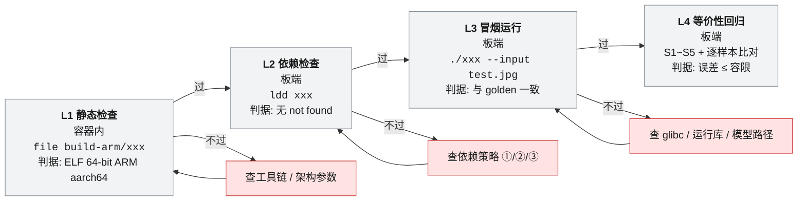

# 验证方法学

本页回答一个问题：**一个模块凭什么从"写了"变成"验证过了"。**
本页把散在状态源、开发流程与下沉循环里的验证纪律收拢成一处；交付与回归的完成判据见 [[验证与交付]]，学习能力的进度见 [[能力与学习进度]]。

## 一、核心原则：只有可复核证据才能提升完成状态

**任何"完成""跑通""没问题"的说法，没有下表里的证据就不算数。** 模型"理论可部署"不能写成"已部署"，功能"计划实现"不能写成"已经完成"。

| 可接受证据类型 | 具体内容 | 能支撑的结论 | 必须归档的位置 |
|---|---|---|---|
| 代码 | RTL／testbench／软件参考实现入库，可指出提交版本 | 只能支撑"已实现"，不支撑"已验证" | 仓库 |
| 编译与运行结果 | Icarus 编译退出码 0、`vvp` 运行退出码 0；交叉编译产物生成成功 | 工具链通过 | 台账记录命令 + 退出码 |
| 自检 PASS／FAIL | testbench **自动**判定的结论（不靠人眼看波形） | 功能验证通过 | 仿真日志 |
| VCD 波形 | 可回放、可指出采样时刻的波形文件 | 边界行为的可复核佐证 | 与日志同目录 |
| 综合报告 | 资源占用（LUT／BRAM／DSP） | 资源在预算内 | Procise 报告 |
| 时序报告 | 时序裕量、是否违例 | 上板可用性判断 | Procise 报告 |
| iCraft 编译结果 | 模型转换成功／失败、算子支持清单 | 模型能否上 NPU（**候选 → 已确认**的唯一路径） | 模型台账 |
| 板上现象 | 串口／SSH 输出、`ldd`、`file`、实际推理结果 | L2／L3 通过 | 上板记录表 |
| 性能测量 | 延迟、吞吐、CPU 占用、资源、稳定性（长跑） | 加速收益结论（答辩主线证据） | 性能对比表 |

> **板子已可登录**（2026-09-28 01:50，PuTTY→COM6 串口 + DHCP + SSH，见 [[状态源与决策记录#D-24 · 板子已在手上并且能登进去：全库"尚未拿到悟净板"口径作废|状态源与决策记录——D-24]] **D-24**）：依赖板卡的证据类型（板上现象、性能测量、L2／L3 验收、参考工程核对）**已具备产生条件**。已经有的是**三条单命令级 E5**——2026-09-27 本机串口会话读到的 `/etc/rc.local`、`ethtool -P eth0`、`ip link down/up` 后的 DWMAC 报错，经她 2026-09-28 确认为真板读数（**D-24 第 5 条**）；**性能测量、L2／L3 验收、端到端现象一条都没有**，因为板端运行时未核对、采集表未跑。在此之前这些标 ⛔ 的理由是"拿不到板"，现在的理由是"没做"。

## 二、"学过 ≠ 已掌握"判据

| 档位 | 条件 | 允许的标记 | 当前实例 |
|---|---|---|---|
| 知道概念 | 读过／聊过原理 | 只可写在"学习"语境 | CDC、异步 FIFO 基本原理 |
| 已学习 | 能解释满空条件、指针、同时读写、边界行为 | 🔄（概念完成，缺口在项目应用） | 同步 FIFO |
| **已验证** | **独立完成 RTL + 自检 testbench + 实际运行验证**，三者齐备 | ✅ | 1-entry valid／ready 握手缓存 |

三件齐备的含义：**独立完成 RTL**（不是照抄示例）、**自检 testbench**（自动 PASS／FAIL）、**实际运行验证**（编译与运行退出码 0 + 日志 + 波形）。缺任何一件都不得标 ✅。

## 三、四级验证阶梯 L1 → L4

**这张表是全项目唯一的 L1~L4 定义处**（交叉编译环节、验证与交付都只引用它，不再各写一份）。

| 级别 | 在哪跑 | 命令／动作 | 通过判据 | 对应证据等级 | 当前可执行性 |
|---|---|---|---|---|---|
| L1 静态检查 | 交叉编译容器内 | `file build-arm/xxx` | 含 `ELF 64-bit LSB, ARM aarch64` | **E2** | ⛔ 需容器与板端参数（未开始） |
| L2 依赖检查 | 板端 | `ldd xxx` | 无 `not found` | **E5** | ⛔ 未到板 |
| L3 冒烟运行 | 板端 | `./xxx --input test.jpg` | 与 `deploy/golden/` 中该目标的冻结参考一致 | **E5** | ⛔ 未到板 |
| L4 等价性回归 | 板端 + 本地仿真 | S1~S5 + 逐样本比对 | 误差 ≤ 容限 | **E6** | 🔄 本地仿真部分现在就能做（RTL 级），板端部分 ⛔ |

> **CI 只能覆盖到 E2**（构建 + `file` 架构检查）。L2~L4 都要在板端跑，CI 无法代替——所以"CI 绿了"不等于"交付可以了"。

这张图回答：**一个产物要按什么顺序过四道检查，某一道不过时回到哪里查。**



> L1–L3 来自交叉编译环节（三级验证），L4 是加速期为 FPGA 下沉新增的**等价性回归**：三级 → 四级是自然演进，不是替换。RTL 模块另有一条并行的仿真阶梯：编译 → 自检 testbench PASS → VCD 复核 → 综合／时序报告 → 上板。

## 四、黄金基线是唯一裁判

| 约定 | 内容 |
|---|---|
| 来源 | 第 ② 步（卡 M2）用现成软件在 CPU 上端到端跑通全链路后冻结，打 tag `baseline-v1`；各节点输入／输出录制为测试向量存 `deploy/golden/` |
| 冻结时点 | 下沉循环**第①步**：误差容限与黄金参考**一起**冻结；容限未定不许开工 |
| 裁判地位 | 两人对结果有争议时一律比对黄金参考，不靠讨论 |
| 永久回退 | CPU 通路永久保留，运行时 feature flag 可一键切回（无开关＝未完成） |

### 误差容限（按模块类型）

| 类型 | 容限 | 说明 |
|---|---|---|
| 音频类（SRC／VAD／分帧·缓冲／TTS 若做） | **≤1 LSB** | 逐样本比对 |
| 视觉类（Resize／Crop／色彩转换／Normalize） | **≤2 LSB** | 逐像素比对 |
| 量化（Quantize）与 JPEG（若做） | **位精确** | 整数值，差 1 bit 即失败 |
| 流控（stream／frame control、router） | **功能等价** | 无像素黄金值，判据是不丢不重不乱序与边界行为 |

> 表内 JPEG／TTS 行保留自台账模板，但二者在本周期为**范围外**，不进当前台账（见 [[3-FPGA组件下沉]] 与 [[进度计算与实时看板]] 的换算规则）。
> 容限数值来自下沉循环的比对判据；量化定标（Q 格式、舍入与饱和策略）在定点化步骤（第③步）确定，并要求**先用 CPU 做定点仿真验证可行性**再写 RTL。

## 五、两类模块的验证法

### 视觉模块：与软件 golden model 逐像素比较

| 步 | 动作 | 要求 |
|---|---|---|
| 1 | 建立软件参考结果 | Python／C 参考实现 + 固定测试图像集（小尺寸起步）入库 |
| 2 | 同一批向量喂给 RTL | 输入完全同源，禁止两套数据分别生成 |
| 3 | 逐像素差分 | 输出最大误差、超差像素计数、超差位置分布 |
| 4 | 自动判定 | `max_err ≤ 容限` 且 `bad_cnt == 0` → PASS，否则 FAIL 并打印首个超差点坐标 |
| 5 | 边界用例 | 首帧、帧尾、分辨率切换、配置中途变更（应只在帧边界生效） |

### 音频模块：不丢、不重、不乱序 + 边界条件

| 判据 | 怎么测 |
|---|---|
| 不丢 | 输入样本计数 == 输出样本计数（+ 明确声明的丢弃位，如 VAD 静音门控需单列） |
| 不重 | 无重复序号；同一样本不被交付两次 |
| 不乱序 | 输出顺序与输入索引单调一致 |
| 边界 | 复位后首样、空缓冲、下游长时间停顿、同时读写、缓冲满、无新输入回落空态 |
| 时序 | 帧边界与 VAD 起止事件的相对顺序正确 |

### testbench 自检要求（硬性）

1. **必须自动输出 PASS／FAIL**，不允许"看波形觉得对"作为结论。
2. 失败要可定位：打印时刻、信号名、期望值与实际值。
3. 用例可重放：一条命令跑完（编译 + `vvp` + 生成 VCD），退出码反映结果。
4. 新流控模块必须复刻 1-entry 握手缓存的 5 项边界检查（见第七节）。
5. 黄金向量与 testbench 一起入库，回归时不换数据。

## 六、工具链与目录约定

| 环节 | 工具 | 状态 |
|---|---|---|
| RTL 仿真 | Icarus Verilog（`iverilog` 编译）+ `vvp` 运行 | ✅ 环境已用最小 testbench 实测跑通编译、运行、PASS 输出与 VCD |
| 波形查看 | GTKWave | ✅ 可用 |
| 编辑器 | Windows + VS Code | ✅ 已建立；用户在 VS Code 独立写第一版 |
| FPGA 开发 | Procise 2025.1.1（综合／布局布线／比特流） | ⛔ 未到板，工程未建立 |
| 模型编译 | ICraft v3.36.1／v3.39（含 CustomOp） | ⛔ 未开始 |
| 交叉编译 | 官方 ubuntu20.04 容器（podman）+ CMake toolchain | ⬜ 未开始 |
| CI | GitHub Actions + GHCR 私有镜像（amd64 runner，无需 QEMU） | ⬜ 未开始；现场无公网时靠本地编译 + U 盘 |

仓库目录沿用交叉编译环节已登记的约定（`src/`、`third_party/`、`cmake/toolchain.cmake`、`build-x86/`、`build-arm/`、`deploy/`、`.github/workflows/`）：

| 目录 | 与验证的关系 |
|---|---|
| `build-x86/` | 本机先跑出标准输出，作为 `deploy/golden.txt` 的来源；结果应与 arm 一致 |
| `build-arm/` | 交叉编译产物，L1 静态检查的对象 |
| `deploy/golden/` | 黄金基线输出与测试向量的存放处（M2 冻结时建齐） |
| RTL／testbench／仿真产物目录 | **待冻结**：黄金向量、RTL 与自检 case 的对应关系在接口契约评审时一并确定（见 [[接口契约与数据通路#8 冻结流程与分工\|接口契约与数据通路——8 冻结流程与分工]]） |

### 本地仿真最小闭环（环境已实测可用）

一条命令跑完"编译 → 运行 → 生成波形"，退出码即结论；这是 ✅ 判据的最低产生装置。

```bash
iverilog -g2012 -o sim/build.vvp sim/tb_xxx.v rtl/xxx.v
vvp sim/build.vvp > sim/run.log
grep -q PASS sim/run.log && echo RESULT_PASS || echo RESULT_FAIL
gtkwave sim/dump.vcd &
```

| 要素 | 要求 |
|---|---|
| 编译 | `iverilog` 退出码 0，无未声明信号告警被忽略 |
| 运行 | `vvp` 退出码 0，日志中出现自检 `PASS` |
| 判定 | 由 `grep` 一类的**自动**判定，不允许"人眼看波形说通过" |
| 归档 | `run.log` + `.vcd` 与模块名、提交版本一起留下 |

## 七、本地参考实例：1-entry 握手缓存的 5 项自动检查（样板）

这是项目里目前唯一跑通自检的自研实例（**它的状态与证据等级只写在 [[FPGA自研模块清单]] 模块台账，本节不另记一份**），它的 testbench 结构就是后续所有流控 testbench 的样板。

| # | 自动检查项 | 考察的契约 | 为什么必须查 |
|---|---|---|---|
| 1 | 复位后状态 | 复位期间与释放初刻 `valid=0`、缓冲为空 | 复位不清 → 上电第一拍就可能送出垃圾 |
| 2 | 空缓冲接收 | 空态下写入立即被接收且不产生假输出 | 冷启动路径，最常被漏测 |
| 3 | 下游停顿时数据保持 | `ready=0` 期间数据与 `valid` 保持不变（不撤销、不覆盖） | 背压下的 R1 保持规则 |
| 4 | 同拍取走旧数据并写入新数据 | `valid && ready` 同拍完成交付，且新数据同拍入槽 | 决定实时链路能否满速 |
| 5 | 无新输入时回到空状态 | 取走后 `valid` 回落，不产生伪样本 | 防止"下游读到重复数据" |

| 项 | 记录值 |
|---|---|
| 编译 | Icarus 编译退出码 **0** |
| 运行 | `vvp` 退出码 **0**，testbench 输出 **PASS** |
| 波形 | 生成 VCD，可回放 |
| 结论 | ✅ 已验证；作为 A／B 两侧流控模块的行为基线 |
| 尚未覆盖 | 溢出计数语义、更深缓冲的多级水位、随机长时背压吞吐统计 |

## 八、状态提升流程（怎么用这页）

| 步 | 动作 | 产出证据 | 允许的状态变化 |
|---|---|---|---|
| 1 | 定契约与容限 | 冻结的寄存器表／接口 + 容限数值 | ⬜ → 🔄（可开工） |
| 2 | 写软件 golden model + 测试向量 | 参考输出入库 | 🔄 |
| 3 | 写 RTL + 自检 testbench | 编译 0 / 运行 0 / PASS / VCD | 🔄 → ✅（RTL 级已验证） |
| 4 | 逐像素或逐样本比对 | 误差报告 ≤ 容限 | ✅（等价性成立） |
| 5 | 综合与时序报告 | 资源与时序裕量 | 上板前放行 |
| 6 | 上板 + 性能测量 | 板上现象 + 延迟／吞吐／CPU 占用 | ✅（加速结论成立） |
| 7 | 回写状态源 | 更新 `FPGA竞赛项目状态.md` | 结论成为长期决定（见 [[状态源与决策记录]]） |

> 第 6 步目前整体 ⛔（未到板）。**在此之前，任何"性能提升"的说法都不成立**：能声明的上限是"RTL 级等价性已验证"。

## 九、无效结论表述对照（写作与答辩都用得上）

| 不得写的说法 | 事实上限 | 允许的说法 |
|---|---|---|
| "ASR 已经部署到 NPU" | 模型仅完成候选选型，iCraft 编译未做 | "ASR 首选 Paraformer（**候选**），待 iCraft 编译与算子支持验证" |
| "FPGA 预处理比 CPU 快" | 无板、无测量 | "设计目标是以 FPGA 承担连续预处理，收益需在板端用延迟／吞吐／CPU 占用测出（⛔）" |
| "视觉前端已完成" | 模块本体 ⬜，只有 1-entry 握手缓存 ✅ | "流控基础构件已验证 ✅；video_stream_ctrl 等模块 ⬜ 未开始" |
| "接口已经定了" | AXI／DMA／DDR／时钟复位全部依赖参考工程 | "握手语义已验证；其余接口项 **待验证**，寄存器映射为**待冻结提案**" |
| "同步 FIFO 已掌握" | 概念完成，未在项目里调 IP | "概念 🔄；缺口是项目应用（厂商 FIFO／BRAM IP 配置与边界验证）" |
| "SRC 是我们 FPGA 的核心亮点" | 是否必需未定 | "SRC 为**条件 P0**：采样率一致则整块删除，不为展示技术增加并行度" |
| "身份认证能开门" | 业务动作未定 | "身份事件触发什么属**待验证**，'开门／开放权限'只是示例" |

## 十、改了 X 之后要重跑什么（回归范围）

| 变更点 | 最小重跑 | 必须追加 |
|---|---|---|
| RTL 单模块（含定点化改动） | 该模块自检 testbench + 与黄金向量逐点比对 | 下游受影响模块的比对（如改 resize → 重跑 crop 之后的整条链） |
| 握手／流控语义 | 样板 5 项检查全跑 + 不丢不重不乱序计数校验 | 全链路数据面冒烟（CPU 通路与 FPGA 通路双跑） |
| 寄存器映射（config_regs） | 读写属性与复位默认值回归 | 上层驱动配置序列 + 一次模式切换用例（FACE／OCR／VLM） |
| 量化参数（scale／zero-point） | 位精确比对 | 端到端精度比对（NPU 推理结果不因前端改变而漂移） |
| 模型替换（见选型表切换条件） | 该模型的输入尺寸与预处理参数复核 | 全链路 L4 等价性回归 + S1~S5 |
| 运行时开关（FPGA↔CPU） | 双通路各跑一遍同一黄金向量 | 现场回退演练（演示前必做，属交付纪律，见 [[验证与交付]]） |

## 十一、证据台账模板（每验证一次填一行）

| 模块 | 命令／动作 | 退出码或判据 | 日志 | 波形／报告 | 结论 | 日期与版本 |
|---|---|---|---|---|---|---|
| 例：1-entry 握手缓存 | `iverilog` + `vvp` | 0／0 | `run.log` 含 PASS | `dump.vcd` | ✅ 已验证 | 状态源登记 |
| （待填） | | | | | | |

| 填写规则 | 说明 |
|---|---|
| 一行一次运行 | 同一模块多次回归就多行，禁止覆盖旧记录 |
| 判据可机器复现 | 写命令与期望值，不写"看起来正常" |
| 产物有路径 | 日志、VCD、综合／时序报告的存放位置必须能点开 |
| 结论只用四档 | ⬜／🔄／⛔／✅；✅ 必须能追溯到本表某一行 |

## 十二、端到端与识别指标：口径归属与未定义项

**这一节是"哪些数字现在根本没法报"的唯一登记处。** 全链路的性能摸底动作（怎么测、跑几次、记哪一列）在 [[2-CPU可用链#6. 基线性能摸底（B8：给加速比准备分母）|2-CPU可用链——6. 基线性能摸底（B8：给加速比准备分母）]]，测量结果一律 `待实测`，Wiki 不出现任何估计值。

| 指标 | 测量口径 | 口径状态 | 依赖 | 结果写在哪 |
|---|---|---|---|---|
| 说完停顿→开始播报的端到端时延 | 从"静音判定成立"时刻到"第一帧音频送出"时刻 | 已定义 | 到板 | [[2-CPU可用链#6. 基线性能摸底（B8：给加速比准备分母）\|2-CPU可用链——6. 基线性能摸底（B8：给加速比准备分母）]]摸底表 |
| 语音识别响应速度 | 单段语音送入→转写文本产出 | 已定义 | 到板 + 模型跑通 | 同上 |
| 画面分析帧率 | 单位时间完成前端的帧数 | 已定义 | 摄像头实际格式与目标尺寸 | 同上 |
| CPU 通路 vs 硬件通路性能 | **同一功能两条通路分别测**（延迟、吞吐、CPU 占用、稳定性） | 已定义（方案）数据未产生 | 到板 | [[3-FPGA组件下沉]] 下沉台账 |
| 连续运行稳定性时长 | 长跑判据的目标小时数 | **未定义**（各任务卡仍是空格，不许留空过关） | 开工前定稿 | [[任务卡与台账规范]] |
| 身份认证误识率／拒识率 | 需测试集（已登记 N 人 × 未登记 M 人 × 各若干次）与统计口径 | **口径未定义**：只有"通过／拒绝正确"的功能级判据，没有百分比口径 | 需先定义测试集 | [[2-CPU可用链#3.1 每条场景的可测量验收判据（B7 冻结时逐项落盘）\|2-CPU可用链——3.1 每条场景的可测量验收判据（B7 冻结时逐项落盘）]] S5 行 |
| OCR 错字率 | 与原文逐字比对 | **容限未定稿** | 需素材集 | 同上 S4 行 |
| 看图回答相关性 | 人工评分 | **评分表未定稿** | 需评分表 | 同上 S3 行 |

**规则**：口径状态为"未定义／未定稿"的指标，**不得**出现在答辩材料、演示口径或任何 ✅ 结论里；要么在开工前把口径写成可计算的定义，要么就不提。

## 相关页面

[[FPGA自研模块清单]] · [[板端提取件台账]] · [[接口契约与数据通路]] · [[板子（除芯片）]] · [[3-FPGA组件下沉]] · [[1-NPU模型部署]] · [[验证与交付]] · [[能力与学习进度]] · [[任务卡与台账规范]] · [[2-CPU可用链]] · [[风险与完成判据]]
