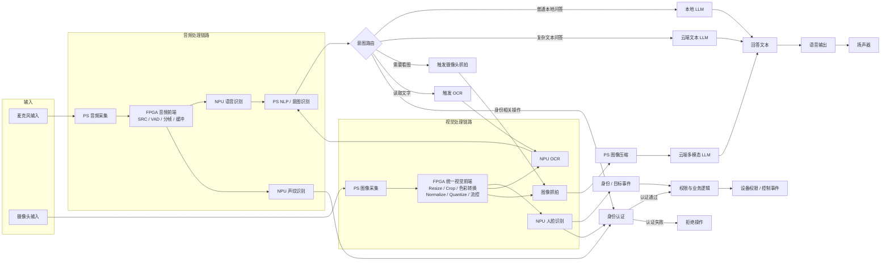
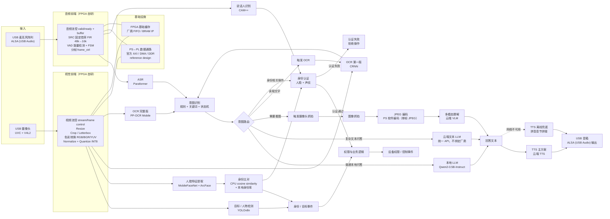

# 系统架构

## 总体形态

系统是**事件驱动的异构多模态处理管线**：音频与视觉两条感知链路并行，后端由 NLP／意图路由统一调度。

## 音频链路

- 麦克风输入 → PS 音频采集 → FPGA 音频前端（SRC、VAD、分帧、缓冲、流控）→ NPU ASR → PS NLP／意图识别。
- NLP 根据意图选择本地小模型、云端文本 LLM、视觉抓拍、多模态 VLM、OCR 或身份／权限逻辑。
- 模块设计详见 [[05-音频链路]]。

## 视觉链路

- 摄像头输入 → PS 图像采集 → FPGA 统一视觉前端（Resize、Crop／Letterbox、色彩转换、Normalize／Quantize、帧控制、流控）。
- FPGA 视觉前端服务多个去向：NPU 人脸／目标识别、NPU OCR，以及按需图像抓拍。
- 人脸／目标识别结果形成身份或目标事件，再由 CPU 执行权限与业务逻辑。
- 需要识别文字时走 OCR → 文本 → NLP／LLM；需要理解场景或物体时抓拍单帧，由 PS 做 JPEG 压缩后发送云端多模态 VLM。
- 模块设计详见 [[04-视觉链路]]。

## 意图路由与输出

| 请求类型 | 路径 |
|---|---|
| 普通本地问答 | 本地小 LLM（Qwen2-0.5B 候选） |
| 复杂文本问答 | 云端文本 LLM |
| 「这是什么／这个怎么用」 | 触发图像抓拍 → 云端多模态 VLM |
| 「这上面写了什么」 | 触发 OCR → 文本 LLM |
| 身份相关操作 | 人脸／目标事件 → 权限与业务逻辑 |
| 回答输出 | 回答文本 → TTS 或轻量拼接式语音合成 → 扬声器 |

详见 [[06-身份认证与意图路由]]。

## 计算资源分工

| 单元 | 职责 |
|---|---|
| FPGA／PL | 连续音视频流的确定性实时预处理、可配置数据通路、流控与硬件加速 |
| NPU | ASR、人脸／目标识别、OCR、本地 AI 模型等矩阵乘加密集型推理 |
| PS／CPU | Linux 设备驱动、采集、NLP／意图识别、模型调度、身份库比较、权限逻辑、网络、JPEG 压缩、文本处理和输出 |
| 云端 | 复杂文本 LLM、多模态 VLM，以及必要时的云端 TTS |

## 系统控制与集成（跨链路模块）

| 模块 | 职责 |
|---|---|
| config_regs | 由 CPU 配置模式、尺寸、裁剪坐标、颜色顺序、归一化参数、音频阈值和启动／停止 |
| stream_router | 把处理后的音视频数据送往对应 NPU 模型、内存或抓拍路径 |
| status | 向 CPU 报告帧状态、缓存状态、错误和处理完成事件 |
| top | 集成视觉前端、音频前端、配置、状态和平台接口 |

## 工作流程图

### 基本视图（无具体组件名）

### 组件级视图

> 板级（PS／PL／NPU 内部模块）最详细视图见 [[03-板级管线详图]]。
>
> 说明：原始 `.mmd` 文件使用 ELK 渲染器（`%%{init: ...}%%` 指令）；Wiki 内嵌版本已移除该指令以保证在 Obsidian／GitHub 中直接渲染，图形布局可能与原图略有差异，连线与节点内容一致。

## 相关页面

[[01-项目概述]] · [[03-板级管线详图]] · [[04-视觉链路]] · [[05-音频链路]] · [[06-身份认证与意图路由]]
