# 板级管线详图

最完整的系统视图：外部设备 → 板级接口 → PS／PL／NPU 内部模块 → 身份认证 → AI／应用逻辑 → 输出。较粗粒度的视图（基本视图、组件级视图）见 [[02-系统架构]]。

```mermaid
flowchart LR

    %% =========================================================
    %% 外部设备
    %% =========================================================
    subgraph EXT["外部设备"]
        direction TB

        MIC[
            USB 麦克风阵列<br/>
            USB 2.0 + USB Audio
        ]

        CAM[
            USB 摄像头<br/>
            USB 2.0 + UVC
        ]

        SPK[
            USB 音箱<br/>
            USB 2.0 + USB Audio
        ]

        SDI[
            2 × SDI 输入<br/>
            视频采集
        ]

        HDMI[
            HDMI 输出<br/>
            显示 / 视频输出
        ]
    end


    %% =========================================================
    %% 板级接口
    %% =========================================================
    subgraph IO["板级接口"]
        direction TB

        USB[
            PS USB Host<br/>
            4 × USB 2.0
        ]

        ETH[
            千兆以太网<br/>
            10 / 100 / 1000 Mbps
        ]
    end


    %% =========================================================
    %% PS
    %% =========================================================
    subgraph PS["PS / Processing System"]
        direction TB

        CPU[
            4 核应用处理器<br/>
            最高 1 GHz
        ]

        PSDDR[
            PS DDR3<br/>
            1 GB
        ]

        QSPI[
            256Mb QSPI FLASH
        ]

        TF[
            32GB TF-CARD
        ]

        ALSA[
            Linux ALSA<br/>
            USB Audio PCM
        ]

        V4L2[
            Linux V4L2<br/>
            UVC 视频采集
        ]

        APS[
            PS 音频采集
        ]

        VPS[
            PS 图像采集
        ]

        NLP[
            PS NLP / 意图识别<br/>
            规则 + 关键词 + 状态机
        ]

        MATCH[
            PS 身份比对<br/>
            Cosine Similarity<br/>
            + 本地身份库
        ]

        JPEG[
            PS JPEG 图像压缩
        ]

        CTRL[
            权限与业务逻辑
        ]

        NET[
            PS 网络通信
        ]
    end


    %% =========================================================
    %% PL
    %% =========================================================
    subgraph PL["PL / FPGA"]
        direction TB

        PLDDR[
            PL DDR3<br/>
            2 GB
        ]

        DMA[
            8 通道 DMA
        ]

        %% 音频前端
        AFLOW[
            FPGA 音频流控<br/>
            valid / ready
        ]

        AFIFO[
            音频 FIFO / Buffer
        ]

        SRC[
            FPGA SRC<br/>
            固定倍率 FIR<br/>
            48 kHz → 16 kHz
        ]

        VAD[
            FPGA VAD<br/>
            能量检测 + FSM
        ]

        FRAME[
            FPGA 音频分帧<br/>
            frame_ctrl
        ]

        %% 视觉前端
        VFLOW[
            FPGA 视频流控<br/>
            AXI4-Stream
        ]

        RESIZE[
            FPGA Resize<br/>
            尺寸缩放
        ]

        CROP[
            FPGA Crop / Letterbox<br/>
            裁剪 / 补边
        ]

        COLOR[
            FPGA 色彩转换<br/>
            RGB / BGR / YUV
        ]

        NORM[
            FPGA Normalize<br/>
            归一化
        ]

        QUANT[
            FPGA Quantize<br/>
            INT8 定点量化
        ]

        VFIFO[
            视频 FIFO / Frame Buffer
        ]

        SDI_IN[
            FPGA SDI 接收
        ]

        HDMI_OUT[
            FPGA HDMI 输出
        ]
    end


    %% =========================================================
    %% NPU
    %% =========================================================
    subgraph NPU["NPU / AI 加速"]
        direction TB

        ASR[
            NPU 语音识别<br/>
            Paraformer
        ]

        SPEAKER[
            NPU 说话人识别<br/>
            CAM++
        ]

        DETECT[
            NPU 目标 / 人物检测<br/>
            YOLOv8n
        ]

        FACE[
            NPU 人脸特征提取<br/>
            MobileFaceNet + ArcFace
        ]

        OCR1[
            NPU OCR 第一版<br/>
            CRNN
        ]

        OCR2[
            NPU OCR 完整版<br/>
            PP-OCR Mobile
        ]
    end


    %% =========================================================
    %% 身份认证
    %% =========================================================
    subgraph AUTH["身份认证"]
        direction TB

        EVENT[
            身份 / 目标事件
        ]

        AUTHCORE[
            身份认证<br/>
            人脸 + 声纹
        ]

        DENY[
            认证失败<br/>
            拒绝操作
        ]
    end


    %% =========================================================
    %% AI / 应用
    %% =========================================================
    subgraph AI["AI / 应用逻辑"]
        direction TB

        ROUTER{
            意图路由
        }

        LOCAL[
            本地 LLM<br/>
            Qwen2-0.5B-Instruct
        ]

        CLOUD[
            云端文本 LLM<br/>
            统一 API
        ]

        CAPTURE[
            触发摄像头抓拍
        ]

        OCRREQ[
            触发 OCR
        ]

        VLM[
            云端多模态 LLM
        ]

        RESP[
            回答文本
        ]

        TTS[
            云端 TTS<br/>
            主方案
        ]

        TTSD[
            离线 TTS 兜底<br/>
            拼音音节拼接
        ]
    end


    %% =========================================================
    %% USB
    %% =========================================================

    MIC -->|USB Audio| USB
    CAM -->|UVC| USB

    USB --> ALSA
    USB --> V4L2

    ALSA --> APS
    V4L2 --> VPS

    ALSA_OUT[
        ALSA<br/>
        USB Audio 输出
    ]

    ALSA_OUT -->|USB Audio| SPK


    %% =========================================================
    %% 音频链路
    %% =========================================================

    APS --> DMA
    DMA --> AFLOW
    AFLOW --> AFIFO
    AFIFO --> SRC
    SRC --> VAD
    VAD --> FRAME

    FRAME --> ASR
    FRAME --> SPEAKER

    AFIFO --- PLDDR


    %% =========================================================
    %% 视觉链路
    %% =========================================================

    VPS --> DMA
    DMA --> VFLOW

    VFLOW --> RESIZE
    RESIZE --> CROP
    CROP --> COLOR
    COLOR --> NORM
    NORM --> QUANT

    QUANT --> DETECT
    QUANT --> FACE
    QUANT --> OCR1
    QUANT --> OCR2

    VFLOW --> VFIFO
    VFIFO --- PLDDR


    %% =========================================================
    %% SDI 输入 → FPGA 视觉前端
    %% =========================================================

    SDI --> SDI_IN
    SDI_IN --> VFLOW


    %% =========================================================
    %% HDMI 输出
    %% =========================================================

    VFIFO --> HDMI_OUT
    HDMI_OUT --> HDMI


    %% =========================================================
    %% OCR / ASR → NLP
    %% =========================================================

    ASR --> NLP
    OCR1 --> NLP
    OCR2 --> NLP


    %% =========================================================
    %% 人脸 / 目标
    %% =========================================================

    FACE --> MATCH
    DETECT --> EVENT
    MATCH --> EVENT
    EVENT --> CTRL


    %% =========================================================
    %% 人脸 + 声纹认证
    %% =========================================================

    SPEAKER --> AUTHCORE
    MATCH --> AUTHCORE

    AUTHCORE -->|认证通过| CTRL
    AUTHCORE -->|认证失败| DENY


    %% =========================================================
    %% 意图路由
    %% =========================================================

    NLP --> ROUTER

    ROUTER -->|普通本地问答| LOCAL
    ROUTER -->|复杂文本问答| CLOUD
    ROUTER -->|需要看图| CAPTURE
    ROUTER -->|读取文字| OCRREQ
    ROUTER -->|身份相关操作| AUTHCORE


    %% =========================================================
    %% 多模态
    %% =========================================================

    CAPTURE --> VPS
    VPS --> JPEG
    JPEG --> VLM

    OCRREQ --> OCR1


    %% =========================================================
    %% AI 输出
    %% =========================================================

    LOCAL --> RESP
    CLOUD --> RESP
    VLM --> RESP

    RESP --> TTS
    RESP -.网络不可用时.-> TTSD

    TTS --> ALSA_OUT
    TTSD --> ALSA_OUT


    %% =========================================================
    %% 控制
    %% =========================================================

    CTRL --> ACTION[
        设备权限 / 控制事件
    ]


    %% =========================================================
    %% 网络
    %% =========================================================

    ETH --> NET

    NET --> CLOUD
    NET --> VLM
    NET --> TTS


    %% =========================================================
    %% PS 存储
    %% =========================================================

    CPU --- PSDDR
    CPU --- QSPI
    CPU --- TF
```

## 分层解读

### 外部设备与板级接口

- **已确认主链路输入**：USB 麦克风阵列（USB Audio）、USB 摄像头（UVC）
- **输出**：USB 音箱（USB Audio）
- 图中另含 2×SDI 视频输入与 HDMI 输出通路——属于板载能力（见 [[08-硬件平台与资料]]），在已确认的双链路主设计之外

### PS（CPU 侧）

- **硬件**：4 核应用处理器（最高 1 GHz）、PS DDR3 1GB、256Mb QSPI FLASH、32GB TF-CARD
- **采集**：Linux ALSA（USB Audio PCM）→ PS 音频采集；Linux V4L2（UVC）→ PS 图像采集
- **逻辑**：NLP／意图识别（规则 + 关键词 + 状态机）、身份比对（Cosine Similarity + 本地身份库）、JPEG 图像压缩、权限与业务逻辑、网络通信

### PL（FPGA 侧，自研核心）

- **存储与通路**：PL DDR3 2GB、8 通道 DMA、音频／视频 FIFO 与帧缓存
- **音频前端**：音频流控（valid/ready）→ 音频 FIFO → SRC（固定倍率 FIR 48k→16k）→ VAD（能量检测 + FSM）→ 分帧 frame_ctrl
- **视觉前端**：视频流控（AXI4-Stream）→ Resize → Crop／Letterbox → 色彩转换 → Normalize → Quantize（INT8）
- **板载通路**：SDI 接收 → 视频流控；帧缓存 → HDMI 输出

### NPU（AI 加速）

| 模型 | 用途 |
|---|---|
| Paraformer | 语音识别（**候选**，必须先过 iCraft 编译验证） |
| CAM++ | 说话人识别（**P2 可选**，已有视觉身份链路，见 [[07-组件选型]]） |
| YOLOv8n | 目标／人物检测（**候选**） |
| MobileFaceNet + ArcFace | 人脸特征提取（**候选**） |
| CRNN | OCR 第一版（**P1**） |
| PP-OCR Mobile | OCR 完整版（**P1，待 iCraft 验证**） |

### 数据流要点

- **音频**：ALSA 采集 → DMA → FPGA 音频前端 → NPU ASR／说话人识别 → NLP
- **视频**：V4L2 采集 → DMA → FPGA 视觉前端 → NPU 检测／人脸／OCR
- **身份**：人脸 embedding → CPU 比对 → 身份事件；人脸 + 声纹 → 双模态认证 → 权限控制
- **多模态**：意图触发抓拍 → PS JPEG 压缩 → 云端 VLM
- **输出**：回答文本 → 云端 TTS（网络不可用时拼音音节拼接兜底）→ USB 音箱

> 说明：本页图与原始文件 `最详细管线（无具体组件名.mmd` 内容一致，仅移除了 ELK 渲染器初始化指令以保证在 Obsidian／GitHub 中直接渲染。

## 相关页面

[[02-系统架构]] · [[04-视觉链路]] · [[05-音频链路]] · [[06-身份认证与意图路由]] · [[08-硬件平台与资料]]
