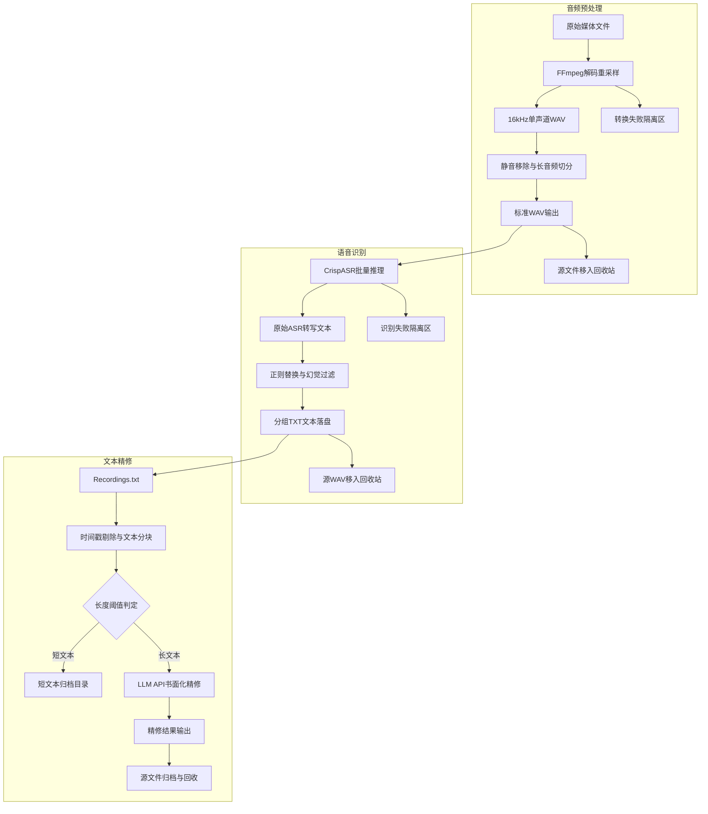

# 音频链路：FPGA 音频前端

音频前端是**第二条必要链路**。已确认的最低边界（见 [[09-开发计划]]）：至少完成**流控、分帧、VAD 和必要缓存**；SRC 由真实采样率需求决定，不为展示技术而强行增加无需求的并行度。

## 数据流

```
USB 麦克风（ALSA 采集）→ PS 音频采集 → FPGA 音频前端 → NPU ASR（Paraformer 候选）→ PS NLP／意图识别
```

## 模块设计

| 模块 | 职责 |
|---|---|
| audio_stream_ctrl | 接收 PCM 数据流并处理握手、背压和节拍 |
| SRC | 在实际采样率与 ASR 输入采样率不一致时进行采样率转换（候选方案：固定倍率 FIR，如 48k→16k）；是否需要并行或多通道实现由真实输入需求决定 |
| VAD | 基于能量与状态机判断开始说话、持续说话和结束说话 |
| frame_ctrl | 按模型要求进行分帧并产生帧边界信号 |
| audio_buffer | 缓存音频样本与帧数据；FIFO／BRAM 本体优先使用厂商 IP |
| stream control | 连接音频采集、预处理和 NPU ASR，保证**不丢失、不重复、不乱序** |

## SRC 的条件性说明

- **条件 P0**：先确认麦克风真实采样率和 ASR 输入格式。
- 麦克风能直接输出 ASR 所需采样率时，直接删掉 SRC；采样率种类多时再考虑多相 FIR（见 [[07-组件选型]]）。

## 验证方法与推进顺序

- **验证方法**：音频流优先检查**不丢、不重、不乱序**及边界条件（每个核心模块都应有可重复的验证方法）。
- **推进顺序（P0）**：确认麦克风真实格式和 ASR 输入要求 → 完成 PCM 流控、分帧、VAD 与缓存 → 只有确有采样率不一致时再实现 SRC。

> **待验证**：麦克风实际采样率、位宽、声道数，以及 ASR 输入格式；据此判断 SRC 是否必需（见 [[11-待验证清单]]）。

## 设计灵感：现有 ASR 链路

以下为个人电脑上已有的离线 ASR 批处理管线，是本作品音频链路的设计灵感来源（阶段化处理、失败隔离、批量推理的思路）：



## 相关页面

[[02-系统架构]] · [[03-板级管线详图]] · [[04-视觉链路]] · [[06-身份认证与意图路由]] · [[07-组件选型]]
