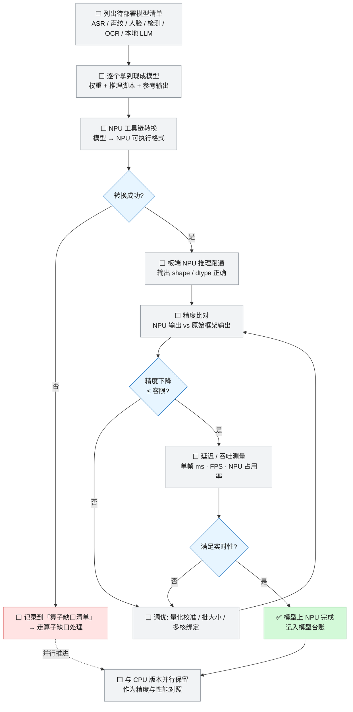

# 1-NPU模型部署

> **本页回答什么问题**：一个现成模型从拿到权重到"确认可上 NPU"要走哪几步，中间三个判定失败各退回哪里，结论记在哪张表上。
> **前置阅读**：[[实施路线]]（本页是第 ① 步）→ [[工具链与素材进README]]（ICraft 安装包与示例工程在哪）。
> **产出物去向**：模型台账 → [[进度计算与实时看板]]；转换失败的模型 → [[算子缺口处理]]；CPU 版本 → [[2-CPU可用链]] 的参考实现。

---

## 1. 这一步的边界

| | 做 | 不做 |
|---|---|---|
| 目标一句话 | 现成模型**原封不动**跑在 NPU 上，**只求能跑、结果对** | 不量化调优、不改结构、不上 FPGA |
| 通过判据 | 精度下降在容限内且满足实时性（容限表见 [[2-CPU可用链#4. 误差 / 精度容限表（B7 的第 3 项冻结物）\|2-CPU可用链——4. 误差 / 精度容限表（B7 的第 3 项冻结物）]]） | 不承诺自研硬算子；CustomOP 只在缺口路径里评估 |
| 产出 | 模型台账填满（转换结论 + 精度 + 延迟） | 性能优化留到 ③ 之后 |
| 负责 | 乙主责、甲备份 | — |
| 状态 | ⬜ 未开始（板端部分 ⛔） | — |

---

## 2. 部署流程（10 步 + 3 个判定）

**逐步操作说明（照做即可）**：

| 步 | 动作 | 产出物 | 通过判据 |
|---|---|---|---|
| A0 | 按系统架构列出待部署模型清单（第 3 节台账的全部行） | 清单（就是第 3 节表） | 每个用途都有候选，无空缺 |
| A1 | 拿官方权重 + 官方推理脚本 + **原始框架参考输出**（缺参考输出就无法做 A6） | 权重、脚本、参考输出 | 同一输入下参考输出可复现 |
| A2 | 用 ICraft 做模型转换（安装位置与版本见 [[工具链与素材进README]]） | 转换日志 + NPU 可执行格式 | 转换无报错 |
| A3 | 判定：转换是否成功 | — | 失败 → A4 登记算子缺口，转 [[算子缺口处理]]，**不阻塞其它模型** |
| A5 | 板端 NPU 推理跑通 | 板端输出文件 | 输出 shape / dtype 与参考一致 |
| A6 | 精度比对：NPU 输出 vs 原始框架输出 | 逐模型精度差报告 | 容限见 [[2-CPU可用链#4. 误差 / 精度容限表（B7 的第 3 项冻结物）\|2-CPU可用链——4. 误差 / 精度容限表（B7 的第 3 项冻结物）]] |
| A7/A8/A9 | 精度达标后测延迟/吞吐，判断是否满足实时性 | 台账"单帧延迟"列 | 实测值填表；阈值在容限表定稿前一律留空 |
| A11 | 只在 A7 或 A9 不达标时才做：量化校准 / 批大小 / 多核绑定 | 调优记录 | 回到 A6 重测 |
| A10 → A12 | 记录台账，并**永久保留 CPU 版本**作精度与性能对照 | 模型台账行 + CPU 参考实现 | CPU 通路可一键切换 |

---

## 3. 模型台账（每上一个模型填一行）

**本页这张表是"哪个模型现在到哪一步"的唯一真值**；为什么选它、退路顺序、切换成本在 [[组件选型与复用边界]]，"最可能卡在哪一级缺口路径"在 [[算子缺口处理#10. 候选模型的预置判断（不是结论，只是排队依据）|算子缺口处理——10. 候选模型的预置判断（不是结论，只是排队依据）]]，一次实测的逐次记录追加到 [[任务卡与台账规范#4.1 模型台账（M1，每上一个模型一行；每次重测追加一行）|任务卡与台账规范——4.1 模型台账（M1，每上一个模型一行；每次重测追加一行）]]。三处都不再重述本表的状态列（D-20）。

"厂商表依据"列的出处是 `fdw/03_FMQL30TAI-悟净开发板手册/模型信息汇总.xlsx`（223 行逐模型实测表，`FAPI平台` 含 `30` 即在悟净板上测过），行号为该表 Excel 行号，结论详见 [[状态源与决策记录#D-19 · 模型可行性的一级依据改为厂商《模型信息汇总》，废弃"平台依据强/弱"的口头判断|状态源与决策记录——D-19]] D-19。**该列为空或写"无条目"就是零平台依据，不得当作"平台依据强"。**

**本列是厂商表读数的唯一登记处**：其它页（[[组件选型与复用边界]]、[[算子缺口处理]]、[[风险与完成判据]]）引用同一条时，只允许写"行号＋一句结论"作为选型理由的出处，不得据此另起一列状态、退路或可信度——那会与本表形成第二个真值（规则见 D-22 第 6 条）。

| 用途 | 候选模型 | 结论可信度 | 厂商表依据 | NPU 转换 | 精度下降 | 单帧延迟 | 状态 |
|---|---|---|---|---|---|---|---|
| ASR 主选 | Paraformer（非流式 large） | **候选（零平台依据）** | **无条目**（全表无 paraformer/funasr/语音识别） | ☐ | ＿% | ＿ ms | 🔄 A1 权重已到位 |
| ASR 备选① | CitriNet-1024 中文（纯 1D 卷积＋CTC） | **候选（结构最贴已验证算子集）** | 无条目；参照第 2/3 行 EcapaTDNN·CAMpplus 音频 CNN 均"已入库·完美·`100,30`·通过测试" | ☐ | ＿% | ＿ ms | 🔄 A1 权重已到位 |
| ASR 备选② | Zipformer-streaming-CTC 中文 small | **候选（含 attention，风险同 whisper／conformer）** | 无条目；第 167 行 whisper 在 `30` 上因 **`-inf`** 判不支持，第 197 行 conformer（ASR）"已入库·**精度低**·by int8 量化精度差" | ☐ | ＿% | ＿ ms | 🔄 A1 权重已到位 |
| ~~ASR 备选~~ | ~~SenseVoice~~ | **出局** | 第 180 行"不支持：算子不支持＋编译 bug＋运行 bug＋速度慢＋不支持测精度"，且平台仅 `100`；工程 `AIBSECO/SenseVoice` 仍在库，只作反面参考 | — | — | — | ⛔ |
| ASR 兜底 | 云端 ASR | 退路 | 不占 NPU | — | — | — | ⬜ |
| 声纹（P2 可选） | CAM++ | **候选（平台依据最强）** | 第 3 行 已入库·完美·`100,30`·通过测试（icraft 3.33.1） | ☐ | ＿% | ＿ ms | 🔄 工程已到位 |
| 人脸检测 | SCRFD-500m | **候选（零平台依据）** | **无条目**（全表无人脸检测/embedding） | ☐ | ＿% | ＿ ms | 🔄 权重已到位 |
| 人脸 embedding | MobileFaceNet＋ArcFace（w600k_mbf） | **候选（零平台依据）** | **无条目** | ☐ | ＿% | ＿ ms | 🔄 权重已到位 |
| 目标检测（唤醒视觉链路）**主** | YOLOv8n（**ZG 档：`run_backend: zg330`**，D-30） | **选型已定／绝对指标已实测（下降待 float 基线）** | 第 27 行 已入库·完美·`100,30`·通过测试（icraft 3.33.1） | ☑ 离线编译通过（2026-10-04～05，icraft 3.39.0 ZG int8，**PSIN 与 PLIN 两档五段产物齐**，两档都**零算子缺口**：PSIN 122 节点＝HardOp 119＋Input/Output＋DetPostZG(`@fpgat`)；PLIN 124 节点＝HardOp 121＋同两端点＋DetPostZG；见 [[算子缺口处理]] §7.1／§7.3）／☑ **已上板出数**（2026-10-05 18:27–18:33 UTC：官方 C++ demo 的 aarch64 版跑完 COCO val2017 全 5000 张，`RC=0`，见 [[板端我方代码与产物台账]] 第 7.1 节） | **绝对值 AP@[.50:.95]＝33.1%／AP50＝46.2%／AP small＝14.8%**（int8＋官方 9 张校准集＋`conf 0.1`；**"下降"这格算不出来**：同一份权重的 float 基线未测，见取证 §18.4 第 3 条） | **12.4 ms**（NPU backbone，n=5000 的 mean，p50 12.23／max 37.91 首帧）；另 **73.8 ms/张** 是评测脚本端到端吞吐（含解 JPEG），两数不可混报 | ✅ **板端跑通并有精度／延迟实测**（A 级，2026-10-05，读数与口径见 [[板卡镜像实测取证#十八、YOLOv8n 第一次上板出数（D-31 队列第 ① 项，2026-10-05）\|板卡镜像实测取证——十八]]）：PSIN `3_deploy/imodel/ZG/int8/Yolov8n_ZG.{json,raw}` 4,722,587 B（md5 前缀 `09f59e39`，`bgr_order=False`，输入 1×640×640×3 NHWC）；PLIN `…/ZG/int8_plin/Yolov8n_ZG.{json,raw}` 4,882,117 B（`180576b3`，**`bgr_order=True`**）**未跑** |
| 目标检测（唤醒视觉链路）**备** | yolov5s（工程 `yolov5_7.0`，同一 ZG 档） | **选型已定（D-30：主 v8n／备 v5s）** | 第 22 行 已入库·完美·`100,30`·通过测试（icraft 3.33.1）——**与第 27 行同级**。旧口径"v8 是唯一打到 `30` 的 CV 条目"是读数错误，同表第 16／21／22／53／54／182 行同状态，已在 D-30 更正 | ☑ PLIN／☐ PSIN | ＿% | ＿ ms | 🔄 **PLIN 通路已到板**（`yolov5s_plin_352x640_ZG` 与 icraft 3.39.0 自编的 `_960x512_ZG` 正在出帧，见 [[板端我方代码与产物台账]]）；**PSIN 未编、精度与延迟未测** |
| OCR 第一版 | CRNN | **候选（平台先例是英文集）** | 第 83 行 已入库·完美·`100,30`，数据集 IIIT5K；第 84 行 `CRNN_Chinese` 待入库·"8bit 可运行，16bit 内存爆炸" | ☐ | ＿% | ＿ ms | 🔄 工程已到位 |
| OCR 完整版 | PP-OCRv5 Mobile（det＋rec） | **候选（预期走缺口路径）** | 识别头属 SVTR 族（第 85 行 不支持）、检测头属 DBNet（第 88 行 待入库·慢） | ☐ | ＿% | ＿ ms | 🔄 权重已到位 |
| 本地 LLM | Qwen2-0.5B-Instruct ＋ Qwen3-0.6B | **可选演示项**（D-25，2026-09-28 由主线降级） | 第 114 行 已入库·速度慢·`30`，依据写的是 `icraft 3.33.1-llmgenai`——**该组件不需要**：厂商那份输入件是 ORT-GenAI builder 的导出件，Qwen2 已在本地 v3.39.0 真编出 ZG 档 imodel（D-19 已记） | ☐ | ＿% | ＿ tok/s | 🔄 输入件两档都已产出并数值验证通过，见 [[Qwen3按厂商Qwen2配方迁移]]；**板上仍未跑**（不再阻塞主线，D-25） |

### 3.1 A1 已落盘的权重与工程（2026-09-23，S:\Downloads\wcis-models\，共约 2.0 GB，全部已核验为真实文件）

> **量化不是免费的**：厂商表里"编得过但精度低"的条目几乎都出在量化档位上——conformer 第 197 行"精度低·by int8 量化精度差"、whisper定长 第 169 行"‑max 精度低"、CRNN_Chinese 第 84 行"8bit 可运行，16bit 内存爆炸"。**A6/A7 必须把 int8 与 16bit 两档都测一遍再填表**，只报一档等于没测。这也是 A1 阶段刻意只下 fp32 ONNX、不下 `com.microsoft` int8 版的原因。

| 目录 | 内容 | 来源与取法 |
|---|---|---|
| `modelzoo/yolov8`、`modelzoo/CRNN`、`modelzoo/CAMpplus` | 完整部署工程 `1_scripts / 2_compile/fmodel / 3_deploy/io/golden`（含金标准输出） | `git clone --depth 1 -b v3.39.0_demo https://www.modelscope.cn/AIBS/<名>.git` → `git lfs install --local && git lfs pull`；**master 分支是空壳**，内容只在 tag 上 |
| `asr/paraformer-zh` | `model.onnx` 823 MB（fp32）＋ `tokens.txt/am.mvn/config.yaml` | HF `csukuangfj/sherpa-onnx-paraformer-zh-2024-03-09`；**int8 版不下**，其 `com.microsoft` 量化算子 iCraft 吃不动 |
| `asr/citrinet-zh-1024` | `model.onnx` 582 MB | HF `OpenVoiceOS/stt_zh_citrinet_1024_gamma_0_25_onnx` |
| `asr/zipformer-ctc-zh-small` | `model.onnx` 92 MB | HF `csukuangfj/sherpa-onnx-streaming-zipformer-small-ctc-zh-2025-04-01` |
| `ocr/PP-OCRv5_mobile_{det,rec}_onnx` | `inference.onnx` 4.8 MB ＋ 16.5 MB | HF `PaddlePaddle/*`（官方 org） |
| `face/buffalo_sc.zip` | `det_500m.onnx` 2.5 MB ＋ `w600k_mbf.onnx` 13.6 MB | GitHub `deepinsight/insightface` release `model-zoo` |

**网络口径**：`modelscope.cn` 与 `api.github.com` 直连可用；`huggingface.co` 直连超时，必须走本机代理 `http://127.0.0.1:7897`；GitHub release 附件用 `curl` 会在 schannel 报 `(56)`，改 Python urllib＋ProxyHandler 可成。**模型权重不进仓库**（体积原因，`.gitignore` 已挡 `*.zip`；赛题资料本身可以入库，见 [[状态源与决策记录#D-21 · 取消"资料保密"类入库限制：私有仓库，内容以可读性为先|状态源与决策记录——D-21]] D-21）。

### 3.2 量化配方与可调项（2026-10-05 直读本机 `C:\Icraft\CLI v3.39.0\docs\quantizer\zhuge\zhuge.html`，A 级）

**"直接量化"这个说法不成立**：诸葛的 INT8 量化是一条九步流水线——准备浮点网络与校准集 → 加载网络 → **前向校准** → **测量特征图（定饱和点）** → **算归一化系数** → **把系数融进网络参数** → 定参数 scale → 序列化 → 精度测试。**且"只有 INT8 才走前向校准"，bf16／fp16／tf32 自动跳过这几步**（所以高位宽档不是"更准的量化"，而是另一条路径，A6/A7 两档对比时别当成同一件事）。

官方 YOLOv8 ZG 档用到的只有三格：`saturation="kld"`（KL 散度直方图选截断点）、`per="channel"`、`forward_mode="image"` ＋ `batch=1`，其余全默认。文档里**还有这些旋钮没被用过**：

| 参数 | 作用（文档原义） | 对我们的意义 |
|---|---|---|
| `saturation` | `kld` / `null` / **`ems`** 三种饱和法 | `ems` 官方工程一处没用；精度掉时是现成的对照组 |
| `per` | `tensor` / `channel` / **`group`** 三档粒度 | 逐组量化是 int8 精度不够时的第二档，不必上重训 |
| `batch` | 校准集**分批前向再取平均**（内存小才用） | 换大校准集时的内存闸门 |
| `bin_num` | 统计饱和点的分箱数，默认 4096 | KLD 截断的分辨率 |
| `autoqset_num` | 从数据集**自动挑校准集**张数，默认关 | 官方 `qtset/coco` 只有 **9 张图**（`coco.txt` 9 行），这是配方里最薄的一环；此参数是官方给的补法 |
| `smooth_alpha` | smoothquant 的特征图／参数放缩系数，建议 (0,1) | 官方文档自认"原作者 layernorm/softmax 走浮点，效果不及预期属正常" |
| `mix_precision` | `"auto"` 或 `"xxx.csv"`；**int8 时高位宽＝fp16**，bf16/fp16 时＝tf32；诸葛默认策略 `cosimilarity+lstm`，可指定 `"variance"` | 逐层 CSV 是官方支持的正路（`op_id,op_type,dtype,value_range_in_bits,saturation,per,order`），不需要自造机制 |
| `value_range` | 把权重／特征图**压到 7bit 等更小范围**避免硬件乘累加溢出 | 若上板出现溢出类误差，这是官方解法 |
| `no_transinput` | **默认 false＝对 UINT8 图片输入全体减 128**，把 [0,255] 挪到 [−128,127] 并用首层卷积 bias 补偿；文档建议**非图片输入才置 true** | ⚠ 官方 ZG toml 是 `inputs_dtype="UINT8"`＋图片校准集，却写了 `no_transinput = true`——**按文档口径这等于关掉了图片输入的动态范围优化**。是有意为之还是配置遗留未核（C）；A6/A7 里值得单独做一次 `false` 对照，其它 toml 的这项也要逐个看 |

**校准集来源的硬要求**（文档原话）：校准集"应来自于实际测试环境中才能确保量化统计的数据范围有实际意义"——COCO 9 张图对着"室内人像／桌面陪伴"这个真实分布是错配，这条比任何量化算法都优先。

**换 tag 的方法**：厂商表内已入库条目的 `icraft版本` 是 **3.33.1**，本地安装包只有 v3.36.1／v3.39.0 —— 用 `v3.39.0_demo` 复现不等于复现厂商结论。若改用别的版本，把上面命令里的 `-b v3.39.0_demo` 换成 `git ls-remote --tags` 查到的对应 tag（现存 `v3.31.0 / v3.33.1 / v3.36.1 / v3.39.0_demo`）。

**台账填写规则（三条，违反即返工）**：

1. 全部状态只能写 ⬜/🔄/⛔/✅，**"理论可部署"不得写成"已部署"**；只有板端跑通并有精度/延迟实测记录才允许 ✅，且 ✅ 后必须带证据等级。
2. **每一个候选都必须先通过 ICraft 编译与算子支持验证**，未通过前该模型的"用途/接口"结论一律停在 **候选**，不得进入 **已确认**。最容易被低估的是**零依据那三行**（Paraformer、人脸检测＋embedding、PP-OCR 检测头）——厂商表里查无一条，意味着没有任何人替我们跑过；而 SenseVoice 已出局，见上表 ⛔ 那一行（出局理由与退路归 [[组件选型与复用边界#三、识别模型|组件选型与复用边界——三、识别模型]]）。Qwen2-0.5B／Qwen3-0.6B 卡的**都不是算子**：厂商输入件由 ORT-GenAI builder 产出，本地 v3.39.0 已能编出 ZG 档 imodel，详见 [[Qwen3按厂商Qwen2配方迁移]]。
3. 任一模型在 A3 失败 → 同时登记到算子缺口表（见 [[算子缺口处理]]），并在本页状态改 ⛔、写清是走路径①②③还是换模型；换模型不影响其它行的推进。

---

## 4. 第一个目标：官方示例工程

先用 `image_cls_resnet18` 示例工程把 A0→A10 整条路走通一遍，再上自己的候选模型。理由：这条路上会踩的坑（环境、驱动、转换参数、输出解读）在示例工程上踩完，比在自己的模型上踩便宜得多。

| 动作 | 位置 | 产出 |
|---|---|---|
| 解压官方图像分类示例工程 | `fdw/08_FMQL30TAI开发教程资料/03_图像分类部署示例工程/image_cls_resnet18.zip`（354 MB，含 `train`／`model`／`onnx`／`torchscript`／`onnx_infer.py`／`img2ftmp.py`／`predict` 与 3312／370 张数据） | 可编译的示例工程，**后续每个候选模型的模板都照它套** |
| 按 ICraft 开发教程走一遍转换 | `fdw/04_ICraft/开发教程.txt` | 转换日志 + 算子支持结论 |
| 记录示例工程用到的板端运行时与依赖 | 见 [[工具链与素材进README]] | 板端环境清单 |

**两条导出约定（能省一轮返工）**：

1. **ONNX opset 用 ≥ 15**。`opset=11` 会让 ICraft 的 parser **直接报解析错**——它报的不是算子不支持，很容易误判成算子缺口跑去改网络。
2. **NPU 输入张量的字节格式以官方 `img2ftmp.py` 为准**。FPGA 视觉前端的验收标准是**逐像素对上它产出的字节流**，不是"看着一样"；判据与接口只写在 [[接口契约与数据通路#2 视觉侧：AXI4-Stream 约定（待验证）|接口契约与数据通路——2 视觉侧：AXI4-Stream 约定（待验证）]]一处。

---

## 5. 未到板时这一步能推进多少

| 工作项 | 状态 | 卡在哪 / 解锁条件 |
|---|---|---|
| A0/A1 清单、权重、参考输出准备 | ⬜ **可立即推进** | 不需要板 |
| A2 模型转换（ICraft） | ⬜ **可在容器/PC 内推进** | 转换在 x86 侧完成，产物格式与算子支持结论先拿到 |
| A3 算子支持验证 | ⬜ 可推进（容器内） | 失败即进 [[算子缺口处理]] |
| A5/A6/A8 板端推理、精度、延迟 | ✅ **已通（以 YOLOv8n 为代表，2026-10-05）** | 解锁条件全部满足：`Yolov8n_ZG`（int8／PSIN）板上 5000 张跑完出数——AP@[.50:.95] 33.1%／NPU 单帧 12.4 ms；链路＝交叉编官方 demo → 推包（md5 逐一致）→ 跑 → 回收 → 官方 `calAP.py`，全过程与可复制命令见 [[板端我方代码与产物台账]] 第 7.1 节、读数见 [[板卡镜像实测取证]] 第十八节。**其余模型（PLIN 档、v5s PSIN、人脸三件套）仍要走同一条链** |

**禁止**用 PC 上模拟出来的数字填板端列。

---

## 6. 与其它约定的关系

- **CustomOP 不是预设必做项**：A3 转换失败先走"图改写 → CPU fallback → 量化友好化"三级便宜路径，见 [[算子缺口处理]]。
- 各模型为什么选它：[[组件选型与复用边界]]。
- 精度比对的分级方法：[[验证方法学]]。

## 相关页面

[[实施路线]] · [[2-CPU可用链]] · [[交叉编译环节]] · [[算子缺口处理]] · [[3-FPGA组件下沉]] · [[工具链与素材进README]] · [[组件选型与复用边界]] · [[验证方法学]] · [[进度计算与实时看板]] · [[状态源与决策记录]] · [[风险与完成判据]]
