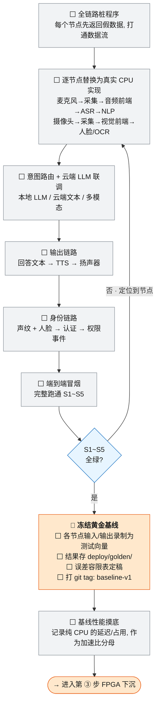

# 2-CPU可用链

> **本页回答什么问题**：在没有一行 FPGA 代码的情况下，怎么把所有环节先在 CPU 上端到端跑通，并在哪一步把它钉死成**黄金基线**。
> **前置阅读**：[[实施路线]]（本页是第 ② 步）→ [[1-NPU模型部署]]（① 的产物是本页的输入之一）。
> **本页的子页**：[[交叉编译环节]]（板端产物怎么编出来）。
> **产出物去向**：`deploy/golden/` + 误差容限表 + tag `baseline-v1` → [[3-FPGA组件下沉]] 第 ① 步的唯一输入。

---

## 1. 为什么这一步最重要

黄金基线是后面所有 FPGA 下沉的**唯一裁判**——FPGA 版本对不对不靠感觉、不靠讨论，只比对基线输出。基线没冻结，下沉就没有判据，两人争执也没有裁判。

**这一步不追求性能**，只追求三件事：跑通、可复现、留下向量。

---

## 2. 全链路打通流程



### 2.1 B0~B8 步骤表

| 步 | 要做什么 | 产出物 | 通过判据 | 状态 |
|---|---|---|---|---|
| **B0** | 写全链路桩程序：每个节点先返回**假数据**，只打通数据流与线程/进程边界 | 桩版 pipeline（可跑） | 一条命令从"输入"跑到"输出"，不崩 | ⬜ |
| **B1** | 逐节点替换为真实 CPU 实现：麦克风→采集→音频前端→ASR→NLP；摄像头→采集→视觉前端→人脸/OCR | 各节点 CPU 参考实现 + 单元自测 | 单节点输出与官方/参考结果一致 | ⬜ |
| **B2** | 意图路由 + 云端联调：本地 LLM / 云端文本 / 云端多模态三条出口 | 路由表 + 联调日志 | 5 类意图各路由到正确出口 | ⬜ |
| **B3** | 输出链路：回答文本 → TTS → 扬声器 | 可听的输出 | 能播出一句完整回答 | ⬜ |
| **B4** | 身份链路：声纹 + 人脸 → 认证 → 权限事件 | 事件流 + 身份库比对 | 通过/拒绝判定正确 | ⬜ |
| **B5** | 端到端冒烟：完整跑 S1~S5（第 3 节） | 冒烟脚本 + 运行日志 | 5 条全绿 | ⬜ |
| **B6** | 判定：5 条场景是否全绿 | 冒烟记录 | 全绿才允许进 B7；争议一律以比对基线为准 | ⬜ |
| **B7** | 🏅 **冻结黄金基线**（第 5 节） | golden 向量 + 容限表 + tag | 第 5 节清单四项齐 | ⬜ |
| **B8** | 基线性能摸底（第 6 节） | 性能摸底表 | 每个待下沉组件都有 CPU 分母数据 | ⬜ |

---

## 3. 场景 S1~S5（此后所有回归都跑这 5 条）

**编号约定（全项目唯一一份场景定义）**：一个场景 = 一条端到端回归用例 = 演示脚本的一个环节，三处共用 S1~S5 编号，不另立编号体系。B5/B6/B7 的"S1~S5 全绿"就是本节五条判据逐条通过；交付期现场演示的编排顺序见 [[验证与交付#9. 现场演示操作规程（到板即用）|验证与交付——9. 现场演示操作规程（到板即用）]]（同一批编号，只是换了演出顺序）。

| # | 场景 | 触发（用户视角） | 涉及链路 | 成功判据 | 依赖网络 | 状态 |
|---|---|---|---|---|---|---|
| **S1** | 普通本地问答 | 说一句常识性、不需要看画面的问题，说完自然停顿（无按键、无结束词） | 麦克风→ASR→NLP→**问答出口**（云端文本 LLM；本地 LLM 为可选演示项，见 [[状态源与决策记录#D-25 · 本地 LLM 从主线交付降级为可选演示项\|状态源与决策记录——D-25]] **D-25**）→TTS | **不出网即路由路径正确**（NLP 判为"普通问答"并走问答出口、有播报）。~~断网条件下仍能完整作答~~——**这条承诺按 D-25 撤销**，断网作答只有本地 LLM 做到才算，它已退出主线 | **是**（本地演示除外） | ⬜ |
| **S2** | 复杂文本问答 | 说一句需要知识量或推理深度的问题 | ASR→NLP→云端 LLM→TTS | 判定为复杂文本、**只上传文本**、云端返回语义相关内容、播报不中断 | **是** | ⬜ |
| **S3** | 看图问答 | 把实物放到摄像头前问"这是什么／怎么用" | NLP→抓拍→JPEG→云端多模态→TTS | 判定为看图、**只产生一帧上传**、回答与画面相关（JPEG 为 PS 软件单帧压缩，非硬件） | **是** | ⬜ |
| **S4** | 读文字 | 举起大字号单栏纸张问"这上面写了什么" | NLP→OCR→NLP→TTS | 识别文本与原文吻合、**拔网仍能读字**（读字走端侧 OCR，理解场景才走云端，两条不混用） | 读字否／转述视路径 | ⬜ |
| **S5** | 身份认证 | 已登记与未登记的人分别走进画面，不需要说话 | 声纹+人脸→认证→权限事件 | 已登记判"通过"、未登记判"拒绝"，判定过程不依赖网络；多人前后不串号 | 否 | ⬜ |

### 3.1 每条场景的可测量验收判据（B7 冻结时逐项落盘）

不接受"基本可用"这种写法；判据要么写成命令／计数，要么写成"待实测"并留空格。

| # | 判据 | 怎么量 | 实测值 | 状态 |
|---|---|---|---|---|
| S1 | 端到端跑通 | 断网连问 3 句，逐条记录转写文本与答案 | 未测 | ⛔ 待实测 |
| S1 | 端到端响应时间 | 从说完停顿到开始播报，计时 | 待实测 | ⛔ |
| S1 | 播报可听清 | 现场人工判定 | 未测 | ⬜ |
| S1 | 没人说话时不触发 | 静置 60 s（只有环境声）：不产生问答、无声段不送 ASR | 未测 | ⬜ |
| S2 | 端到端跑通 | 联网问 3 句复杂问题 | 未测 | ⛔ 待实测 |
| S2 | 上送内容仅文本 | 抓包或日志核对 | 未测 | ⬜ |
| S2 | 云端往返耗时 | 单独计时 | 待实测 | ⛔ |
| S3 | 端到端跑通 | 3 件物品各测一次 | 未测 | ⛔ 待实测 |
| S3 | 只传一帧 | 上传次数核对 | 未测 | ⬜ |
| S3 | 抓拍→答案返回耗时 | 单独计时 | 待实测 | ⛔ |
| S3 | 回答相关性 | 人工评分（评分表待定稿） | 未测 | ⬜ |
| S4 | 端到端跑通 | 3 张不同素材各测一次 | 未测 | ⛔ 待实测 |
| S4 | 断网可读 | 拔网后仍输出文本 | 未测 | ⬜ |
| S4 | 最小可识别字号／最远距离 | 阶梯测试 | 待实测 | ⛔ 摄像头格式那半**已结**（10-05 实测：SDI 1920×1080@30.06 fps、AI 路 640×352 或 960×512 隔 3 抽样，见 [[我方在板外设#三、从时序侧能确定的摄像头规格（A＋C 混合，逐条标级）|我方在板外设——三]]）；**这一项现在只欠"画面里摆字／摆人"本身的实测**，其中隔 3 抽样会走样，是字号下限的直接嫌疑人 |
| S4 | 错字率 | 与原文逐字比对（容限**待定稿**） | 未测 | ⬜ |
| S5 | 通过／拒绝正确 | 已登记 N 人 + 未登记 M 人各若干次，统计正确次数 | 未测 | ⛔ 待实测 |
| S5 | 端侧完成比对 | 断网仍能判定 | 未测 | ⬜ |
| S5 | 判定所需时间 | 走进画面到出结果，计时 | 待实测 | ⛔ |
| S5 | 误识率／拒识率 | 需测试集与统计口径 | 未测 | ⬜ **口径未定义**，见 [[验证方法学#十二、端到端与识别指标：口径归属与未定义项\|验证方法学——十二、端到端与识别指标：口径归属与未定义项]] |
| S5 | 触发的业务动作 | 人工观察 | **未定义** | ⛔ 业务动作待验证 |

**S5 的两点硬约束**：① "通过/拒绝"目前是**功能级判据**，身份事件最终触发什么业务动作仍属**待验证**（"开门/开放权限"只是示例，不视为已确定产品功能）；② **未定义活体检测**，照片攻击可能被判为本人——这条限制的用户可见表现登记在 [[风险与完成判据#5. 已知限制与范围外（对外唯一口径）|风险与完成判据——5. 已知限制与范围外（对外唯一口径）]] L11。

### 3.2 场景失败时的处置（现场与开发侧共用一张表）

| # | 典型失败 | 你会看到 | 处置 |
|---|---|---|---|
| S1 | 静音判定过严 | 说完没反应 | 提高音量或靠近麦克风；必要时改用带麦耳机 |
| S1 | 转写错字多 | 答非所问 | 降低背景噪声后重问；根因是端侧无语音增强，见 [[风险与完成判据#5. 已知限制与范围外（对外唯一口径）\|风险与完成判据——5. 已知限制与范围外（对外唯一口径）]] L15 |
| S1 | 端侧模型不可用 | 有转写无答案 | 属能力缺失，改走 S2（有网）或跳过该环节 |
| S2/S3 | 现场无公网／网络拥塞 | 长时间不出答案 | 不重试超过一次，立即走 [[验证与交付#6. 无公网场景的离线交付预案\|验证与交付——6. 无公网场景的离线交付预案]]离线预案 |
| S2/S3 | 云端额度耗尽或返回鉴权错误 | 无回答或答非所问 | 切备用服务商（不绑定厂商是设计原则），赛前须实测过一次 |
| S2/S3 | 云端可答但合成不可用 | 有文字没声音 | 切离线兜底播报（机械但完整）或投屏显示文本 |
| S3 | 画面太暗／物体出框 | 答非所问 | 调整光线与距离后重问 |
| S4 | 字太小／距离太远 | 读出部分或错字 | 换大字近距素材；**未定义自动重拍策略**（L13） |
| S4 | 倾斜、反光、抖动、多栏表格 | 质量明显下降或顺序错乱 | 拿稳、避开反光、换平整单栏纸面；复杂版式是后续升级项 |
| S5 | 逆光、侧脸、遮挡 | 漏判（认不出） | 改正面顺光、缩短距离 |
| S5 | 相似外观／照片攻击 | 误判为已登记 | 当前无活体检测（L11），不算故障 |
| S5 | 身份库未预置 | 谁都认不出 | 演示前人工预置名单（注册流程本身**待定义**，L12） |
| S5 | 声纹链路未实现 | 只用声音时无法确认身份 | 属预期：声纹为 P2 可选，不作为 S5 必判项 |

---

## 4. 误差 / 精度容限表（B7 的第 3 项冻结物）

**前四类对象（音频前端／视觉前端／量化／流控）的容限数值不在本页写**：类别定义与比法只写在 [[验证方法学#四、黄金基线是唯一裁判|验证方法学——四、黄金基线是唯一裁判]]一处，逐子模块的冻结值只写在 [[3-FPGA组件下沉#6. 下沉范围与误差容限预置（按子模块，第 ① 步冻结）|3-FPGA组件下沉——6. 下沉范围与误差容限预置（按子模块，第 ① 步冻结）]]一处。B7 的第 3 项冻结物就是**把这两张表的空格填成实值**，不是再抄第三份。

本页只登记这两张表都装不下的、属于"链路级"的两条待定项：

| 对象 | 容限 | 可信度 | 说明 |
|---|---|---|---|
| NPU 模型输出 vs 原始框架输出 | **待定，冻结基线前必须定稿** | 待验证 | 源文档未给数字，不许自己编 |
| 整模型端到端精度下降（含硬算子） | **待定，第 ④ 步启动前必须定稿** | 待验证 | 源文档为空白，禁止提前填数 |

**规则**：容限在开工前冻结，实测值逐行记进 [[任务卡与台账规范#4.2 下沉台账（第 ③ 步，每组件每次比对一行）|任务卡与台账规范——4.2 下沉台账（第 ③ 步，每组件每次比对一行）]]，留空等于该组件**永远"看起来对"**——出问题时无法回答"是 bug 还是可接受误差"。

---

## 5. 黄金基线冻结物清单（B7 的交付定义）

**1~3 项没进，就不算冻结，第 ③ 步不许开工。** 第 4 项里只有 GS3 一项须在本次冻结前填；另两项依赖板端 profiling 数据，最迟在**第 ④ 步启动前**补齐并回填本表（补齐前 A9 不得开工，见 [[风险与完成判据#3.3 加速期 DoD（路线第 ③④ 步的闭合条件）|风险与完成判据——3.3 加速期 DoD（路线第 ③④ 步的闭合条件）]]）。第 5 项 tag 指向 1~3 项齐备的那次提交。

| # | 冻结物 | 存放位置 | 内容要求 | 谁来用 |
|---|---|---|---|---|
| 1 | 各节点输入/输出测试向量 | `deploy/golden/vectors/` | 每个节点一套：输入原始数据 + CPU 参考输出 + 生成命令。视觉含小尺寸图起步的多组（分辨率/颜色顺序/裁剪坐标组合）；音频含静音段、起始语音、连续语音、突发噪声、边界长度 PCM | 下沉循环 ①⑤ 步与回归 |
| 2 | 端到端结果 | `deploy/golden/` | S1~S5 各一条完整运行的输入快照 + 输出结果 + 关键中间节点落盘 | 每次全链路回归比对 |
| 3 | 误差容限表定稿 | `deploy/golden/tolerance.md`（第 4 节表的定稿版） | 每个组件一行，空值不得留到开工后 | [[3-FPGA组件下沉]] |
| 4 | 三个未定阈值关闭 | 见下表"未定阈值" | 全 Wiki 目前只有这三处判据值是空的，冻结流程里要逐个填成实值并回写到各自归属页 | [[3-FPGA组件下沉]]、[[算子缺口处理]] |
| 5 | git tag `baseline-v1` | 代码仓库 | 指向以上四项齐备的那次提交 | 所有比对脚本按 tag 取参考 |

**未定阈值（第 4 项冻结物的具体内容，一处定稿、别处只引用）**：

| 阈值 | 用在哪 | 归属页（填值的地方） | 定稿时点 |
|---|---|---|---|
| GS3 连续长跑小时数 | 灰度第 3 阶段"无崩溃、无泄漏、无丢帧"要跑多久 | [[3-FPGA组件下沉#12. 第 ⑦⑧ 步的具体操作（开关与灰度怎么做才算对）\|3-FPGA组件下沉——12. 第 ⑦⑧ 步的具体操作（开关与灰度怎么做才算对）]] GS3 行 | B7 冻结前 |
| Top-N 耗时占比门槛 | 第 ④ 步启动条件 2：哪些算子值得硬件化 | [[算子缺口处理#5. 进入路径④ 的三条评估门槛（缺一不可）\|算子缺口处理——5. 进入路径④ 的三条评估门槛（缺一不可）]]门槛表 | **第 ④ 步启动前**（依赖 B8 摸底数据，可晚于 B7；但 B8 完成时必须一并定值） |
| 整模型精度下降上限 | 硬算子接入整图后的端到端精度判定（6.6） | [[算子缺口处理#6. 路径④ 的执行细节（复用上页 8 步，不另起流程）\|算子缺口处理——6. 路径④ 的执行细节（复用上页 8 步，不另起流程）]] 6.6 行 | **第 ④ 步启动前**，与上一行同时定 |

**冻结动作的操作顺序（照做）**：

1. 跑一次全链路冒烟，确认 5 条场景全绿；
2. 执行录制脚本把各节点输入/输出落盘到 `deploy/golden/`（**必须在干净仓库状态下跑，产物全部入库**）；
3. 定稿容限表与本节"未定阈值"三项，把第 4 节和本节里所有"待定"关掉；
4. 打 tag，并把 tag 号写进 [[进度计算与实时看板]]。

```bash
# replay every node and freeze its reference vectors
python tools/capture_golden.py --out deploy/golden/vectors

# verify the recorded vectors are reproducible (byte-identical for bit-exact nodes)
python tools/compare_golden.py --ref deploy/golden --run-now

# freeze the baseline: only tag after all three artifacts are in place
git add deploy/golden
git commit -m "step2: freeze golden baseline vectors and tolerance table"
git tag baseline-v1
git push origin main --follow-tags
```

**冻结后的变更规则**：`baseline-v1` 一旦打上不修改。CPU 参考实现若有 bug 需修，必须新开 `baseline-v1.1`，并在 [[状态源与决策记录]] 里写明"哪些组件的等价性结论需要重跑"——否则前面所有下沉结论一起作废。

---

## 6. 基线性能摸底（B8：给加速比准备分母）

**没有 CPU 分母，"加速比"这个数字就无从谈起**，而 CPU vs FPGA 的实测对比正是本项目预期成果之一。

| 摸底项 | 怎么测 | 记录内容 | 用途 |
|---|---|---|---|
| 各节点 CPU 单帧延迟 | 固定输入集，跑 100 次取分布（不是只取一次） | 平均 / P50 / P95，ms | 下沉台账"CPU 延迟"列 |
| CPU 占用率 | 单节点独占运行时采样 | %CPU、是否绑核 | 答辩时的"卸掉 CPU 负担"证据 |
| 内存/带宽占用 | `RSS` + 每秒搬运字节数 | MB、MB/s | 判断访存瓶颈是否值得硬件化 |
| 模型侧（NPU）延迟 | [[1-NPU模型部署]] 的 A8 数据 | ms / FPS / NPU 占用率 | 与前端拼接成全链路预算 |
| 全链路端到端延迟 | S1~S5 各测一次 | 从"说完话/对准画面"到"出结果"的 ms | 交付期性能对比表 |

摸底表在 `deploy/golden/perf-baseline.md` 落盘，与基线同 tag。**FPGA 延迟列在拿到板之前只能留空。**

---

## 7. 未到板可推进的子集：先在 x86 上建 golden model

**这是不等板的关键动作**：黄金基线的价值在于"可复现的参考输出"，参考实现跑在 x86 还是 aarch64 只影响性能数字，**不影响数值参考的成立**。

| 步 | 在 x86 上做什么 | 产出 | 到板后要补什么 |
|---|---|---|---|
| 1 | 用 C++/Python 实现视觉前端 CPU 参考链：Resize、Crop/Letterbox、色彩转换、Normalize、Quantize，参数化到与将来到 FPGA 配置一一对应 | `src/ref/video_frontend.*` + 单元自测 | 板端重跑一遍，交叉编译产物与 x86 结果 diff |
| 2 | 实现音频前端 CPU 参考链：PCM 流控、分帧、VAD（能量+状态机）、缓冲，条件性 SRC | `src/ref/audio_frontend.*` | 麦克风侧**已实测结掉**（10-05）：48000 Hz 单档／S16_LE／录音 1 声道，所以 SRC 只会是**固定 3 倍抽取**这一档，CPU 兜底的代价也测过（`plughw` 重采样＝单核 0.17 %，见 [[音频#四、测试记录|音频——T17]]）。剩下待核的只有**ASR 模型要的输入速率**，那是模型侧的事 |
| 3 | 生成**固定测试向量集**：图像（多分辨率、多颜色顺序、ROI 组合、边界尺寸），音频（静音/起始/结束/连续/突发噪声/边界长度） | `deploy/golden/vectors/`（x86 版） | 板端只需重跑同一套向量做二次确认，不重做 |
| 4 | 把"输入→参考输出→生成命令"三件套脚本化，一条命令全量重建 | `tools/capture_golden.py` | 到板后同一命令加 `--target board` |
| 5 | 在 x86 上跑通桩版全链路（B0）+ 意图路由与云端联调（B2） | 可演示的 PC 版链路 | 外设替换为板端 ALSA/V4L2 |
| 6 | 预填下沉台账的"黄金参考"与"误差容限"两列 | 见 [[3-FPGA组件下沉]] | 到板只填实测列 |

```bash
# build and run the host-side reference implementation (no board needed)
cmake -B build-host -DCMAKE_BUILD_TYPE=Release
cmake --build build-host -j$(nproc)
ctest --test-dir build-host --output-on-failure

# regenerate golden vectors after any change to a reference node
./build-host/tools/capture_golden --out deploy/golden/vectors --scope all

# equivalence harness reused later for FPGA comparison
./build-host/tools/compare_golden --ref deploy/golden/vectors --candidate ./build-arm/video_frontend
```

**边界声明**：x86 参考集**不能**当作"已上板可用"的结论；所有依赖板卡的验收项在看板上保持 ⛔ 并写解锁条件。性能列在板前一律空白，禁止用 PC 数字冒充板端 CPU 分母。

---

## 8. 板端产物怎么编出来

B1 之后的 CPU 实现要跑在板上，就要交叉编译。这一步的完整流程、容器用法、验收清单在子页里：[[交叉编译环节]]。

## 相关页面

[[实施路线]] · [[1-NPU模型部署]] · [[交叉编译环节]] · [[3-FPGA组件下沉]] · [[全链路逻辑基线]] · [[任务卡与台账规范]] · [[进度计算与实时看板]] · [[状态源与决策记录]] · [[风险与完成判据]] · [[验证方法学]] · [[工具链与素材进README]]
