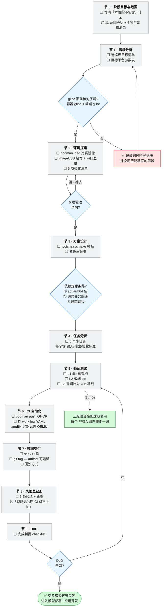

# 交叉编译环节

> **本页回答什么问题**：一个 x86 上写的 C/C++ 程序，要一步步走到"能在悟净板上直接跑"，具体每一步做什么、产出什么、怎么算通过、卡住了去哪里查。
> **前置阅读**：[[实施路线]]（一条主线：先让现成的东西跑起来）→ 本页 §5（环境搭建与 5 项验收；原本的「环境搭建与快速上手」精简版**已作废**，2026-11-01，见 §5.3 顶注）。本页是准备期任务卡 P0~P4 的详细展开。
> **产出物去向**：本节 0~9 的表格填完后归档到仓库 `docs/`，第 5 节的三级验证（L1/L2/L3）在加速期被每个 FPGA 组件复用（见 [[3-FPGA组件下沉]]），第 6 节 CI 与第 7 节交付方式在交付期复用（见 [[验证与交付]]），第 8 节风险全部并入 [[风险与完成判据]] 的登记册。

本页是**专项流程层**页面，不是方法论：照着从上往下做即可，每一节的表格就是交付物本身。

---

## 1. 节 0~9 与任务卡的对应关系

| 模板节号 | 干什么 | 对应任务卡 | 卡点（做到什么才算过） | 本页章节 |
|---|---|---|---|---|
| 节 0 | 阶段目标与范围（含「本阶段不包含」） | P0 | 范围冻结，含「不包含」清单 | §3 |
| 节 1 | 需求分析：待编译目标 + 平台参数 | P1 | glibc 与平台参数核对通过 | §4 |
| 节 2 | 环境搭建：容器 + 板端 + 5 项验收 | P2 | 5 项验收全勾（板端 2 项可登记条件通过） | §5 |
| 节 3 | 方案设计：toolchain.cmake + 依赖三策略 | P3 | 方案评审通过 | §6 |
| 节 4 | 任务分解：5 张小卡 | P4 | 5 张任务卡就绪 | §7 |
| 节 5 | 三级验证 L1/L2/L3 | — | 逐条判据 | §8 |
| 节 6 | CI 自动化（GHCR + workflow） | 贯穿活动 | 一次绿 | §9 |
| 节 7 | 部署交付 + 回滚 | 贯穿活动 | tag↔artifact↔板端 可追溯 | §10 |
| 节 8 | 风险登记册 | 贯穿活动 | 开放风险均有应对记录 | §11（指向总册） |
| 节 9 | DoD 完成判据 | — | 全勾才关环节 | §12（指向总册） |

> **两套编号的关系**：「节 n」是模板的序号，「§n」是本页的章节号，两者相差 3（§1 是映射表、§2 是流程图）。**引用一律用 §号**，别写"第 n 节"。

---

## 2. 专项流程图（图 3 完整移植）

这张图回答的问题：**交叉编译这一整段活儿按什么顺序走、哪三个地方必须停下来核对、不通过时退回哪一格。**



**图上状态与真实进度一致**：⬜ 未开始（交叉编译容器环境与板端烧写均未开始，见 [[进度计算与实时看板]]）。板端相关项为 ⛔，原因见 §13。

---

## 3. 节 0 · 阶段目标与范围

**一句话目标（填写式）**：本阶段结束时，`______`（工程名）以交叉编译方式产出可在板载 Linux 直接运行的 arm64 程序/库，并能通过 CI 一键重建。

| 项目 | 内容 |
|---|---|
| 本阶段**包含** | 容器环境搭建、工具链验证、示例工程 `image_cls_resnet18` 及自研代码的交叉编译、产物传板验证、CI 流程 |
| 本阶段**不包含**（硬约束，防范围蔓延） | 模型训练/量化（另有阶段，见 [[1-NPU模型部署]]）、板端内核/驱动调试、性能优化 |
| 阶段产出物 | ① 可运行的 arm64 二进制　② `toolchain.cmake`　③ CI workflow　④ 本页各表的填写记录 |
| 负责人 / 备份 | 甲主责、乙备份（分工见 [[排期与分工]]） |

---

## 4. 节 1 · 需求分析

### 4.1 待编译目标清单（每个目标一行，编译前先登记）

| # | 编译目标 | 来源工程 | 依赖库（必须注明需 arm64 版） | 语言/构建系统 | 依赖策略①/②/③ | 状态 |
|---|---|---|---|---|---|---|
| 1 | 示例分类程序 | `image_cls_resnet18` | libtorch / opencv / onnxruntime（按实际填） | C++ / CMake | 待定 | ⬜ |
| 2 | 视觉前端 CPU 参考实现（golden model） | 自研 | OpenCV | C++ / CMake | 待定 | ⬜ |
| 3 | 音频前端 CPU 参考实现（golden model） | 自研 | ALSA / libsndfile | C++ / CMake | 待定 | ⬜ |
| 4 | 全链路桩程序 / 冒烟 runner | 自研 | 按实际填 | C++ 或 Python | 待定 | ⬜ |
| 5 | 打包与上板脚本 | 自研 | — | shell | 不适用 | ⬜ |

> 第 2、3 行是**故意提前登记的**：CPU 黄金参考本身也是交叉编译目标，交叉编译环节验收通过后紧接着就要编它（见 [[3-FPGA组件下沉]] 第 ① 步）。

### 4.2 目标平台参数表（值必须在板端用命令实测后填入，不许照抄手册）

| 参数 | 值 | 获取命令（板端执行） |
|---|---|---|
| CPU 架构 | aarch64 | `uname -m` |
| 系统版本 | Ubuntu 20.04.x | `lsb_release -a` |
| glibc 版本 | ＿＿＿（**未到板，待实测**） | `ldd --version \| head -1` |
| Python 版本 | 3.8（对照 whl 文件名 `cp38`） | `python3 -V` |
| torch 版本 | 2.0.1（比赛提供 aarch64 包） | `python3 -c "import torch; print(torch.__version__)"` |
| 板端可用磁盘 / 内存 | ＿＿＿（待实测） | `df -h; free -h` |

**硬约束（本节的核心判据）**：交叉编译容器内的 glibc 版本必须 **≤** 板端 glibc，否则产物在板上报 `GLIBC_x.y not found`。容器与板端同为 Ubuntu 20.04 基底，正常情况下一致；若板端镜像被改动过，必须在 [[风险与完成判据#1. 风险登记册|风险与完成判据——1. 风险登记册]]「风险 3」留下记录。

> **未拿板前这一格怎么填**：留空并标 ⛔，把该行列入阻塞清单（[[进度计算与实时看板#4. 阻塞清单|进度计算与实时看板——4. 阻塞清单]]）；不允许用"应该是 2.31"这类推测值过关。

---

## 5. 节 2 · 环境搭建（含 5 项验收清单）

### 5.1 本地编译环境（podman）

**容器导入与自检的 5 条命令就写在这里**（2026-11-01 起）。此前本页把命令推给「环境搭建与快速上手」，而**那一页已由她亲自删除**（嫌啰嗦，2026-11-01 核定：44 处引用指着它、盘上与 git 全史均零命中 ⇒ 判定作废、不重建）；这 5 条是从 `wiki/PS/psrt/rt/rt.md` 的草稿迁来的，那份草稿已删。

```bash
podman load -i ubuntu20.04_container.tar     # 1 加载比赛镜像
podman images                                 # 2 记下实际镜像名，后面全用它
podman run -it --rm -v /path/to/project:/work:z localhost/<image-name> /bin/bash   # 3 进容器
# 4 容器内自检两项
aarch64-linux-gnu-gcc -v
cmake --version
# 5 加 arm64 架构并更新索引（装 arm64 依赖才需要）
dpkg --add-architecture arm64 && apt update
```

**镜像基底是 amd64（Ubuntu 20.04）⇒ CI 用 GitHub Actions 官方 runner 直接跑同一个镜像，无需 QEMU。**

本卡与入门页那一次跑通的**唯一差别**是挂载路径：上面的 `-v /path/to/project:/work:z` 是占位，开工后要换成真实工程目录（本机为 `-v S:/projects/work:/work:z`），并把 `podman images` 里的**实际镜像名**记下来——后面所有 `podman run`、CI 里的 `localhost/<image-name>` 都替换成它。跑完这 5 条就回 §5.3 勾验收。

> 占位符对照：模板里的 `<镜像名>` / `<用户名>` / `<板子IP>` / `<可执行文件>` 在代码块中一律写作 `<image-name>` / `<user-name>` / `<board-ip>` / `<executable>`——本页所有代码块按规范保持纯英文（注释也是英文），占位符含义不变，填的时候替换即可。

### 5.2 板端环境（⛔ 依赖到板）

板端的**步序、官方串口登录程序、让板子自己拿 IP 并起 sshd 的改法、到板后的动作顺序**现在分住在四处，本页不复制：① 串口与 bootargs、时间与日志、启动与服务 → [[PS/psrt&dev/os]] 第五、六节；② 网络与 `rc.local` 逐件改动（含两轮 `dhclient.conf`、租约改名）→ [[板端我方代码与产物台账]] **#204～#207**；③ 到板后的动作顺序 → [[外设与资金申报改成设备信息#五、到板第一天：一件外设一条命令|外设与资金申报——五]] 与 [[板载接口与内核改造收纳进dev#九、到板必查（这一页相关的项）|板载接口与内核改造——九]]；④ 入口打通的历史记录（2026-09-28 01:50，**D-24**）→ [[状态源与决策记录#D-24 · 板子已在手上并且能登进去：全库"尚未拿到悟净板"口径作废|状态源与决策记录——D-24]]。**原本那一页登记的是本机侧实测（COM6／PuTTY／驱动）＋板端已执行但回显未存档的入口打通记录，不是板端性能读数。**

一条硬约束（内容限制现在**只剩这一条**，见 [[状态源与决策记录#D-26 · 借用金额与条款改判为入库，撤销 D-17；分发面限制单独保留|状态源与决策记录——D-26]] **D-26**）：**真实凭据**——口令／私钥／token／`/etc/shadow`／厂商 portal 账号——不进页面也不提交，只写它在哪份提取件的第几项。凭据的**值**按 **D-27** 只出现在 [[板卡镜像实测取证#敏感信息|板卡镜像实测取证——敏感信息]]"敏感信息"一节里那一张表，其余页面写 `登录凭证` 加链接指过去；用户名 `root` 属连接参数，不是凭据，可以直接写。板端 IP **不登记**（**D-24 第 6 条**，走 DHCP，用时回串口现取）。

### 5.3 环境验收清单（硬条件：5 项全勾才进 §6）

> **⚠ 2026-11-01：清单本体已随「环境搭建与快速上手」一页被删（她亲自删，嫌啰嗦）而丢失，本页不再指向它。** 现在只确定三件事，细则 **待她补或按她当时的实际标准重定**：
>
> 1. **共 5 项＝容器侧 3 项 ＋ 板端 2 项**（出处：看板 P2 行备注原文「容器侧 3 项可做；板端 2 项待做」，[[进度计算与实时看板#3.1 任务卡总账（唯一进度真值，一行一卡）|看板——3.1]]）。
> 2. **容器侧 3 项**对应本页 §5.1 的 5 条命令跑完（导入镜像→记镜像名→进容器→容器内两项自检→加 arm64 架构）；**具体分项与“条件通过（partial）”规则原文已失，不替我编**。
> 3. **板端 2 项**已知其中之一是 **`scp`／`pscp` 通否**（SSH 已通不等于文件传输已通），另一项是**板端运行时核对**（出处同上 P2 行备注）。
>
> **G0 卡点判据**：按看板 P2 行的状态列＋本页 §5.1／§5.2 判；填完再回本页登记 P2 的进度。

---

## 6. 节 3 · 方案设计

### 6.1 CMake 交叉编译（统一用 toolchain 文件：不污染系统、本地与 CI 命令完全一致）

```cmake
# toolchain.cmake -- target: FMQL30TAI (aarch64, Ubuntu 20.04)
set(CMAKE_SYSTEM_NAME Linux)
set(CMAKE_SYSTEM_PROCESSOR aarch64)

set(CMAKE_C_COMPILER   aarch64-linux-gnu-gcc)
set(CMAKE_CXX_COMPILER aarch64-linux-gnu-g++)

# Search for arm64 dependencies only; never link x86 libraries by mistake
set(CMAKE_FIND_ROOT_PATH /usr/aarch64-linux-gnu)
set(CMAKE_FIND_ROOT_PATH_MODE_LIBRARY ONLY)
set(CMAKE_FIND_ROOT_PATH_MODE_INCLUDE ONLY)
set(CMAKE_FIND_ROOT_PATH_MODE_PACKAGE BOTH)

# Confirm -mcpu against the chip manual before freezing this file
set(CMAKE_C_FLAGS_INIT   "-O2 -mcpu=cortex-a7")
set(CMAKE_CXX_FLAGS_INIT "-O2 -mcpu=cortex-a7")
```

构建命令（容器内与 CI 中**完全相同**，这是方案评审的判据之一）：

```bash
cmake -B build-arm -DCMAKE_TOOLCHAIN_FILE=toolchain.cmake -DCMAKE_BUILD_TYPE=Release
cmake --build build-arm -j$(nproc)
```

### 6.2 依赖三策略（每个依赖必须选一条，选完回填 §4.1 清单的"依赖策略"列）

| 优先级 | 策略 | 适用情况 | 操作 |
|---|---|---|---|
| ① | apt arm64 多架构包 | Ubuntu 20.04 仓库里有现成库 | `apt install libxxx-dev:arm64` |
| ② | 交叉编译源码 | 有源码、仓库没有 arm64 dev 包 | 源码目录内用同一 `toolchain.cmake`，或 `--host=aarch64-linux-gnu ./configure` |
| ③ | 静态链接进产物 | 板端不便装运行库、依赖关系复杂 | `-static` 或直接链 `.a`；用体积换省心 |

### 6.3 目录结构约定

```
project/
  src/                  # own code
  third_party/          # dependencies cross-built from source
  cmake/toolchain.cmake
  build-x86/            # local reference build, output must match the arm build
  build-arm/            # cross-built artifacts, copied to the board
  deploy/               # pack.sh / run.sh / golden vectors / board checklist
  .github/workflows/cross-build.yml
```

---

## 7. 节 4 · 任务分解（5 张卡）

> 5 张卡的字段全部按 [[任务卡与台账规范]] 填写。
| # | 任务 | 输入 | 输出 | 验收标准（可测量） | 负责/备份 | 状态 |
|---|---|---|---|---|---|---|
| 1 | 放置 `toolchain.cmake`，先跑通示例工程 x86 本机构建 | 示例源码 | `build-x86/` | 本机运行输出正确，结果存为 golden | 甲/乙 | ⬜ |
| 2 | 同一工程交叉构建 | 源码 + toolchain | `build-arm/` | `file` 输出含 `ELF 64-bit LSB, ARM aarch64` | 甲/乙 | ⬜ |
| 3 | 解决依赖问题 | 构建报错日志 | §4.1 与 §6.2 表更新 | 构建无 `undefined reference` | 甲/乙 | ⬜ |
| 4 | 产物打包脚本 `deploy/pack.sh` | `build-arm` | `pkg-<git短哈希>.tar.gz` | 解压即含二进制 + 模型 + 运行库，一条命令可解 | 甲/乙 | ⬜ |
| 5 | 上板运行脚本 `deploy/run.sh`（可选） | 打包产物 | — | 板端一条命令跑通 demo | 甲/乙 | ⛔（依赖到板） |

**P4 卡的完成条件**：5 张卡都有「输入/输出/验收标准」三栏且验收标准是可测量数字或命令判据；写"基本可用"一律打回。

---

## 8. 节 5 · 三级验证（全周期复用的核心验证法）

阶梯本身（L1 静态检查 → L2 依赖检查 → L3 冒烟运行 → L4 等价性回归，含命令、判据、对应证据等级、当前可执行性）只在 [[验证方法学#三、四级验证阶梯 L1 → L4|验证方法学——三、四级验证阶梯 L1 → L4]]定义一处，本页不复制那张表。**交叉编译环节只跑到 L1~L3**，L4 是加速期下沉才引入的。

本节留下的是 L1~L3 的**唯一一条命令序列**（别的页面引用它）：

**一致性基线怎么来**：先在 `build-x86/` 跑出标准输出，存为 `deploy/golden.txt`，板端结果与之比对。注意 `deploy/golden.txt` 是**单模型／单目标**的冒烟比对文件，与 M2 冻结的链路级向量目录 `deploy/golden/` 不是一回事（两者的关系见 [[验证方法学#六、工具链与目录约定|验证方法学——六、工具链与目录约定]]）：

```bash
# host side: produce the reference output once and freeze it
cmake -B build-x86 -DCMAKE_BUILD_TYPE=Release
cmake --build build-x86 -j$(nproc)
./build-x86/image_cls --input test.jpg > deploy/golden.txt

# container side: cross build and static check
cmake -B build-arm -DCMAKE_TOOLCHAIN_FILE=cmake/toolchain.cmake -DCMAKE_BUILD_TYPE=Release
cmake --build build-arm -j$(nproc)
file build-arm/image_cls

# board side: dependency check and smoke run against the frozen reference
ldd ./image_cls
./image_cls --input test.jpg > board_out.txt
diff deploy/golden.txt board_out.txt
```

> L1–L3 在本节建立命令序列，加速期每个 FPGA 组件再复用一次并追加 **L4 等价性回归**（S1~S5 + 逐样本比对），流程侧的引用见 [[验证与交付#1. 验证阶梯（引用，不重复定义）|验证与交付——1. 验证阶梯（引用，不重复定义）]]。

---

## 9. 节 6 · CI 自动化（GitHub Actions）

### 9.1 一次性准备（本地 podman → GHCR）

```bash
podman tag <image-name> ghcr.io/<user-name>/fmql30tai-cross:u20
podman login ghcr.io -u <user-name>
podman push ghcr.io/<user-name>/fmql30tai-cross:u20
```

> 首推会在 GHCR 创建 package，**必须立刻确认它是 Private**（GHCR 有默认公开的情况；为什么仍要私有见 [[状态源与决策记录#D-21 · 取消"资料保密"类入库限制：私有仓库，内容以可读性为先|状态源与决策记录——D-21]] D-21 第 3 条）。

### 9.2 workflow（.github/workflows/cross-build.yml）

```yaml
name: cross-build
on:
  push: { branches: [main] }
  workflow_dispatch:

jobs:
  build:
    runs-on: ubuntu-latest            # amd64 runner, amd64 container, no QEMU needed
    container:
      image: ghcr.io/<user-name>/fmql30tai-cross:u20
      credentials:
        username: ${{ github.actor }}
        password: ${{ secrets.GITHUB_TOKEN }}   # private image in the same account pulls fine
    steps:
      - uses: actions/checkout@v4
      - name: Build (ARM64)
        run: |
          cmake -B build-arm -DCMAKE_TOOLCHAIN_FILE=cmake/toolchain.cmake -DCMAKE_BUILD_TYPE=Release
          cmake --build build-arm -j$(nproc)
          file build-arm/<executable>
      - uses: actions/upload-artifact@v4
        with:
          name: board-pkg-${{ github.sha }}
          path: build-arm/**
```

### 9.3 CI 要点表

| 项 | 做法 | 判据/坑 |
|---|---|---|
| runner | `ubuntu-latest`（amd64）跑 amd64 容器 | **无需 QEMU**，这是选 amd64 容器的唯一原因 |
| 镜像 | `ghcr.io/<user-name>/fmql30tai-cross:u20` | 必须 Private |
| 触发 | `push: main` + `workflow_dispatch` | 手动触发用于救火复现 |
| 产物 | `actions/upload-artifact@v4` | 名字含 `${{ github.sha }}`，保留 90 天，**不会自动上板** |
| 权限坑 | 构建目录放 `$GITHUB_WORKSPACE` | uid 1001 报 Permission denied 时 `chmod -R` |
| **根本限制** | **比赛现场无公网时 CI 完全帮不上忙** | CI 只是日常加速器；交付必须"本地编译 + U 盘传板" |

### 9.4 镜像分发方式（团队决定，勾一个）

| 方式 | 优点 | 缺点 | 本队决定 |
|---|---|---|---|
| GHCR 私有镜像 | 拉取快、可版本化、workflow 最简 | 需 PAT 登录一次 | ☐ |
| Releases 存 tar + `podman load` | 不建 package，镜像即文件 | 每次 CI 多一步加载（大 tar 下载慢） | ☐ |

---

## 10. 节 7 · 部署交付

```bash
scp -r board-pkg user@<board-ip>:~/app/
ssh user@<board-ip> "cd ~/app && ./run.sh"
```

无公网时：`board-pkg` 拷入 U 盘 → 板端挂载 U 盘 → 解到 `~/app/` → 执行 `run.sh`。**同一套命令、同一个包，现场与平时不许换路。**

其余交付规则**不在本页写**：三级可追溯（tag ↔ artifact ↔ 板端目录）、板端目录约定、两条回滚通路只在 [[验证与交付#3. 交付与回滚流程|验证与交付——3. 交付与回滚流程]] 第 3、4 节各写一份；每次上板填的那一行是 [[任务卡与台账规范#4.4 上板记录表|任务卡与台账规范——4.4 上板记录表]]的上板记录表，本页不再放一张空表让人两处填。失败必须同时进 [[风险与完成判据#1. 风险登记册|风险与完成判据——1. 风险登记册]]。

---

## 11. 节 8 · 风险登记册（不在本页登记）

交叉编译这一段的 6 条风险（无 arm64 二进制包、容器与板端 glibc 不一致、凭据外流、podman 资源不足、现场无公网、CI 内 uid 1001 权限）**全部登记在 [[风险与完成判据#1. 风险登记册|风险与完成判据——1. 风险登记册]]总册**（风险 2~6 与风险 16），本页只在出现处就地指向它，不再维护第二张表。

新增风险的唯一入口是那一节：先判概率／影响／触发信号／负责人再入册，"开放"就必须有应对记录。

---

## 12. 节 9 · DoD（判据只写一份）

交叉编译环节的闭合条件（7 条，含 `-mcpu` 表述统一这一硬项）只在 [[风险与完成判据#3.1 交叉编译环节 DoD（准备期 P0–P4 的闭合条件）|风险与完成判据——3.1 交叉编译环节 DoD（准备期 P0–P4 的闭合条件）]]登记，本页不复制清单；打勾动作在 [[清单]] 的 P0~P4 行与总账（[[进度计算与实时看板#3.1 任务卡总账（唯一进度真值，一行一卡）|进度计算与实时看板——3.1 任务卡总账（唯一进度真值，一行一卡）]]）。

> 全勾 → 交叉编译环节关闭，进入 [[1-NPU模型部署]]。未过退回 §8 重跑 L1~L3 命令序列，不允许"先关环节后补测"。

---

## 13. 当前真实状态与阻塞处理

| 项 | 状态 | 说明 |
|---|---|---|
| 容器侧（§5.3 验收项 1~3、§6、§7 卡 1~4、L1） | ⬜ 未开始 | **不依赖板卡，现在就能做** |
| 板侧（§5.3 验收项 4~5、§8 的 L2/L3、§10 上板、§4.2 的 glibc 实测值） | ⬜ 未开始 | ~~尚未拿到悟净板~~ 该理由已于 **D-24** 作废：板子可登录，**现在就能做**，缺的是把包传上去并跑命令 |
| CI 出绿 | 🔄 依赖容器侧完成 | artifact 可先出，但 L2/L3 验收要上板做 |

**解锁条件**（2026-09-28 之后**只剩我方动作**，"拿到板"这一条已随 **D-24** 满足）：按 [[板端我方代码与产物台账]] #204～#207 把串口与网络入口弄通 → SSH／`pscp` 打通 → 实测并回填 §4.2 全部参数 → 解除 ⛔。

**无板可推进的子集（本周就能干，不空等）**：

1. 导入容器、跑通本页 §5.1 的 5 条命令（原指「环境搭建与快速上手」验收项 1~3，那一页已作废，改指本页自己的 §5.1）；
2. 写 `toolchain.cmake` 并把示例工程 L1 过关（`file` 出 aarch64）；
3. 在 x86 上建立 CPU 参考实现与 `deploy/golden.txt`，为黄金基线攒测试向量；
4. 把 §4.1 目标清单、§6.2 依赖策略先按推测填一遍，到板后只改"实测值"列。

---

## 相关页面

[[实施路线]] · [[任务卡与台账规范]] · [[进度计算与实时看板]] · [[1-NPU模型部署]] · [[3-FPGA组件下沉]] · [[验证与交付]] · [[风险与完成判据]] · [[状态源与决策记录]] · [[板子（除芯片）]] · [[PS/psrt&dev/os]]
