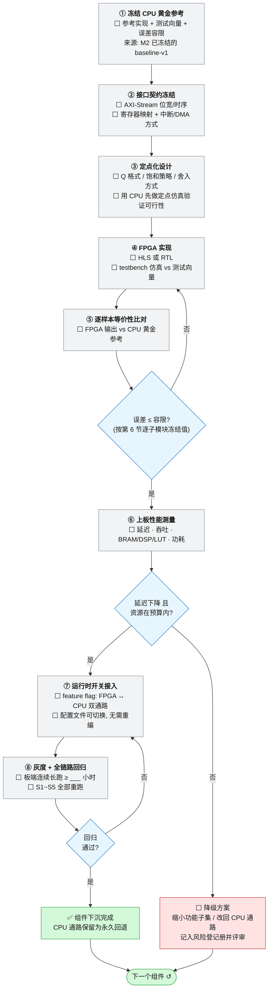

# 3-FPGA组件下沉

> **本页回答什么问题**：一个已经跑在 CPU 上的功能，要按什么固定 8 步搬到 FPGA 里，每步交什么、过不过怎么判、前人常在哪摔。
> **前置阅读**：[[实施路线]]（本页 = 路线第 ③ 步的主循环）→ [[1-NPU模型部署]]（本页第 ① 步的输入是它冻结的 `baseline-v1`）→ [[接口契约与数据通路]]（第 ② 步要冻结的东西）。
> **产出物本页交出去**：每个组件的下沉台账行 → [[进度计算与实时看板]] 加速期；性能与资源实测 → [[验证与交付]] 的 CPU vs FPGA 对比；降级/失败 → [[风险与完成判据]] 登记册。

---

## 1. 本页的范围已经按冲突消解修正（先读这一段）

`开发流程与生命周期管理.md` 与 `立项说明.md` 早于状态源修订，把下沉范围写成 **AFPGA → VFPGA → JPEG → TTS → TOE 五件套**。**以状态源为准，本页采用修正后的范围**：

| 项 | 旧文档写法（不采用） | 本页采用（状态源结论） | 可信度 |
|---|---|---|---|
| 下沉范围 | 五件套全下沉 | **JPEG / FPGA TTS 后端 / TOE 网络卸载不在当前周期自研范围**；主循环只做视觉前端 + 音频前端 + 条件性硬算子 | **已确认** |
| 按需抓拍 | FPGA JPEG 压缩 | **PS 软件单帧 JPEG**（明确"不在当前周期自研 H.264/H.265 或 FPGA JPEG"） | **已确认** |
| 语音输出 | FPGA TTS 后端 | **云端 TTS 为主方案 + 基于拼音音节拼接的离线兜底**，二者都不是 FPGA 自研 | **已确认** |
| 云端连接 | FPGA TOE/MAC 卸载 | **PS 侧 Linux 网络协议栈** | **已确认** |
| 链路优先级 | 音频前端排下沉顺序第 1 | **「图像重点、音频也做」**：视觉前端优先（主要 FPGA 成果 + 答辩主线），音频前端同步推进但边界更小 | **已确认** |
| 自定义硬算子 | 旧文档把第 ④ 步当作固定主线 | **CustomOP 不是预设必做项**，只有 iCraft 编译/profiling 发现值得硬件化的瓶颈后才评估 → 条件项 | **已确认** |

范围外三项在本页台账里**保留行但状态列写「范围外（下版 backlog）」**，依据与切换条件见 [[状态源与决策记录]]；技术选型层面的理由见 [[组件选型与复用边界]]。

**计分口径连带修正**：本步只出**卡**的完成与证据，加速期的分母是 A1–A9 九张卡（条件项 A9 未触发时按 ➖ 剔除）。阶段权重（准备 20/基线 30/加速 35/交付 15）已随决策 **D-12** 取消，14 周排期降级成参考而非承诺。卡的当前状态与总进度只在 [[进度计算与实时看板#3.1 任务卡总账（唯一进度真值，一行一卡）|进度计算与实时看板——3.1 任务卡总账（唯一进度真值，一行一卡）]] 总账里记一份，本页只提供循环步骤与台账数据源。

---

## 2. 主循环流程图（图 6 完整移植）

这张图回答的问题：**每个组件的下沉都要走同样的 8 步和 3 个判定，判定失败分别退回哪一步、什么情况下允许降级。**



---

## 3. 8 步逐条展开（照着做）

| 步 | 要做什么 | 产出物 | 通过判据 | 常见踩坑 |
|---|---|---|---|---|
| **① 冻结 CPU 黄金参考** | 从 `baseline-v1` 里取该组件的 CPU 实现；**先定误差容限再动手**；生成固定测试向量集（含边界尺寸/边界长度） | `deploy/golden/vectors/<组件>/`（输入 + 参考输出 + 生成命令）+ 台账"黄金参考版本"列填好（容限取值只登记在本页第 6 节，台账不重复） | 同一命令重跑两次，参考输出逐字节可复现 | 用一次抽样结果当参考；容限留白先开工；向量只覆盖典型图、不覆盖边界（奇数宽、非整除缩放比、全静音、单样本帧） |
| **② 接口契约冻结** | 定 AXI-Stream 位宽与时序（valid/ready 语义、tlast/tuser）、寄存器映射、中断/DMA 方式、mode_router 参数域 | 接口契约文档（[[接口契约与数据通路]] 的一节）+ 头文件/寄存器映射表 | **两人共同签署**后各自独立推进，不再互相等待 | 先写 RTL 后定接口，结果 PS 侧驱动全改；把背压处理留给"以后再说"；tready 拉低时的数据保持没定义 |
| **③ 定点化设计** | 选 Q 格式、饱和策略、舍入方式；**用 CPU 先做定点仿真**验证数值可行 | 定点仿真脚本 + 与浮点参考的误差直方图 | 定点仿真误差已在容限内（还没写一行 HDL 就先把数值风险清零） | 直接上 HDL 才发现累加位宽不够；round-to-nearest 与 CPU 的 round-half-up 不一致导致逐位 diff 全红 |
| **④ FPGA 实现** | HLS 或 RTL 实现；写自检 testbench 跑同一批测试向量 | RTL/HLS 工程 + testbench + 仿真日志/VCD | Icarus/仿真器编译运行退出码 0、testbench 输出 PASS、逐样本比对通过；资源估算在预算内 | testbench 不自检（只看波形，人眼判 PASS）；复位/空满/同拍读写边界不测；把厂商 FIFO/BRAM IP 从零重写（明确不要求，复用即可，见 [[组件选型与复用边界]]） |
| **⑤ 逐样本等价性比对** | FPGA 仿真输出 vs CPU 黄金参考，逐像素/逐样本对齐比对 | 误差报告（最大误差、超差点位置、分布） | 逐子模块比对本页第 6 节冻结的容限（类别取值定义见 [[验证方法学#四、黄金基线是唯一裁判\|验证方法学——四、黄金基线是唯一裁判]]） | 只比"平均值看起来对"；对齐偏移没排除就判超差；比对脚本本身没测过 |
| **⑥ 上板性能测量** | 板端实测延迟、吞吐、LUT/DSP/BRAM、功耗；与 B8 的 CPU 分母相除得加速比 | 台账"实测误差/CPU 延迟/FPGA 延迟/加速比/资源占用"列 + 综合与时序报告 | 延迟下降 **且** 资源在预算内（G_PERF）；时序无违例 | 拿 PC 数字当板端 FPGA 数字；只看峰值不看持续吞吐；布局布线后时序违例仍报性能数据 |
| **⑦ 运行时开关接入** | feature flag：FPGA ↔ CPU 双通路，**配置文件切换、无需重编译**；CPU 通路永久保留 | 开关配置文件 + 两态各一次的回归记录 | 开关切到 CPU 后全链路回归通过，切换耗时可现场演示 | 只在启动时读一次（现场要重启才能切）；CPU 通路被优化掉，只剩单通路 |
| **⑧ 灰度 + 全链路回归** | 板端连续长跑；S1~S5 全部重跑；比对黄金基线 | 长跑日志 + S1~S5 回归报告 | 长跑 ≥ ___ 小时（**阈值待定，标 ✅ 前必须冻结**）无崩溃、无泄漏；S1~S5 全绿 | 只跑一次冒烟就算完成；回归只跑当前组件相关场景，不跑全 5 条 |

**判定失败的去向**：G_EQ 不过 → 回 ④（实现层）；G_PERF 不过 → 走降级方案（缩小功能子集或改回 CPU 通路，记入风险登记册并评审）；G_REG 不过 → 回 ⑦（开关与集成层）。**没有一条失败路径允许"跳过这一步继续往下"。**

---

## 4. 修正后的下沉顺序与理由

| 顺位 | 对象 | 为什么这么排 | 状态 |
|---|---|---|---|
| **1** | **VFPGA 视觉前端**（Resize / Crop·Letterbox / 色彩转换 / Normalize / Quantize / 流控·帧控制 / mode_router） | 状态源 P0 明确「视觉优先」，视觉流水线是**主要 FPGA 成果与答辩主线**，且必须能测吞吐、延迟、资源和 CPU 占用变化。像素级规则运算，FPGA 细粒度并行收益最大，同时解除 NPU 预处理的访存瓶颈 | ⬜ |
| **1′（同步推进）** | **AFPGA 音频前端**（流控 / VAD / 分帧 / 缓冲，SRC 条件性） | 音频是第二条必要链路，**边界更小**（模块少、位宽窄、接口简单），与视觉并行不抢人；确定性低延迟与无阻塞流式处理是 FPGA 天然优势 | ⬜ |
| **条件** | AFPGA-SRC | **只有确认麦克风真实采样率与 ASR 输入要求不一致时才实现**；不为展示技术强行加并行或多通道 | ⬜（待验证触发） |
| **条件** | 第 ④ 步 自定义硬算子（卡 A9） | 见 [[算子缺口处理]]，**不是预设必做项** | ⬜（条件项） |
| — | 落地次序建议（视觉内部） | 先 frame control → crop/letterbox → 色彩转换 → normalize/quantize → resize → 可配置 mode_router（**从小尺寸图像开始，先做可验证版本，再决定是否升级双线性**） | ⬜ |

> C 类系统控制与集成模块（`config_regs` / `stream_router` / `status` / `top`，卡 **A8**）**同样属于本周期 FPGA 自研范围**，但它们没有对应的 CPU 实现可作黄金参考，因此**不走本页 8 步、不进第 6 节容限表**。**它们的验收判据不在 [[FPGA自研模块清单]]、也不在本页第 9 节，只有第 13 节一处**：功能级 + 协议级九条判据、无板可推进子集、以及"A8 整卡什么时候才允许打 ✅"。

---

## 5. 两条铁律（本页唯一不可协商的部分）

**① 没有误差容限就不开工。**
容限在第 ① 步和黄金参考一起冻结，写进台账后才能进第 ② 步。没有容限的实现**永远"看起来对"**：出问题时你无法回答"是 bug 还是可接受误差"，两人争执也没有裁判，只能靠讨论。每张卡标 ✅ 之前会检查台账该列是否为空。

**② 没有运行时开关就不算完成。**
无法一键切回 CPU 的组件，**在演示现场就是定时炸弹**：板子温度、外设抖动、时序边缘问题往往只在演示那一刻暴露，而重编译或改代码在现场根本来不及。有开关 = FPGA 版本出问题时当场切回 CPU，演示和联调都不中断——这是两人团队最重要的安全网。所以第 ⑦ 步不是"收尾锦上添花"，而是**完成定义本身**；[[风险与完成判据#3.3 加速期 DoD（路线第 ③④ 步的闭合条件）|风险与完成判据——3.3 加速期 DoD（路线第 ③④ 步的闭合条件）]]明确检查"每个组件都有运行时开关，可一键切回 CPU"。

配套硬规则：**推进到任何一个组件，CPU 通路都必须保留且可一键切回**（双通路），这条贯穿全周期，不因下沉完成而下线。

---

## 6. 下沉范围与误差容限预置（按子模块，第 ① 步冻结）

本表只回答一个问题：**每个子模块开工前要冻结的误差容限与黄金参考来源是什么**（铁律一）。实测列不在这里——每次测量的实测误差、延迟、加速比、资源、开关状态一律追加到 [[任务卡与台账规范#4.2 下沉台账（第 ③ 步，每组件每次比对一行）|任务卡与台账规范——4.2 下沉台账（第 ③ 步，每组件每次比对一行）]]的下沉台账（按卡一行、不删行）；卡号映射见 [[进度计算与实时看板#2. 任务卡集合（进度分母）|进度计算与实时看板——2. 任务卡集合（进度分母）]]，本表不重复。

| # | 子模块 | 黄金参考来源 | 误差容限（第 ① 步冻结） | 范围 |
|---|---|---|---|---|
| 1 | VFPGA-Resize | `baseline-v1: video_frontend.resize` | ≤ 2 LSB | 在范围内 |
| 2 | VFPGA-Crop / Letterbox | `baseline-v1: video_frontend.crop` | ≤ 2 LSB | 在范围内 |
| 3 | VFPGA-色彩转换 | `baseline-v1: video_frontend.color` | ≤ 2 LSB | 在范围内 |
| 4 | VFPGA-Normalize | `baseline-v1: video_frontend.normalize` | ≤ 2 LSB | 在范围内 |
| 5 | VFPGA-Quantize | `baseline-v1: video_frontend.quantize` | **位精确** | 在范围内 |
| 6 | VFPGA-流控 / 帧控制 | `baseline-v1: stream/frame ctrl` | **功能等价**：不丢／不重／不乱序 | 在范围内 |
| 7 | VFPGA-mode_router | `baseline-v1: mode_select` | **功能等价**：FACE／OCR／VLM 参数正确 | 在范围内 |
| 8 | AFPGA-流控（PCM 握手／背压） | `baseline-v1: audio_frontend.stream_ctrl` | **功能等价** | 在范围内 |
| 9 | AFPGA-VAD | `baseline-v1: audio_frontend.vad` | 功能等价 + 帧边界一致 | 在范围内 |
| 10 | AFPGA-分帧 | `baseline-v1: audio_frontend.frame` | ≤ 1 LSB（样本保真） | 在范围内 |
| 11 | AFPGA-缓冲 | `baseline-v1: audio_frontend.buffer` | 位精确 | 在范围内 |
| 12 | AFPGA-SRC | `baseline-v1: audio_frontend.src` | ≤ 1 LSB | **条件项**：待采样率核实后决定是否入范围 |
| 13 | 第 ④ 步 自定义硬算子（卡 A9） | 逐算子定，见 [[算子缺口处理]] | ≤ 容限（第 ④ 步启动前定稿） | **条件项**：触发才做 |
| 14 | JPEG-DCT／量化／熵编码 | — | 位精确 | **范围外（下版 backlog）**：按需抓拍用 PS 软件单帧 JPEG，依据见 [[状态源与决策记录]] |
| 15 | TTS-解码／重采样 | — | ≤ 1 LSB | **范围外（下版 backlog）**：云端 TTS 主方案 + 拼音音节拼接离线兜底 |
| 16 | TTS-I2S／TDM 驱动 | — | 功能等价 | **范围外（下版 backlog）** |
| 17 | TOE／MAC 网络卸载 | — | 功能等价 | **范围外（下版 backlog）**：PS 侧 Linux 网络协议栈 |

> 1~11（+ 条件项 12~13）对应看板的 A1–A9 卡，14~17 不参与计分。**空值就是空值**——没测过就不许往 4.2 台账里填任何数字。VAD 一行的判据源文件未给具体 LSB 定义（VAD 输出是状态／边界而非波形），因此写作"功能等价 + 帧边界一致"，具体量化方式在第 ① 步冻结。

---

## 7. 已完成的前置成果（8 步循环唯一已有地基）

| 成果 | 状态 | 证据 | 对本页的意义 |
|---|---|---|---|
| **1-entry valid/ready 握手缓存 RTL + 自检 testbench** | ✅ 已完成 | Icarus 编译与 vvp 退出码 0、testbench 输出 PASS、生成 VCD；自动检查覆盖：复位、空缓冲接收、下游停顿保持、同拍取走旧数据并写入新数据、无新输入回空 | **它是流式接口契约（第 ② 步）的基础**：valid/ready 背压语义已经在最小单元上被证明可测、可自检。台账第 6、8 行（VFPGA 流控/帧控制、AFPGA 流控）的设计与 testbench 写法可直接沿用它的模式 |
| 本地仿真环境：Windows + VS Code + Icarus Verilog + vvp + GTKWave | ✅ 已验证 | 用最小组合逻辑 testbench 实跑过编译/运行/PASS/VCD | 第 ④ 步不再需要搭环境 |
| 同步 FIFO | 🔄 进行中 | 概念学习完成（满空条件、读写指针、同时读写、边界行为） | 缺口是**项目应用**：调用厂商 FIFO/BRAM IP 完成参数配置、流式接口连接、自检与边界验证；**不再手写内核** |

> 能力口径提醒：**学过不等于掌握**——只有独立完成 RTL + 自检 testbench + 实际运行验证，对应能力才升为已验证。能力进度看板见 [[能力与学习进度]]。

---

## 8. 未到板对本循环的影响

| 步骤 | 能否在无板情况下推进 | 说明 |
|---|---|---|
| ① 冻结黄金参考 | ✅ 可（x86） | 见 [[1-NPU模型部署#5. 未到板时这一步能推进多少\|1-NPU模型部署——5. 未到板时这一步能推进多少]] |
| ② 接口契约冻结 | ✅ 可 | 但 PS↔PL 实际数据通路/DMA/时钟复位方式仍属**待验证**，需核对悟净板官方参考工程后二次确认 |
| ③ 定点化设计 | ✅ 可 | CPU 定点仿真不需要板 |
| ④ FPGA 实现 + testbench | ✅ 可 | 本地 Icarus 环境已验证 |
| ⑤ 逐样本等价性比对（仿真级） | ✅ 可 | 比对仿真输出 |
| ⑥ **上板性能测量** | ⛔ **阻塞** | 解锁条件：~~拿到悟净板~~（已满足，**D-24**）+ 交叉编译环节关闭（L1/L2/L3 过）+ 位流能下板。台账的实测列在此之前一律留空 |
| ⑦ 运行时开关接入 | 🔄 部分可 | 软件侧开关与配置文件可在 x86 上先做；板端生效验证 ⛔ |
| ⑧ 灰度 + 全链路回归 | ⛔ 阻塞 | 同上；S1~S5 的板端冒烟本身也在 ⛔ 状态 |

**由此得出的正确排布**：到板之前把 ①②③④⑤（仿真级）做扎实，到板之后剩下的只有"下板、测数、开开关、跑回归"。**到板时间越晚，越要提前把不需要板的部分做完**，否则加速期 5 周会被 8 步一次性挤爆。

---

## 9. 每步的验收证据口径（防止"口头完成"）

状态源对完成状态有硬要求：**只有可复核证据才能提升完成状态**。对应到本循环：

| 步 | 必须留下的证据（贴在任务卡或仓库里） | 不接受的"证据" |
|---|---|---|
| ① | `deploy/golden/vectors/<组件>/` 目录清单 + 重跑两次的 diff 为空记录 | "参考实现就是 OpenCV 那一句" |
| ② | 接口契约文档版本 + 两人在 PR/提交上的签署记录 | 口头约定、聊天记录 |
| ③ | CPU 定点仿真脚本 + 误差分布报告（文件入库） | 只有一句"位宽够用" |
| ④ | 仿真编译与运行退出码 0、testbench 自检 PASS 输出、VCD 波形、综合报告 | 只看波形人眼判定 |
| ⑤ | 逐样本误差报告（最大误差 + 超差点坐标 + 与容限的对照） | 平均误差、目视截图 |
| ⑥ | 板端实测日志 + 时序/资源报告 + 台账数字列 | PC 数字、估算值 |
| ⑦ | 开关配置文件 + 两态各一次回归记录（切回 CPU 也必须是绿的） | 只有 FPGA 态的日志 |
| ⑧ | 长跑日志 + S1~S5 回归输出 | "昨天跑了一下没问题" |

**结论**：没有证据的完成 = 未完成；这条同时是 [[风险与完成判据#4. 「算不算做完」的三条判据|风险与完成判据——4. 「算不算做完」的三条判据]]三条判据里的第一条。

---

## 10. 一个组件 = 5 张卡（把 8 步切成可认领、可并行的粒度）

8 步不是一张卡的粒度。按下面的拆法，前 3 张卡全部**不依赖板卡**，可与其它组件并行推进：

| 卡 | 覆盖步骤 | 输入 | 输出 | 验收标准（示例，数字来自容限表） | 负责/备份 |
|---|---|---|---|---|---|
| 卡 A 参考与容限 | ① | `baseline-v1` 向量 | 向量集 + 容限行 | 重跑两次逐字节一致；台账"黄金参考/误差容限"两列非空 | 甲/乙 |
| 卡 B 契约冻结 | ② | 卡 A | 接口契约小节 + 寄存器映射表 | 两人签署；valid/ready 语义与 1-entry 缓存一致 | 共同/— |
| 卡 C 定点化 | ③ | 卡 A + 卡 B | 定点仿真脚本 + 误差报告 | 仿真误差 ≤ 容限（未写 HDL 前达成） | 乙/甲 |
| 卡 D 实现与比对 | ④⑤ | 卡 C | RTL/HLS + testbench + 误差报告 | 编译/vvp 退出码 0、PASS、VCD 入库；逐样本比对通过 | 乙/甲 |
| 卡 E 上板与开关 | ⑥⑦⑧ | 卡 D + 板 | 实测台账行 + 开关配置 + 回归记录 | 延迟下降且资源在预算；开关两态回归全绿；长跑阈值达标 | 乙/甲 |

- 卡 A~D 在任何一周都能开工（**无板可做**）；卡 E 是 ⛔ 组。
- **卡 D 未完成前不得开下一个组件的卡 E**：一次只下沉一个组件，避免多个未比对模块同时进链路，出错无法定位。
- 卡片字段与命名规范见 [[任务卡与台账规范]]；卡 E 的"实际"列完成后才回填 §6 台账。

---

## 11. 双人分工与交接点（本循环内）

| 步 | 乙（硬件/加速侧，主责） | 甲（系统/应用侧，备份+对端） | 交接物 |
|---|---|---|---|
| ① | 提出向量覆盖不足的地方 | 产出 CPU 黄金参考与向量（M2 已建） | `deploy/golden/vectors/<组件>/` |
| ② | 写 RTL 侧接口需求 | 写 PS 侧驱动/配置可见的接口 | 接口契约（**共同冻结**） |
| ③④⑤ | 定点化、实现、仿真比对 | 复核容限判据、提供 CPU 侧观测点 | 误差报告 |
| ⑥ | 板端性能与资源实测 | 采 CPU 占用侧数据（同一输入集） | 台账行 + 性能摸底对照 |
| ⑦ | 提供 FPGA 侧配置项 | 实现软件侧 feature flag 与配置文件 | 开关文档 + 两态回归 |
| ⑧ | 组件灰度 | S1~S5 全链路回归主持 | 回归记录 |

**协作硬规则**（本页落到操作上）：

1. 接口契约冻结后各自独立推进，**不互相等待**；
2. 每张卡必须有备份人，备份人要能独立完成该卡关键操作（下沉类关键操作 = 下位流、切开关、跑比对脚本）；
3. 两人对结果有争议时，**一律以比对黄金参考为准，不靠讨论**；
4. 阻塞当天在站会暴露，⛔ 项必须在看板阻塞清单里有解锁条件。

---

## 12. 第 ⑦⑧ 步的具体操作（开关与灰度怎么做才算对）

**开关的最低要求**：改配置文件即可切换 FPGA ↔ CPU 通路，**不需要重新编译、不需要重启整个链路**（重启进程可接受，重烧位流不可接受）。配置项示意（字段名以最终接口契约为准）：

```ini
[frontend]
video_path      = fpga        ; fpga | cpu
audio_path      = cpu         ; fpga | cpu
resize_mode     = bilinear    ; nearest | bilinear
fallback_on_err = 1           ; auto switch back to cpu when equivalence check fails
```

**灰度上线顺序（同一组件内）**：

| 阶段 | 动作 | 判据 | 可回退？ |
|---|---|---|---|
| GS1 单节点灰度 | 只对该组件开 FPGA，其余保持 CPU，跑该组件的向量集 | 逐样本比对通过 | 改配置一行 |
| GS2 链路灰度 | 该组件加入完整链路，跑 S1~S5 | 端到端结果与 `baseline-v1` 一致 | 同上 |
| GS3 长跑 | 连续长跑 ≥ ___ 小时（**取值在 [[2-CPU可用链#5. 黄金基线冻结物清单（B7 的交付定义）\|2-CPU可用链——5. 黄金基线冻结物清单（B7 的交付定义）]]"未定阈值"表冻结，冻结前本行不得打 ✅**） | 无崩溃、无泄漏、无丢帧/丢样本 | 同上 |
| GS4 全开 | 与上一个已完成组件同时开启 | 全链路回归通过 | 双开关分别可回退 |

> 上表 GS1~GS4 是**灰度阶段**（Gray Stage）编号，与任务卡号、范围优先级 P0/P1/P2 都无关；跨页引用时写全称"灰度 GS2"。

**现场应急口径**：演示前必须先做一次"开关切 CPU + 回归"的彩排；演示中出现异常 → 切 CPU 通路继续演示 → 事后按 [[风险与完成判据]] 记录并复现。这是两条铁律②存在的唯一理由。

---


## 13. C 类控制与集成（卡 A8）的验收判据：不走 8 步循环

第 4 节把 C 类排除在 8 步与第 6 节容限表之外，理由是**没有 CPU 对位实现可当黄金参考**。排除不等于没有判据——**A8 的全部判据只写在本节**（[[FPGA自研模块清单]] 与 [[全链路逻辑基线]] 都指到这里，不各自另写一份）。

C 类四个模块：`config_regs` / `stream_router` / `status` / `top`。它们没有"误差"这个概念，因此判定形态是**功能级 + 协议级**，不是逐样本比对：

| # | 判据 | 怎么测（无板可推进的子集标 ✔） | 证据 |
|---|---|---|---|
| C1 | 寄存器映射与文档逐项一致：地址、位宽、复位默认值、读写属性 | RTL 与 [[接口契约与数据通路]] 的寄存器表逐行 diff，脚本比对而非人眼 ✔ | E3 比对输出 |
| C2 | 复位后所有寄存器读到默认值；写只读位不改变该位 | 仿真 testbench 遍历写＋读回 ✔ | E3 波形＋自检 PASS |
| C3 | 非法配置不挂死：越界模式码、超范围尺寸、越界地址写 → `status` 置错误位，其余通路继续正常出流 | 仿真注入非法配置，检查错误位与后续帧 ✔ | E3 自检 PASS |
| C4 | `mode_router` 的模式切换**只在帧边界生效**（帧中途改配置不得撕裂当前帧） | 仿真在帧中点改寄存器，比对输出帧边界计数 ✔ | E3 计数比对 |
| C5 | `stream_router` 任一时刻一条输入只路由到一个输出；背压期间**不丢、不重、不乱序** | 与 A1／A6 的流完整性判据同一套自检（定义见 [[验证方法学#三、四级验证阶梯 L1 → L4\|验证方法学——三、四级验证阶梯 L1 → L4]]） ✔ | E3 |
| C6 | `status` 的完成／错误／水位计数在板端读回值与仿真一致 | 板端 `/dev/mem` 或驱动读寄存器；⛔ 等板 | E4 读回日志 |
| C7 | `top` 全芯片综合通过、时序 WNS ≥ 0、资源占用进台账 | Procise 综合与实现报告；无板可做综合，⛔ 时序收敛要板端比特流 | E3 报告 |
| C8 | **A1~A7 的运行时开关真的由 A8 提供**：每个已下沉组件能只改配置切回 CPU，不重启应用 | 逐组件切一次并跑 S1~S5；第 5 节铁律②的落地检查，⛔ 等板 | E4/E5 |
| C9 | 系统集成：C 类与 A1~A7 全开时 S1~S5 全绿，且与 `baseline-v1` 端到端结果一致 | 灰度 GS2／GS4 的同一套回归（第 12 节） ⛔ 等板 | E5 |

**打勾规则**：C1~C5、C7 属于"无板可推进子集"，可在到板前完成并打 ✅（附 E3 证据）；C6、C8、C9 到板前只能是 ⬜ 或 ⛔。**A8 整卡不得在 C8、C9 未通过前打 ✅**——因为铁律②要求开关在现场可用。

第 9 节的证据口径同样适用于本节；本节不重复列。
