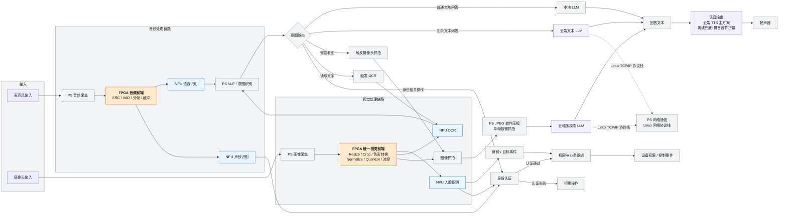

# 全链路逻辑基线

> **本页回答什么问题**：整机逻辑上有哪些节点、每个节点最终由谁算（FPGA / NPU / PS / 云端）、它在哪个阶段被做出来——一句话：**这张图就是第 ② 步（卡 M2）要照着跑通的清单，也是第 ③ 步（卡 A1–A8）要照着搬走的地图。**
> **前置阅读**：[[实施路线]]（第 ②→③ 步的先后）→ [[1-NPU模型部署]]（基线冻结）→ [[3-FPGA组件下沉]]（橙色节点的落地方法）。
> **产出物去向**：本页 §5 的映射表是 [[进度计算与实时看板]] 各阶段任务卡的来源；节点边界与接口以 [[接口契约与数据通路]] 为准；本周期 FPGA 自研范围（§4）落到 [[FPGA自研模块清单]]。

---

## 1. 这张图和"上一版图"的唯一区别

`开发流程与生命周期管理.md` 第 10 节与 `立项说明.md` 第三节把 JPEG、TTS、网络卸载画成**橙色 FPGA 节点**，早于状态源修订。**按冲突消解，这三项当前不由 FPGA 承担**，本页图中：

| 节点 | 原画法 | 本页改法 | 归属类 |
|---|---|---|---|
| JPEG | `FPGA JPEG 压缩 DCT/量化/熵编码`（橙） | `PS JPEG 软件压缩 单帧按需抓拍` | 灰 = PS |
| TTS | `FPGA TTS 后端 解码/重采样/I2S-TDM`（橙） | `语音输出：云端 TTS 主方案 + 离线兜底拼音音节拼接` | 紫 = 云端（兜底在 PS） |
| NET | `FPGA 网络协议卸载 TOE`（橙） | `PS 网络通信 Linux 网络协议栈` | 灰 = PS |

其余节点、连线、拓扑**一律不改**。拓扑（节点集合与连线）的唯一出处是 [[系统架构总览#6.1 粗粒度基本视图（无具体组件名）|系统架构总览——6.1 粗粒度基本视图（无具体组件名）]] 第 6.1、6.2 节，本页**不维护第二份拓扑**——它只在这些节点上叠加"颜色＝最终计算归属"这一层语义，并按上表改写 JPEG／TTS／NET 三处。要改连线，先改那一页，再回来同步本图；两图之间有 22 条同形连线，属于已知且被登记的耦合（D-22 第 8 条）。原设想保留在 §6 作为**候选**（不是计划）。

**依据（状态源，均为已确认）**：按需抓拍用 PS 软件单帧 JPEG，"不在当前周期自研 H.264/H.265 或 FPGA JPEG"；TTS 优先可部署方案，无法部署时用云端 TTS，离线兜底为基于拼音音节拼接的轻量合成；PS/CPU 职责里明确包含"网络、JPEG 压缩"；FPGA 自研核心 = 统一视觉前端（主）+ 音频前端（第二链路）+ 系统控制与集成。追溯见 [[状态源与决策记录]]。

---

## 2. 全链路逻辑基线图（图 8 移植，颜色 = 最终计算归属）

这张图回答的问题：**从麦克风/摄像头到扬声器，数据按什么路径流动、每一步落在哪种算力上、意图路由把S1~S5 场景分支分开在哪里。**

颜色语义：🟧 **橙 = FPGA 自研**　🟦 **蓝 = NPU（现成模型部署）**　⬜ **灰 = PS（常规软件）**　🟪 **紫 = 云端**。

**用法（这是"逻辑基线"四个字的实际含义）**：

1. **第 ② 步（卡 M2）期间所有节点都先跑在 CPU（PS 侧）上**，包括橙色节点——颜色表示的是**最终归属**，不是当前实现位置。
2. 第 ③④ 步只把橙色节点从 CPU 搬走，搬完必须回到本图做全链路回归。
3. 灰色与紫色节点在本周期**不产生 FPGA 工作量**；把它们当自研范围是范围蔓延，走 [[风险与完成判据#1. 风险登记册|风险与完成判据——1. 风险登记册]] 第 12 条。
4. 本图与电气/地址级细节无关，板级管线详图与接口信号见 [[板级管线详图]]。

---

## 3. 四条链路的读法（拆图，便于分工与验证）

| 链路 | 节点序列 | 逻辑基线（M2 全 CPU）验收点 | 最终归属变化 |
|---|---|---|---|
| 音频感知 | 麦克风→APS→AFPGA→ASR→NLP | 一句话被正确转写为文本 | AFPGA 转 FPGA（第二链路），ASR 转 NPU |
| 视觉感知 | 摄像头→VPS→VFPGA→FACE/OCR | 人脸与文字结果正确 | VFPGA 转 FPGA（主线），FACE/OCR 转 NPU |
| 意图与问答 | NLP→路由→本地 LLM / 云端文本 / 抓拍→VLM / OCR→回答文本→语音输出 | S1~S5 各走对出口 | 无 FPGA 归属变化（本地 LLM 看能否上 NPU） |
| 身份与权限 | VOICE/FACE→AUTH→CTRL→ACTION | 通过/拒绝判定正确；事件可观测 | AUTH/CTRL 保持 PS；前置图像/音频处理转 FPGA |

> 身份事件最终触发的具体业务动作仍是**待验证**（"开门/开放权限"只是示例，不视为已确定产品功能）。CAM++ 声纹为**可选功能、不列当前 P0**（已有视觉身份链路）——图中 VOICE 节点保留，但其模型侧优先级低于人脸。

---

## 4. 本周期 FPGA 自研范围（橙色节点）

**只有以下三类**：

| 类别 | 内容 | 定位 |
|---|---|---|
| **A. 统一视觉前端 VFPGA** | `video_stream_ctrl`、`video_frame_ctrl`、`resize`、`crop/letterbox`、`color_convert`、`normalize_quantize`、`buffer/line_buffer_ctrl`、`mode_router` | **主要 FPGA 核心与答辩主线**；多模型共享、可配置，而不是每个模型重复写一套 |
| **B. 音频前端 AFPGA** | `audio_stream_ctrl`、`SRC`（条件性）、`VAD`、`frame_ctrl`、`audio_buffer`、stream control | **第二条必要链路**，同步推进但边界更小；至少完成流控、分帧、VAD 和必要缓存 |
| **C. 系统控制与集成** | `config_regs`、`stream_router`、`status`、`top` | 由 CPU 配置模式/尺寸/裁剪坐标/颜色顺序/归一化参数/音频阈值/启停；向 CPU 报告帧状态、缓存状态、错误与完成事件 |

**明确不在本周期 FPGA 自研范围的三项**＝FPGA JPEG、FPGA TTS 后端、TOE 网络协议卸载。它们的当前替代方案（PS 软件单帧 JPEG／云端 TTS + 拼音音节拼接兜底／PS 侧 Linux 协议栈）已写进上面第 5 节归属表的"当前实现"行；**"为什么不做什么、什么条件下会变成做"只有一处**：[[组件选型与复用边界#十一、明确不采用／暂不采用的技术（负面清单）|组件选型与复用边界——十一、明确不采用／暂不采用的技术（负面清单）]]，下版评估的原设想见本页第 6 节。

同样不自研：完整 OCR 神经网络、YOLO/人脸/ASR 网络、DDR 控制器、通用 AXI 基础设施、自研神经网络加速器。成熟基础 IP（PLL、BRAM/FIFO、DDR 控制器、AXI/DMA、FFT）与 Linux 驱动框架、NPU SDK、官方参考工程接口**直接复用**，只要求会用（选型、配置、连接、约束、仿真、读报告），不计入团队核心 RTL。工作量以功能与验证为准，不以 RTL 行数计（模块数量口径的唯一出处见 [[FPGA自研模块清单]] 的 D5 一节）。

---

## 5. 节点 → 阶段映射表（"在哪一阶段完成"按修正后的范围填写）

| 节点 | 最终归属 | 在哪一步完成（对应卡号） | 备注 |
|---|---|---|---|
| APS / VPS 采集 | PS | 第 ② 步 · **M2** | 保持 PS，不下沉；USB 麦克风(ALSA) / USB UVC 摄像头(V4L2) |
| **VFPGA 视觉前端** | FPGA | 第 ③ 步主循环（优先，主线）· **A1–A5** | Resize / Crop·Letterbox / 色彩转换 / Normalize / Quantize / 流控·帧控制 / mode_router |
| **AFPGA 音频前端** | FPGA | 第 ③ 步主循环（第二链路，同步推进）· **A6–A7** | 流控 / VAD / 分帧 / 缓冲；**SRC 条件性**（采样率不一致才做） |
| C 类控制与集成 | FPGA | 第 ③ 步集成期 · **A8** | config_regs / stream_router / status / top；无 CPU 对位实现，判据见 [[3-FPGA组件下沉#9. 每步的验收证据口径（防止"口头完成"）\|3-FPGA组件下沉——9. 每步的验收证据口径（防止"口头完成"）]] |
| ASR / 声纹 / 人脸 / OCR | NPU | 第 ① 步 · **M1** | 现成模型直接部署；**必须先通过 iCraft 编译与算子支持验证** |
| NLP / 意图路由 | PS | 第 ② 步 · **M2** | 业务逻辑，保持 PS |
| 本地 LLM | NPU 或 PS | 第 ① 步 · **M1** | **可选演示项**（[[状态源与决策记录#D-25 · 本地 LLM 从主线交付降级为可选演示项\|状态源与决策记录——D-25]] **D-25**，不再挂主线）：看模型能否上 NPU；上不去则留 PS（Qwen2-0.5B 为候选） |
| 云端文本 / 多模态 LLM | 云端 | 第 ② 步 · **M2** | 走网络；不绑定单一服务商 |
| 抓拍 + JPEG 压缩 | **PS（软件单帧）** | 第 ② 步 · **M2** | **当前不由 FPGA 承担**；FPGA JPEG 为下版候选 |
| TTS / 语音输出 | **云端主方案 + PS 离线兜底** | 第 ② 步 · **M2** | **当前不由 FPGA 承担**；FPGA TTS 为下版候选 |
| 网络通信 | **PS（Linux 协议栈）** | 第 ② 步 · **M2** | **当前不做 TOE 卸载**；TOE 为下版候选 |
| 缺算子模型 | （条件）FPGA 自定义算子 | 第 ④ 步（条件项）· **A9** | **非预设必做**；见 [[算子缺口处理]] |
| 身份认证 / 权限与业务逻辑 | PS | 第 ② 步 · **M2** | 认证通过→CTRL，失败→DENY |

> **本表不逐行标状态**：它只回答"这个节点最终归谁算、在哪一步动它"。进度真值只有一处——[[进度计算与实时看板#3.1 任务卡总账（唯一进度真值，一行一卡）|进度计算与实时看板——3.1 任务卡总账（唯一进度真值，一行一卡）]]总账，勾打在 [[清单]]。项目当前真实状态：板子已可经串口与 SSH 登录（2026-09-28，[[状态源与决策记录#D-24 · 板子已在手上并且能登进去：全库"尚未拿到悟净板"口径作废|状态源与决策记录——D-24]] **D-24**），**已有三条单命令级 E5 板端读数**（09-27 本机串口会话的 `rc.local`／`ethtool -P`／DWMAC 报错，D-24 第 5 条），但**端到端功能在板上一次都没跑过**；依赖板卡的卡解锁条件见 [[进度计算与实时看板#4. 阻塞清单|进度计算与实时看板——4. 阻塞清单]]。

---

## 6. 若未来上 FPGA 时的原设想（候选，不是计划）

保留旧文档的下沉理由，仅作下版评估输入；**本周期不排期、不投人力、不进台账计分**。

| 候选项 | 原设想下沉内容 | 当时的理由 | 触发下版评估的信号 |
|---|---|---|---|
| FPGA JPEG | DCT 离散余弦变换、量化、熵编码 | 高度数据并行与流水线特征，适合硬加速以降低 CPU 开销 | 抓拍频次显著上升，或 PS 软件压缩成为可测量的端到端瓶颈 |
| FPGA TTS 后端 | 音频流解码、重采样、I2S/TDM 物理层驱动 | 需硬实时与确定性时序 | 出现无公网的长期演示场景，或云端 TTS 延迟不可接受 |
| TOE / MAC 网络卸载 | 连接云端 LLM 的 TCP-IP 卸载、MAC 层处理 | 适合 FPGA 实现线速数据包解析 | 网络吞吐成为实测瓶颈（当前无此证据） |

> 三项若要转正，必须先给出**实测瓶颈数据**（同 [[算子缺口处理#5. 进入路径④ 的三条评估门槛（缺一不可）|算子缺口处理——5. 进入路径④ 的三条评估门槛（缺一不可）]] 的门槛逻辑），并且不得挤占 VFPGA/AFPGA 的既有排期。

---

## 7. 用这张图做验收的三张检查单

| 检查单 | 时机 | 怎么做 |
|---|---|---|
| M2 全链路打通 | 冻结 `baseline-v1` 前 | 沿图逐节点确认"有真实 CPU 实现，不是桩"；再跑 S1~S5 各一次 |
| 黄金基线覆盖 | 打 `baseline-v1` 前 | 图上每个节点至少有一套输入/输出向量落在 `deploy/golden/`；缺向量的节点不得进下沉队列 |
| 第 ③ 步下沉完整性 | 每个组件收尾 | 确认该橙色节点的 CPU 通路仍在、开关仍能切回、切回后本图全链路回归仍通过 |

---

## 相关页面

[[实施路线]] · [[1-NPU模型部署]] · [[3-FPGA组件下沉]] · [[算子缺口处理]] · [[进度计算与实时看板]] · [[状态源与决策记录]] · [[排期与分工]] · [[系统架构总览]] · [[板级管线详图]] · [[FPGA自研模块清单]] · [[接口契约与数据通路]] · [[组件选型与复用边界]] · [[2-CPU可用链]]
