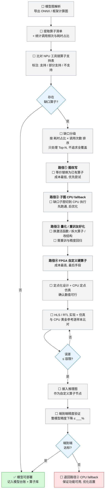

# 算子缺口处理

> **本页回答什么问题**：某个现成模型 NPU 工具链编不过 / 跑不动时，按什么顺序试哪几条路，什么条件下才允许动"用 FPGA 写自定义硬算子"这张最贵的牌。
> **前置阅读**：[[1-NPU模型部署]]（缺口在本页 A3「转换成功?」判定处产生）→ [[3-FPGA组件下沉]]（路径④ 的实现与验收复用它的 8 步）。
> **产出物去向**：算子缺口登记表 → [[进度计算与实时看板]] 加速期；每一次升级到路径④ 的判定 → 决策记录（[[状态源与决策记录]]）；最终模型结论 → 模型台账。

---

## 1. 本页的两条前置结论（先读，避免走错方向）

| 结论 | 内容 | 可信度 |
|---|---|---|
| **CustomOP 不是预设必做项** | 旧文档把第 ④ 步当作"第四阶段主线"。**以状态源为准**：只有 iCraft 编译/profiling 发现**值得硬件化的瓶颈**后才评估。第 ④ 步在本项目里是**条件项**，不排主线、不承诺产出 | **已确认** |
| **成本顺序不可颠倒** | 算子缺口优先走「图改写 → 子图 CPU fallback → 量化/重训友好化」三级便宜路径，**先穷尽便宜的办法，最后才上 FPGA**。自定义硬算子是成本最高、周期最长、风险最大的一步 | **已确认** |

这两条属于 manifest 冲突消解的第三处，依据与追溯见 [[状态源与决策记录]]。

---

## 2. 触发条件（什么时候进入本页流程）

| # | 触发信号 | 出现在哪一步 | 立刻做什么 |
|---|---|---|---|
| 1 | iCraft/NPU 工具链转换报错"算子不支持/部分支持" | 模型部署 A3（图 4） | 登记缺口，进入 §3 流程的路径① |
| 2 | 模型图解析发现 NPU 算子支持表覆盖不到的算子 | A2 前置分析 | 同上 |
| 3 | 整图可编但性能极差：某算子耗时占比畸高 | 板端 profiling（⛔ 未到板前无法取得） | 进入瓶颈评估，**先按 §4 的成本门槛判是否值得硬件化** |
| 4 | 量化后精度下降超容限，且定位为特定算子 | A6/A7 | 走路径③（量化/重训友好化） |
| 5 | 子图只能靠 CPU 跑，全链路延迟不达标 | A8/A9 | 走路径②→③→瓶颈评估，不直接跳到④ |

> **不触发本页的情况**：模型只是"理论可部署但还没试过"。**理论不等于已部署**，没有 iCraft 编译结果之前，不许先假设存在算子缺口、更不许提前立项写硬算子。

---

## 3. 流程图（图 7 完整移植）

这张图回答的问题：**从模型图解析到"模型可部署"之间有哪些岔路，四级路径按什么顺序穷尽，路径④ 失败时的退路是什么。**



**读图三条要点**：

1. `D3 → 否 → D15` 是正常出口——**大多数模型不该走到 D8**。
2. `D5 → D6 → D7 → D8` 在图上是顺序链，含义就是**四级成本递增，逐级穷尽**。
3. `D14 → 否 → D16` 是唯一硬退路：路径④ 端到端不达标时**退回 CPU fallback 保证功能可用**，优化后置。绝不因为"硬算子已经写了"就把功能交付押在它身上。

---

## 4. 成本递增的四级路径（本页核心）

| | 路径① 图改写 | 路径② 子图 CPU fallback | 路径③ 量化/重训友好化 | 路径④ FPGA 自定义硬算子 |
|---|---|---|---|---|
| 做法 | 把缺口算子等价替换为 NPU 已支持的算子组合（改的是**计算图**，不改权重） | NPU 跑子图 + CPU 跑缺口算子，中间用内存/张量交接 | 换激活函数、拆大算子、改结构，使模型落在 NPU 友好集合内，**需重训与精度回归** | 用 HLS/RTL 把该算子做成硬件模块，接入推理图 |
| 成本 | **最低** | 低 | 中（含重训算力与时间） | **最高** |
| 精度风险 | 等价改写→几乎无；近似改写→需 A6 复测 | 无（CPU 侧就是参考实现） | 有，必须重跑整模型精度回归 | 有（定点化），必须逐样本比对 + 端到端验证 |
| 性能风险 | 低 | 高：CPU/GPU 与 NPU 之间来回搬数据，可能比整图 CPU 还慢 | 低到中 | 收益不确定，**可能做了不如不做** |
| 对交付的影响 | 无额外交付物 | 多一条 CPU 分支代码，需纳入回归 | 模型版本变化，台账与基线要重记 | 新增 RTL 模块 + 验证 + 开关，占用加速期名额 |
| 进入门槛 | 默认先试 | 路径① 走不通即进 | 路径② 能跑但精度/延迟不达标 | **必须同时满足 §5 三条评估门槛** |
| 退出判据（可离开本级） | 转换成功或明确判定"无等价改写" | 全链路功能跑通（先跑通，后优化） | 精度回归达标或判定不可行 | 见 §3 的 D11 与 D14 两道判定 |
| 本项目里最可能用到它的模型 | 通用，任何候选模型 | 本地 LLM（Qwen2-0.5B 算子面最广）、ASR（Paraformer／CitriNet-CTC） | OCR / 人脸 / 目标检测的量化前处理 | 只在 profiling 指到明确热点时 |

**顺序纪律**：不允许出现"路径① 没试过就直接评估 FPGA 硬算子"。台账（§7）的"尝试路径"列就是用来抓这个的——如果那格只写了"④"，就是流程违规。

---

## 5. 进入路径④ 的三条评估门槛（缺一不可）

| # | 门槛 | 判据 | 证据要求 |
|---|---|---|---|
| 1 | **确实存在缺口**，且便宜路径已穷尽 | ①②③ 均已尝试并记录结论（含"已尝试但不可行"的具体原因） | 台账"尝试路径"列完整 |
| 2 | **瓶颈值得硬件化**：该算子/子图的耗时占比在整链路中足够大 | 按「耗时占比 × 调用次数」排序，只处理 **Top-N**，不追求全覆盖；**占比阈值登记在 [[2-CPU可用链#5. 黄金基线冻结物清单（B7 的交付定义）\|2-CPU可用链——5. 黄金基线冻结物清单（B7 的交付定义）]]"未定阈值"表**，冻结前本级不得启动 | 板端 iCraft profiling / 运行计时数据（⛔ 未到板前无法取得，见 §8） |
| 3 | **硬件化后仍守得住质量**：定点化可行、误差在容限内、资源在预算内 | 先做 CPU 定点仿真 + 资源估算再决定是否开工 | 定点仿真误差分布 + 综合资源报告 |

**反面门槛同样要记**：如果瓶颈在**访存或 NPU↔CPU 数据搬运**而不是算子本身，硬算子不会带来收益——这种结论也要写进决策记录，避免下个模型重犯。

---

## 6. 路径④ 的执行细节（复用上页 8 步，不另起流程）

| 步 | 动作 | 判据 | 备注 |
|---|---|---|---|
| 6.1 | 冻结该算子的 **CPU 黄金参考**（就是路径② 的 CPU 实现） | 输入/输出向量可复现 | 容限**必须先定再开工**（[[3-FPGA组件下沉]] 铁律①） |
| 6.2 | 定点化设计 + CPU 定点仿真（D9） | 定点仿真误差已在容限内 | 位宽/饱和/舍入策略写进设计说明 |
| 6.3 | HLS/RTL 实现 + testbench 仿真（D10） | 编译退出码 0、testbench 自检 PASS | 本地 Icarus 环境已可用 |
| 6.4 | 逐样本等价性比对（D11 判定） | 误差 ≤ 容限 → 过；不过 → **回 6.3 改实现**，不放行 | 比对脚本与黄金基线共用一套 |
| 6.5 | 接入推理图，作为自定义算子节点（D12） | 整图可编、可运行 | NPU 图 + 硬件节点的接口属**待验证**，需参考工程核对 |
| 6.6 | 端到端精度验证（D13/D14） | 整模型精度下降 ≤ ___%（**取值登记在 [[2-CPU可用链#5. 黄金基线冻结物清单（B7 的交付定义）\|2-CPU可用链——5. 黄金基线冻结物清单（B7 的交付定义）]]"未定阈值"表，本步启动前必须已填**） | 不达标 → 退路径②（D16），功能可用优先 |
| 6.7 | 运行时开关 + 全链路回归 | 可切回 CPU 且 S1~S5 全绿 | 与下沉循环 ⑦⑧ 完全一致 |

---

## 7. 算子缺口登记表（一个缺口一行；空着就写空）

| # | 模型 | 缺口算子 | 调用次数 | 耗时占比 | 缺口分级 | 尝试路径 | 各级结论 | 端到端结果 | 误差 | 状态 |
|---|---|---|---|---|---|---|---|---|---|---|
| 1 | YOLOv8n（ZG int8） | **无**——整图 158 节点全部落到 `@zhuget(330)`，host 只剩 Input/Output 两个端点（见 §7.1） | 不适用 | 未测（本板 profiling 未做） | 不适用 | 未触发（D3 判"否"→ D15） | ①②③④ 均无需 | 未上板 | — | ✅ 有结论（结论＝不做硬算子；证据等级 A：编译产物 JSON 直读，**非板端实测**） |
| 2 | | | | % | Top-N 第＿ | ①→②→③→④ | | | | ⬜ |

填写规则：

- **"尝试路径"列必须逐级记录**，写了 ④ 就必须同时有 ①②③ 的结论；
- "各级结论"记的是**为什么这一级不成立**（例：路径① 无等价改写；路径② 数据搬运使延迟反升；路径③ 需重训且无算力）；
- 状态只有四种：⬜ 未开始 / 🔄 处理中 / ⛔ 阻塞（写清解锁条件）/ ✅ 有结论（含"结论=不做"）；
- **"设计性 host 回退"不进本表**（10-30 加）。`_ZG.json` 里的 `@hostt` 节点分两类，混记就把账做错了：**①设计性回退**＝官方支持表直接标 `×`＋备注"Host 回退"（`Gather` 三档全 `×`），或图合同本来就把这个算子放在 host（LLM 的 `RopeDynamic`／`CausalMask`／`SliceDynamic`——这三个在厂商表里连行都没有）；**②真缺口**＝原图要求、编译器拒收或降级后功能变样的那个算子。只有 ② 占一行；① 记在结构门禁的读数表里（host 名字的**集合与条数**），别把"host 有 61 个节点"读成 61 个缺口——Qwen3 件实测 61 个 `@hostt` ＝ `Input`／`Output` 各 1 ＋ `SliceDynamic` 56 ＋ `Gather`／`RopeDynamic`／`CausalMask` 各 1，**缺口仍是零**（见 [[LLM上板要求与候选模型对照]] 第四、五节与 [[NPU模型上板出指标SOP]] 第四节补条）；
- **结论为"不做"也是完成**，且往往是正确的完成——它意味着缺口被便宜路径吃掉或被证明不值得硬件化。

### 7.1 YOLOv8n 的 D2 三态标注（2026-10-04 本机取证，A 级）

**取证方式**（可复跑，无需板子）：iCraft 3.39.0 已装在本机 `C:\Icraft\CLI v3.39.0`（文档 5750 个文件在 `…\CLI v3.39.0\docs`，含 `ops/spec` 114 页与 `adapt/index_zhuge.html`）；在 `S:\work\WCIS\wcis-models\modelzoo\yolov8\yolov8_icraft\2_compile` 下执行

```
icraft compile config/ZG/Yolov8_int8.toml
```

退出码 0，五段产物全部落在 `3_deploy/imodel/ZG/int8/`（`Yolov8n_parsed / _optimized / _quantized / _adapted / _ZG` 各 `.json`+`.raw`；最终 `.raw` 4,722,587 B，md5 前缀 `09f59e39`）。三态标注直接读 JSON 的 `ops[].compile_target` 与 `_type_key`：

| 原图算子（parse 后 158 节点） | 个数 | 最终 ZG 图里的去向 | 三态 | 诸葛侧依据 |
|---|---|---|---|---|
| Conv2d | 63 | **65** 个 HardOp（多出的 2 个由 `ZGPreMethodOps2Conv2dPass` 把 `pre_scale` 除法折成卷积） | **支持** | `ZhugeLayoutPass::conv2d_layout` |
| SiLU | 57 | **0**——全部融合进 Conv2d，最终图无独立 SiLU 节点 | **支持** | `silu_layout`（融合是优化，不是缺口） |
| Concat | 13 | 13 | **支持**（约束：常量侧 ≤2 输入；日志出现 4 次 `ConcatNormratio: change input normratio to same value` 警告，工具自行抹平） | `concat_layout` |
| Split | 8 | 8 | **支持** | `split_layout` |
| Add | 7 | 6（1 个被融合） | **支持** | `add_layout` |
| MaxPool2d | 3 | 3 | **支持** | `maxpool_layout` |
| Upsample | 2 | 2 | **支持**（默认 `NEAREST`；双线性会被 `ConvertUpsampleBili2NearestPass` 改写，本图未触发） | `ZhugePadLayoutPass::upsample_layout` |
| Cast | 1 | 1（量化阶段曾扩到 13，适配后收敛回 1） | **支持** | `cast_layout` |
| Multiply | 1 | 折入相邻节点 | **支持** | `multiply_layout` |
| SwapOrder | 1 | 折入相邻节点 | **支持** | `swaporder_layout` |
| Input / Output | 各 1 | **留在 `@hostt`** | **端点，不是缺口** | — |
| （新增，非原图算子）Copy / Reshape / Matmul | — | 17 / 3 / 1 个 HardOp | 布局搬运与头改写产物 | — |
| DetPostZG（CustomOp） | 1 | **`compile_target = @fpgat`** | **不在 NPU、也不在 CPU，在 PL** | `pass_on = customop.DetPostZGPass` |

**这张表推翻了本页此前的两条预设**：

1. 官方 YOLOv8 工程在 ZG330 INT8 下 **D3 判"否"、直接走 D15**，不需要路径①②③④ 任何一级；本页 §10 里"YOLOv8n 通过或路径①"的预判取"通过"。
2. `DetPost` 类后处理**确实**是硬件算子，但归属是 **PL（`@fpgat`）**，不是 NPU 阵列——这与 [[板卡镜像实测取证]] 里 DetPostZG 走 PLDDR 的观测一致。
3. **仍未取得的数据**：耗时占比（本板 profiling）、端到端精度与延迟（上板）。厂商随工程附带的 `3_deploy/metrics/logs/BY_int8|BY_mix/Yolov8n_time.txt` 是**布衣 100TAI** 的数，可当量级参考，不得填进本页 §7 的"耗时占比"列。

### 7.2 交叉复现：同一套编译换到 Linux 容器跑（2026-10-05 实测，A 级）

换环境的目的只有一个——**确认上表不是 Windows 版工具链的偶然结果**。方法：`podman run --rm -v /mnt/s/apps/llm/agentwork/tts_build:/build -w /build/2_compile localhost/fpai-ub2004:tts-saved sh -lc 'icraft compile config/ZG/Yolov8_int8.toml'`（容器内是 ICraft 3.39.0，`3.39.0.0-431be90`，与 Windows CLI 同一 commit）。

| 阶段 | Windows CLI | `tts-saved` 容器 | 结论 |
|---|---|---|---|
| parse / optimize / quantize / adapt | 通过 | 通过 | 逐阶段**节点数与 `compile_target` 分布完全一致**：quantized 168（host 2 / zhuget 166）、adapted 179（host 2 / zhuget 176 / **fpgat 1**）→ **§7.1 的"零算子缺口"与"DetPostZG 归 PL"跨平台复现** |
| generate（出 `Yolov8n_ZG.json/.raw`） | 通过 | **fatal 中断** | 容器缺库：`Exception info : File "/lib/x86_64-linux-gnu/libicraft_zhuge_codegen.so" does not exist!`（`dll.cpp:37`，`icraft-generate` 的 `LoadDLLInBinDir`）。容器里只有 `libicraft_buyi_codegen.so`；Windows `bin\` 有 `icraft_zhuge_codegen.dll` 与 `zg_codegen.dll`。**＝这份 amd64 包的 codegen 只带了布衣，ZG 档最终产物在 Linux x86_64 上出不来** |
| 参数字节级 | — | — | 各阶段 `.raw` **大小相同但几乎逐字节不同**（`parsed.raw` 两边都是 12,609,128 B，其中 12,069,821 个字节位置取值不同），magic `ICRAFT_RAW` 一致、头部段计数字段不同（Win `0x18d` / Linux `0x1de`）；`.json` 里量化 scale 只差在小数第 8 位（`0.045796867` vs `0.045796864`）。**判读：D2 这类"结构＋后端归属"结论跨平台稳；参数字节与 md5 不可跨平台比对，别拿 md5 当验收**（原因未核，C） |

**顺带记一条与算子无关但会卡住所有人的工具链坑**：官方 `config/ZG/Yolov8_int8.toml` 的 `forward_list = "./qtset/coco.txt "` **值里带尾随空格**——Win32 吃掉尾空格所以没事，Linux 当它是另一个文件名，`icraft-quantize` 在 `CalibratePass.cpp:1451` fatal `File ./qtset/coco.txt  does not exist`。**两次失败上层 `icraft` 都返回 0**，所以判编译成败只能看日志里的 `[F]`／`[E]` 行与产物是否齐全，退出码不可作数。

### 7.3 ZG 档内两条通路（PSIN／PLIN）各自的图与前端合同（2026-10-05，A 级）

同一个 YOLOv8n、同一个诸葛后端，官方给两份 toml，**产物与喂图合同都不同**，上板前必须认准是哪一档：

| | `Yolov8_int8.toml`（PSIN） | `Yolov8_8_plin.toml`（PLIN） |
|---|---|---|
| 输入 | `[1,640,640,3]` UINT8 NHWC | `[1,512,960,3]` UINT8 NHWC |
| 量化差异 | `no_transinput = true`（关掉"输入全体减 128、首层卷积 bias 补偿"的动态范围平移） | **没有这一行**＝默认 false，做平移 |
| 生成差异 | — | `no_mergeops = true`、`etmopt = 0`（不合并 HardOp） |
| 最终图 | 122 节点＝HardOp **119** ＋ `@fpgat` DetPostZG 1 ＋ Input/Output 2 | 124 节点＝HardOp **121** ＋ `@fpgat` DetPostZG 1 ＋ Input/Output 2 |
| 算子缺口 | **零**（与 §7.1 一致） | **零**（同一结论） |
| 产物 | `imodel/ZG/int8/Yolov8n_ZG.{json,raw}`，4,722,587 B，md5 前缀 `09f59e39` | `imodel/ZG/int8_plin/Yolov8n_ZG.{json,raw}`，4,882,117 B，md5 前缀 `180576b3` |
| **网络自带 tag** | `bgr_order: `**`False`** | `bgr_order: `**`True`** |

**最后一行是上板最容易踩的坑**：PLIN 那份 toml **没写** `image_channel_order`（PSIN 写了 `"rgb"`），于是烧进 JSON 的 `tags.bgr_order` 一个 False 一个 True。`bgr_order` 是 host 后端 `Image2Tensor(img_path, value, bool bgr_order = true)` 的读图通道序形参名（`C:\Icraft\CLI v3.39.0\docs\hostbackend\_cppapi\function_utils_8h_*.html`，A）——**＝这个模型自报要 BGR 还是 RGB**。换档时前端喂的字节顺序必须跟着改，否则不报错，只是精度静默崩；若通道序最终由 PL 侧负责，这一位就是 PL 配置的验收项之一。

**HardOp 数差 2（119→121）来自 `no_mergeops = true`**：PLIN 不合并算子段。**不影响"有没有缺口"的判定**，只影响段数与调度——别把段数当延迟或功耗的依据（§7 的"耗时占比"列仍只能由板端 profiling 填）。


---

## 8. 无板条件下能推进到哪一步

| 步 | 状态 | 说明 |
|---|---|---|
| D0 模型图解析（导出 ONNX/框架计算图） | 🔄 部分完成 | **YOLOv8n 已完成**（直接用厂商 `fmodel/yolov8n_640x640.pt`，与 3.39.0 同 tag）；其余模型未做。与板无关 |
| D1 算子清单 + 调用频次统计 | 🔄 部分完成 | **YOLOv8n 已完成**（158 节点 / 12 种算子，见 §7.1）。**耗时占比**需要运行数据 |
| D2 比对 NPU 工具链算子支持表 | 🔄 部分完成 | **YOLOv8n 已完成，结论＝零缺口**（§7.1）。方法已跑通：本机 `C:\Icraft\CLI v3.39.0` 编译后读 JSON 的 `compile_target`；其余模型照此复跑 |
| D4 缺口分级 | 🔄 部分可 | 静态排序（调用次数）可做；`耗时占比 × 调用次数` 需板端 profiling |
| 路径① 图改写 | ⬜ 可推进（容器内可重编验证） | 最终运行仍需板 |
| 路径② 子图 CPU fallback | ⬜ 可推进（x86 上先跑通） | 也正是黄金基线的 CPU 参考来源 |
| 路径③ 量化/重训友好化 | 🔄 受算力与到板影响 | 重训与精度回归可在 PC 做，实测在板 |
| **路径④ 的门槛 2（profiling 数据）** | ⛔ **阻塞** | ~~拿到悟净板~~（已满足，**D-24**）：剩下的解锁条件是**交叉编译环节关闭 + 板端 NPU 运行环境就绪**。**无 profiling 数据即无进入路径④ 的资格** |

**结论**：无板期间本页的正确产出是「缺口清单 + 三态标注 + 便宜路径结论」，**不是** RTL。任何在 ⛔ 状态下开写的硬算子都属于流程违规。

---

## 9. 决策记录要求

| 情形 | 必须留什么 | 记在哪 |
|---|---|---|
| 任一模型出现缺口 | 缺口算子、支持表结论、便宜路径各级尝试结果 | §7 登记表 |
| **每次走到路径④（无论最终做或不做）** | **profiling 数据**：耗时占比、调用次数、测量条件（输入集、是否绑核、NPU/Runtime 与位流组合）+ 三条门槛逐条勾选 + 结论与理由 | [[状态源与决策记录]]，并在 §7 表引用条目号 |
| 决定换模型 | 原模型卡在哪个算子、为什么不可绕过、新模型对系统能力的影响 | 同上 |
| 路径④ 中途放弃 | 已投入内容、放弃判据（D11/D14 具体超差数据）、退回 CPU 的验证记录 | 同上 + 风险登记册 |

> 一句话纪律：**没有 profiling 数据，就没有资格谈自定义硬算子。** 这条是防止两人团队把最贵的资源押在没被证明的问题上。

---

## 10. 候选模型的预置判断（不是结论，只是排队依据）

本表与 [[1-NPU模型部署#3. 模型台账（每上一个模型填一行）|1-NPU模型部署——3. 模型台账（每上一个模型填一行）]]台账**分工不同**：那一页登记"选哪个模型、转换与实测进度"，本页只登记"它最可能卡在哪一级路径、现在该做什么准备"。模型状态以那一页为准，本页不重复标注。

下表**不构成任何"已验证"结论**：所有可信度都停在 **候选/待验证**，直到 iCraft 编译结果与板端运行结果拿到为止。它的作用只是决定"先编哪个、先给谁留 CPU fallback"。**已出局的候选不进本表**（没有"该做的准备"可言）：SenseVoice 的出局理由与退路只在 [[组件选型与复用边界#三、识别模型|组件选型与复用边界——三、识别模型]]登记，取证见 [[状态源与决策记录#D-19 · 模型可行性的一级依据改为厂商《模型信息汇总》，废弃"平台依据强/弱"的口头判断|状态源与决策记录——D-19]] D-19。

| 模型（候选） | 用途 | 预判的风险面 | 最可能的落点 | 现在该做的准备 |
|---|---|---|---|---|
| Paraformer | ASR 主选 | **厂商实测表内无条目 → 零平台依据**；CIF 采样与注意力/解码结构算子面广 | 路径①或②；上不去则**换模型**（四步路线的第一条就是"不行就换模型"） | 先做 D0~D2，把三态标注表拉出来 |
| CitriNet-CTC（中文） | ASR 备选① | 纯 1D 卷积＋CTC，**无 attention、无 RNN、无 embedding 查表**，落在厂商已证明能跑的算子集合内（同表音频侧 EcapaTDNN/CAM++ 均"已入库·完美"） | 预期通过或仅路径① | 优先编它做"能不能通"的最小验证 |
| Zipformer-streaming-CTC | ASR 备选② | 含 attention 掩码，与第 167 行 `whisper`（不支持算子 `-inf`）同类风险 | 路径①或② | 排在 CitriNet 之后 |
| Qwen2-0.5B | 本地 LLM（**可选演示项**，D-25） | **行114 已入库、平台就是 `30`、阶段细节只有"速度慢"**——所以缺口风险反而不是第一位；第一位是**工具链变体**：icraft 版本写的是 `3.33.1-llmgenai`、备注"适用于 icraft-llm-genai"，本地没有这个包 | 先解决工具链与权重获取；算子层面按 §10.1 的 `embedding`/`Gather` 风险预判 | **按 D-25 退出主线**：向厂商问 `icraft-llm-genai` 与 `qwen2_icraft_runtime_demo` 这件事**照旧进行**（它就是这条路的触发条件），但拿不到不算交付风险；"本地 LLM 可退到 PS 跑"的架构余量保留。**10-30 实况回写**：这条路既没等 `3.33.1-llmgenai` 也没等厂商回复——本机通用 `icraft` 3.39.0 CLI 直接吃改写完的 ONNX 就出了 `_ZG` 件，10-14 厂商 Qwen2 那颗在 ZG330 上真出 20 个 token／2.83 tok/s（A，见 [[Qwen3按厂商Qwen2配方迁移]]）。**真正的第一道墙不是工具链变体、也不是算子缺口，是前端摄取门＋图合同**（四道门与判据见 [[LLM上板要求与候选模型对照]] 第二～四节）。上面那句"第一位是工具链变体"**判错了，但保留原文**：它记的是当时"该向谁问什么"，那是这条路的触发条件 |
| MobileFaceNet + ArcFace | 人脸识别 | **厂商表 223 行里没有任何人脸条目**（与人脸沾边的只有视线估计 GazeTR 行35、MPIIFaceGaze 行36）→ 与 Paraformer 同为**零平台依据**；主干较规则，ArcFace 只在训练侧 | 大概率直接通过，但**没有任何人替我们验过**；量化后需 A6 复测 | 参考输出与比对脚本先备好；编译顺序上它其实该往前提（无依据 ≠ 低风险） |
| YOLOv8n | 目标检测（唤醒视觉链路） | **全表依据最硬的一条**：行27 yolov8 已入库·完美·通过测试·平台 `100, 30`·icraft 3.33.1·更新日期 2026-02-13，部署工程 `AIBS/yolov8` 可直接拉 | 预期直接通过；风险只在**我们自己的输入尺寸/前处理与官方工程不一致** | 前处理与 VFPGA 对齐；照抄官方工程的输入约定，别自己改结构 |
| PP-OCR（检测+识别）/ CRNN | OCR | 整包 PP-OCR **表内无条目**；拆开后是 CRNN 行83（已入库·完美·`100, 30`，但备注"须手动配 mmlab 环境，暂未测试"）、CRNN_Chinese 行84（待入库，"8bit 可运行，16bit 内存爆炸，需 argmax 硬算子优化"）、DBNet 行88（待入库·速度慢·仅 `100`）、SVTR 行85（**不支持·算子不支持**） | 识别链走 CRNN 可行；**检测头是唯一真正的不确定点**，中文识别要看 8bit 这条路 | 确认 CTC/解码由 NPU 还是 PS 承担；先按"CRNN 已入库"做最小验证 |
| CAM++ | 声纹（**可选，不列当前 P0**） | 已有视觉身份链路，优先级最低 | 不做也要有结论 | 排在最后，缺资源时直接延后（结论="本周期不做"） |

**排队原则**：**先编 ASR**（CitriNet → Zipformer），因为它最可能触发缺口、又最影响全链路设计。**最晚发现的缺口 = 最贵的缺口。** 本地 LLM 原来与 ASR 并列排在前两位，**2026-09-28 按 [[状态源与决策记录#D-25 · 本地 LLM 从主线交付降级为可选演示项|状态源与决策记录——D-25]] D-25 退出主线队列**——它卡的是工具链变体而不是算子，等厂商给包再进队；人脸虽然零依据，但主干算子规则，排在 ASR 之后、OCR 之前。

## 10.1 厂商表里已经实测出来的不支持算子（做 D2 标注时照抄，别自己发明）

来源：`模型信息汇总.xlsx`「模型信息汇总」表全 223 行里被标为"算子不支持 / 不支持导出 / 编译 bug"的 **44 行**，"备注"列逐条写明了卡住的算子名。这是**别人已经踩完的坑**，比任何工具链文档都硬。

| 缺口类别 | 已确认不支持的算子 | 出现处（行号） | 对第 10 节候选的含义 |
|---|---|---|---|
| **数学/逐元素** | `div`、`pow`、`reciprocal`、`floor_divide`、`floor`、`reducemean`、`cumsum`、`clamp`、`exp`、`round`、`ne`、`where`、`arange` | restormer 行99、omni-sr 行102、SAM 行107、fastspeech2 行198、pointpillars 行214 | **最高频的一类**。任何含归一化/掩码/位置编码的结构都会撞上；路径①（等价替换）通常能解，因为它们是标量语义 |
| **注意力填充值 `-inf`** | 常量 `-inf` | **whisper 行167，FAPI 平台就是 `30`** | **悟净板上唯一被实测证实的语音类硬缺口**。直接波及 Zipformer-CTC 的 attention 掩码（所以它排 CitriNet 之后）；CitriNet 无 attention 因此不撞。**LLM 那一侧的答案与直觉相反（10-30 补）**：Qwen3 件里的掩码是 `CausalMask`（属性 `fill_value="-inf"`），编译通过、归属 `@hostt`，**不是缺口**——它和 whisper 卡的那个 `-inf` 不是同一个算子，别拿这条行号去预判 LLM（实读见 [[LLM上板要求与候选模型对照]] 第四节） |
| **ASR 编得过但 int8 掉精度** | — | conformer 行197（领域 ASR）**已入库、阶段细节"精度低"、备注"by int8 量化精度差"**，icraft 3.31.0，平台仅 `100` | 这是**比"不支持"更阴的坑**：转换一次通过、台账却永远 ✅ 不了。**attention 系 ASR 量化后精度差已被实测证明过一次**，Paraformer 若编译通过，A6/A7 要按 int8/16bit 分别复测（CRNN_Chinese 行84"8bit 可运行、16bit 内存爆炸"是同一类问题的另一面） |
| **索引/搬运** | `Gather`、`GatherND`、`ScatterND`、`NonZero`、`embedding`、`unbind`、`split_with_sizes`、`repeat`、`to`、`zeros`、`tile` | fastflownet 行97、raft 行103、SAM 行107、pointpillars 行214、fastspeech2 行198 | **`embedding` 是 LLM 的头号风险**（Qwen 的词表查表与 KV cache 索引都要它）；CTC 解码若在图内也会撞 `Gather`。**10-30 实测：这个预判落空了**——词表查表在 ZG 件里就一个 host 侧 `Gather`（官方标 `× Host 回退`，NPU 不做但编译不报错），KV 索引那 56 条是 `SliceDynamic` 也在 host；**它既不是编译失败也不是缺口，代价全在运行时的搬运与 CPU 时间**（口径见 §7 新增那条"设计性 host 回退"） |
| **采样/插值** | `GridSample`、`upsample_trilinear3d`、`MaxUnPool` | 光流系（行97/103/104/106）、T-RODNet 行205、DIM 行209 | 检测/分割头的 deformable、ROI align 类结构要避开；常规 `Upsample` 不在黑名单内 |
| **卷积变体** | `conv1DTranspose` / `conv_transpose1d`、`stride!=1` 的 `conv2dtranspose`（数组越界）、3d 反卷积、`unfold`、`slice_conv(inplace)` | hifigan 行131、FRCRN 行208、GTCRN 行207、rodnet 行188、MDRN 行101、PANN-10 行115、SCNN 行116 | **语音增强路线整条被堵**：GTCRN/FRCRN 都卡在这里（且 GTCRN 是工具链自身越界报错，不是我们的错）。若将来想做 NPU 端降噪，先排除这两个；**声码器（hifigan 类）同理不可用** |
| **复数/频域/矩阵求逆** | 傅里叶变换、复数计算、`linalg_inv` | deeprft 行100、MVDetr 行129、mvder 行223、3DROM 行224 | 频域增强（如 DeepFilterNet 类）走不通，一律退回 PS 用 FFT 库做 |
| **其它** | `ROIAlign`/`PrRoiAlign`、`feature_dropout_`、`inplace` 类 | keeptrack 行122、globaltrack 行123、UNetFormer 行210、PANN-10 行115 | 跟踪头结构不要选 two-stage ROI 系；**导出前关掉 inplace** |

**三条可直接抄的作业**：

1. **路径① 是厂商在用的常规手段，不是我们的取巧**。行108 UPR-Net 的备注写得很清楚：把不支持的结构**改为网络输入**、做**等价替换**，消除了 `floor_divide`/`to`/`zeros`，只剩 `clamp`、`div`（tensor 相除）没解决。也就是说"图改写能救大部分、救不了的是 tensor-tensor 数学运算"——**这就是 D2 标注时的分级依据**。
2. **导出侧的坑与算子侧同等致命**：行193 DeepFillv1 因 TensorFlow 框架不支持导出、行203 TransRAD 因权重与结构不符、行111 MCGaze 不支持导出、行108 因 `cupy` 计算无法导出。**拿到权重先确认能导出干净 ONNX，再谈算子**（对应 [[1-NPU模型部署]] A1 的"缺参考输出就无法做 A6"）。

> 使用限制：本表**只能用于"预判风险、决定先编谁"**，不能填进台账当结论。厂商条目多为 icraft 3.7.1～3.33.1、且大量只标了平台 `100`；本地是 3.36.1 / 3.39.0，**版本代差可能已消掉某些缺口，也可能新增**。证据等级 E1，最终以我们自己的 D2 标注为准（见 [[状态源与决策记录#D-19 · 模型可行性的一级依据改为厂商《模型信息汇总》，废弃"平台依据强/弱"的口头判断|状态源与决策记录——D-19]] D-19）。

**第 3 条：先读 CustomOp 头文件，再划 RTL 边界**。安装包里的 `CustomOp_Setup` 带了这几个硬算子的头文件：`DetPost`、`DetPostZG`、`GridSample`、`WarpAffine`、`NearestUpsample`。它们说明**检测后处理、仿射 warp、最近邻上采样在 NPU 侧已有硬件实现**——所以第 10 节里"哪些节点归 FPGA"不能凭直觉划：**先确定哪些后处理留在 NPU 硬算子，剩下的才是自研模块的边界**，否则 A1~A5 的划分是猜的。`GridSample` 另有一条时间线要注意：它在 3.7 系列**已在 xir 注册但未正式并入**，所以"头文件里有"不等于"我们这版能用"，以 `isOpSupported` 实测为准。


---

## 11. 六个常见误判（本页的踩坑清单）

| # | 误判 | 为什么错 | 正确做法 |
|---|---|---|---|
| 1 | 转换报错就直接开写硬算子 | 跳过 ①②③，成本最高的路最先走 | 台账强制逐级记录结论，缺级即流程违规 |
| 2 | 追求"算子全覆盖" | 缺口清单可能几十个，全做等于自研加速器（明确**不自研神经网络加速器**） | D4 分级只处理 **Top-N**，其余留 CPU fallback |
| 3 | 用 PC 上的算子耗时估算板端占比 | 架构、内存带宽、NPU 全不一样，结论方向都可能反 | 占比只认板端 profiling；无数据即 ⛔，不进入路径④ |
| 4 | 把"CPU fallback"当成临时方案删掉 | 它同时是黄金参考、回退通路和验收裁判 | 永久保留（铁律：CPU 通路可一键切回） |
| 5 | 只补单个算子，不管 NPU↔CPU 之间的张量搬运 | 瓶颈可能在搬运而不是算子，硬算子做了也不快 | 门槛 2 里必须同时记"占比"与"搬运开销"两项 |
| 6 | 缺口未澄清就冻结模型台账 | 状态源禁止"理论可部署"写成"已部署" | 台账该行状态保持 ⬜/⛔，A3 结论出来才允许改 |

---

## 12. 与相邻页面的职责边界（谁负责哪一段）

| 事项 | 负责页 | 本页做什么 |
|---|---|---|
| 模型清单、权重获取、参考输出、精度与延迟判定 | [[1-NPU模型部署]] | 接收它 A3 失败产生的缺口条目 |
| 算子支持表比对、图改写、CPU fallback、量化友好化 | **本页** | 主体工作 |
| RTL/HLS 实现、逐样本比对、上板实测、运行时开关、回归 | [[3-FPGA组件下沉]] | 路径④ 复用它的 8 步，不另起流程 |
| 是否占用加速期名额、完成率如何换算 | [[进度计算与实时看板]] | 只提供条件项状态与台账数据 |
| 精度损失到什么程度才允许放行 | [[风险与完成判据#3.3 加速期 DoD（路线第 ③④ 步的闭合条件）\|风险与完成判据——3.3 加速期 DoD（路线第 ③④ 步的闭合条件）]] | 提供端到端精度与 profiling 证据 |
| 换模型/放弃功能的最终拍板与追溯 | [[状态源与决策记录]] | 提交决策所需数据 |

**唯一出口判据**：本页对每个缺口只产出四种结论之一——**①改写通过 / ②CPU fallback 长期承担 / ③量化改造后通过 / ④硬算子（或④做了仍不达标→退回②）**。四种结论都必须落到模型台账的一行里，不允许"悬而未决"跨阶段存在。

---

## 相关页面

[[1-NPU模型部署]] · [[3-FPGA组件下沉]] · [[实施路线]] · [[状态源与决策记录]] · [[进度计算与实时看板]] · [[风险与完成判据]] · [[组件选型与复用边界]] · [[验证方法学]]
