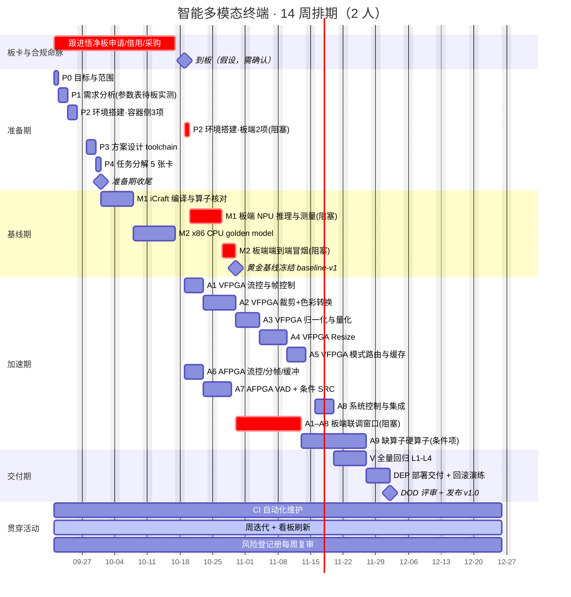

# 排期与分工

> **本页回答什么问题**：14 周怎么排、谁做什么、哪条线是命脉。
> **前置阅读**：[[实施路线]]（四步路线、无板可推进子集）、[[进度计算与实时看板]]
> **产出物去向**：排期变更需回写 [[状态源与决策记录]]；分工体现在每张任务卡的负责/备份列。

---

## 1. 分工（含备份，抗 bus factor）

| 角色 | 主责 | 备份 | 定位 |
|---|---|---|---|
| **甲 · 系统／应用侧** | 音频链路（采集→NLP→输出）、意图路由、LLM 联调、部署脚本、CI、进度看板与状态源维护 | 乙 | 更靠近业务与端到端集成 |
| **乙 · 硬件／加速侧** | NPU 模型部署与 iCraft 编译、FPGA 前端（VFPGA/AFPGA）、自定义硬算子、接口契约 | 甲 | 更靠近芯片与底层 |

### 协作规则（5 条，全部可执行）

1. **接口契约由两人共同冻结**（下沉循环第②步），冻结后各自独立推进，不互相等待。
2. **每张卡必须有备份人**，且备份人要能独立完成该卡的关键操作——判定标准是"备份人单独跑过一次该卡的核心命令"，不是"看过"。
3. **M2 黄金基线是唯一裁判**：两人对结果有争议一律比对黄金参考，不靠讨论。
4. **每天 10 分钟站会**，阻塞当天暴露，不许憋着。
5. **每周五一起演示**，用板子（或当前可达的最高证据环境）跑 S1~S5，不靠口头汇报。

### 责任边界表（避免灰色地带）

| 事项 | 唯一责任人 | 另一人角色 |
|---|---|---|
| 状态源与决策日志 | 甲 | 评审，不得单方面改架构结论 |
| 看板与进度数字 | 甲 | 乙可质疑，改动走决策记录 |
| 接口契约冻结 | 乙 | 甲会签；分歧升级到黄金基线/官方参考工程裁决 |
| 误差容限值 | 乙 | 甲会签（影响演示承诺） |
| 演示脚本与现场降级 | 甲 | 乙备运行时开关操作 |
| 风险登记册 | 甲 | 每条风险的"负责"列由乙确认 |

---

## 2. 里程碑甘特图

起点 2026-09-21（周一），14 周，**假设值**——官方截止节点尚未确认（风险 #17）。`crit` 红条 = 命脉或阻塞项。

**甘特里的数字是 [[进度计算与实时看板#3.1 任务卡总账（唯一进度真值，一行一卡）|进度计算与实时看板——3.1 任务卡总账（唯一进度真值，一行一卡）]]总账"预估"列的机械复制**：一张卡若拆成两条（无板部分 + 板端阻塞部分），两条加起来必须等于总账那一格。改预估只改总账，本页跟着重画，**不在本页发明新数字**。带"（阻塞）"的条只表示该卡被 ⛔ 卡住的那部分。唯一例外是 `sink` 条——它是**日历窗口不是工作量**，天数已含在 A1–A8 各卡预估里，不另计。

### 读图要点

- **两条并行泳道**：VFPGA（A1→A5）与 AFPGA（A6→A7）同时推进，不串行。这是决策 D-03「视觉优先但不牺牲音频」的排期兑现；代价是乙在加速期负载最重，因此 A8 排在 A5 之后。
- **`m2a`（x86 golden model）是全项目最关键的单点**：它不依赖板卡，却是所有下沉工作的裁判来源。它延期，加速期全线延期。
- **阻塞条（crit）全部指向 `mboard`**：`p2b`/`m1b`/`m2b`/`sink` 四项的起点都是"到板"，不是前置任务完成。到板推迟 1 周，交付期就被压缩 1 周——这是唯一真正的关键路径。
- **`a9`（自定义硬算子）是条件项**：未触发则整条消失，见决策 D-04。

---

## 3. 时间盒与收尾条件

分组名称与 [[进度计算与实时看板#2. 任务卡集合（进度分母）|进度计算与实时看板——2. 任务卡集合（进度分母）]]的卡集合一致；收尾条件就是 [[风险与完成判据#3. DoD · 完成判据|风险与完成判据——3. DoD · 完成判据]]对应的 DoD 清单。

| 分组 | 时间盒 | 收尾条件 | 若延期，先砍什么 |
|---|---|---|---|
| 准备期 | 约 3 周 | P0–P4 五张卡 ✅（板端项可条件通过） | 不砍。范围/环境不冻结，后面全是返工 |
| 基线期 | 约 4 周 | M1、M2 ✅ 且 `baseline-v1` 已打 tag | 砍模型数量（先保 ASR + 一个视觉模型），**不砍基线冻结** |
| 加速期 | 约 5 周 | A1–A8 ✅；A9 按条件项处理 | 砍 A5 的 OCR 共享（P1）、砍双线性（P2）、砍 A9；**不砍运行时开关** |
| 交付期 | 约 2 周 | V、DEP、DOD ✅ | 不砍。砍交付期等于砍答辩 |

**"若延期先砍什么"是提前定的**，不是延期时现场讨论。目的：把范围决策从压力下移到冷静期。任何实际砍动都要记一条决策记录。

---

## 4. 周节奏

| 时间 | 活动 | 时长 | 产出 |
|---|---|---|---|
| 每日 09:40 | 站会（可异步消息） | 10 min | 昨天做了啥／今天做啥／卡在哪 |
| 每周一 09:30 | 迭代计划 | 30 min | 本周任务卡认领 + 更新看板 |
| 每周五 16:00 | 演示 + 看板刷新 + 复盘 | 45 min | 看板刷新 + 风险复审 |
| 分组收尾时 | 过一遍该分组的 DoD 清单 | 30 min | 遗留项全部落进风险登记册 |

周五刷新动作的 9 个步骤见 [[进度计算与实时看板#5. 每周五刷新动作（15 分钟内完成）|进度计算与实时看板——5. 每周五刷新动作（15 分钟内完成）]]。

---

## 5. 学习与协作方式（已确认决策）

| 场景 | 用什么 | 为什么 |
|---|---|---|
| 概念、新知识、原理、学习路线 | Chat 对话完成 | 不消耗本地工具额度，适合抽象讨论 |
| 第一版 RTL／代码 | 在 VS Code **独立**写 | 能力必须落到人身上，答辩要单人讲清 |
| 读本地代码、跑编译／仿真、定位具体报错与波形 | AI 辅助，**短时**使用 | 只在机器比人快的事上用，避免无谓消耗 |

原则：**学过不等于已掌握**。只有独立完成 RTL、自检 testbench 和实际运行验证后，才把对应能力标为已验证（见 [[能力与学习进度]]）。

---

## 6. 预期成果（交付即答辩材料）

| # | 成果 | 证据来源 |
|---|---|---|
| 1 | 可运行的智能多模态终端原型（板端独立运行） | 上板记录表 + S1~S5 演示 |
| 2 | S1~S5 端到端演示 | [[2-CPU可用链#3.1 每条场景的可测量验收判据（B7 冻结时逐项落盘）\|2-CPU可用链——3.1 每条场景的可测量验收判据（B7 冻结时逐项落盘）]]验收判据；现场规程与分工到人见 [[验证与交付#10. 演示前检查清单\|验证与交付——10. 演示前检查清单]] |
| 3 | **CPU vs FPGA 性能对比数据**（延迟、吞吐、CPU 占用、资源） | 下沉台账，必须是记录值而非现场临时测 |
| 4 | 完整可复现的交叉编译 + 部署流程 | `toolchain.cmake` + CI + 交付包 + tag 链 |
| 5 | 全部自研 RTL 模块及其自检 TB（数量口径见 [[FPGA自研模块清单]] D5） | [[FPGA自研模块清单]] 模块台账 |
| 6 | 本 Wiki（用户/技术/开发管理三类文档） | 本仓库 |
