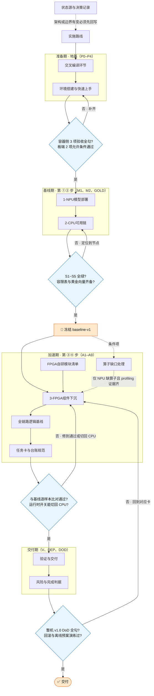

# 清单

> **本页回答什么问题**：现在该做哪一件、这一件的判据写在哪个文档里、做完了没有。
> 本页只有一种东西是手写的：第 2 节的流程图。**第 3 节（卡号→判据页的勾选框清单）现状＝尚未重建**——它原本由脚本从 [[进度计算与实时看板#3.1 任务卡总账（唯一进度真值，一行一卡）|进度计算与实时看板——3.1 任务卡总账（唯一进度真值，一行一卡）]] 总账生成，而本页在 2026-11-01 核对时只剩第 1、2 节。**在它重建之前，"按卡号找判据页"改看总账表末列「详情」**（列规则要求那一格必须是一个 `[[页面名]]` 形式的双链），那里一处不缺。
> 打勾的动作在总账那一行：改状态列，跑 `python -X utf8 wiki/format/progress.py`；或一条命令替他改完：
>
> ⚠ **2026-11-01 更正**：本页此前 4 处写的是 `tools/progress.py`，**该路径在全库不存在**；脚本实际在 **`wiki/format/progress.py`**（`llms.txt` 与 `ARCHITECTURE.md` 一直是对的）。

```bash
python -X utf8 wiki/format/progress.py --tick A3 done "E3 sim/run.log"   # 标完成，同时写证据与日期
python -X utf8 wiki/format/progress.py --tick A3 doing                    # 标进行中
python -X utf8 wiki/format/progress.py --check                            # 只检查，不动文件
```

---

## 1. 四条用法

| 条 | 内容 |
|---|---|
| 线性 | 从上往下就是执行顺序。上面没勾完的分组，下面的卡不要开工（唯一例外是各卡的"无板可推进子集"，见 [[实施路线]]）。 |
| 打勾 | 勾选框**不可手改**。要改状态就改总账那一行，或直接跑上面那条 `--tick`。 |
| 证据 | 状态改成 ✅ 必须同时给 `E<级别> 可核查指向`，否则脚本拒绝生成清单（证据阶梯见 [[状态源与决策记录#2.3 证据阶梯 E0–E6（状态提升的唯一通道）\|状态源与决策记录——2.3 证据阶梯 E0–E6（状态提升的唯一通道）]]）。 |
| 阻塞 | 状态标 ⛔ 的卡必须同时出现在 [[进度计算与实时看板#4. 阻塞清单\|进度计算与实时看板——4. 阻塞清单]] 阻塞清单里，脚本会两边对账。 |

每一行的 `→ [[某页]]` 就是这一张卡的详细开发文档：判据、命令、表格都在那一页，本页不重复写。**找不到某个东西时**，按 2026-11-01 定的新口径走——**"找什么去哪"不再有独立分流表**，改由这四处合起来承担（分工见主库根 `ARCHITECTURE.md` §1.4 与 `AGENTS.md` 第五节，**这两份在主库根、不在 `wiki/` 里，所以这里只写文件名不建双链**）：

1. **`AGENTS.md` §五「目录与信息放哪」** —— 规矩、承重页指向、一个事实只写一处；
2. **`llms.txt`「入口文档」＋「目录」** —— llm 优先读的入口清单与主库/文档库目录；
3. **`wiki/README.md`「目录」表** —— 逐目录"这里放什么"＋代表页（**最接近本页原第 4 节的那一张**）；
4. **`ARCHITECTURE.md` §1.4「承重页与数据流」** —— 三处真值与数据流。

**如果四处都查不到，那就是文档缺陷**，两条登记途径：① 进 [[状态源与决策记录]] 新增一条 `D-nn`（结构性问题）；② 只差一行说明的话，直接补进 `wiki/README.md` 对应目录行（局部问题）。**本页不再承担登记职责**（原第 4 节已不存在）。

---

## 2. 流程图

节点文字就是页面名，在 Obsidian 里可以直接点进去；方括号是判据卡点，不通过就退回上一格。



**四个卡点各归谁判**：G0 的验收清单原本在「环境搭建与快速上手」，**⚠ 2026-11-01 核对：这一页在全库不存在**（43 个文件、47 处引用指着它、盘上零命中；`check-md.py` 把它报成 `unresolved wikilink` 已有很长时间）。⇒ **G0 暂按 [[进度计算与实时看板#3.1 任务卡总账（唯一进度真值，一行一卡）|看板——3.1]] 的 P2 行（`环境搭建与 5 项验收`）判，命令本体在 [[交叉编译环节#5.1 本地编译环境（podman）|交叉编译环节——5.1]]（podman 5 条）与 [[工具链与素材进README]]（板端串口侧）**；G1 与冻结动作是 [[2-CPU可用链#5. 黄金基线冻结物清单（B7 的交付定义）|2-CPU可用链——5. 黄金基线冻结物清单（B7 的交付定义）]]的五项冻结物；G2 是 [[3-FPGA组件下沉]] 的下沉循环第 ⑤⑥ 步（要下沉哪些模块见 [[FPGA自研模块清单]]，模块级判据在 [[任务卡与台账规范#4.2 下沉台账（第 ③ 步，每组件每次比对一行）|任务卡与台账规范——4.2 下沉台账（第 ③ 步，每组件每次比对一行）]]台账）；G3 是 [[风险与完成判据#3.4 整机 v1.0 DoD（交付期的闭合条件）|风险与完成判据——3.4 整机 v1.0 DoD（交付期的闭合条件）]]。

---

## 相关页面

[[进度计算与实时看板]] · [[状态源与决策记录]] · [[风险与完成判据]] · [[任务卡与台账规范]] · [[实施路线]] · [[验证与交付]] · [[交叉编译环节#5.1 本地编译环境（podman）|交叉编译环节——5.1]]

> **本页的结构现状（2026-11-01 核对）**：全页只剩第 1 节（四条用法）与第 2 节（流程图）。**第 3 节（按卡号生成的勾选框清单）与第 4 节（全库"找什么去哪"分流表）都不存在**——git 上唯一一版（`4c07739`，D-60 搬家那次）进来时就已经只有两节。
>
> - **第 3 节**可由 `wiki/format/progress.py` 从总账重建（脚本实测 `--check` rc=0）；重建前先跑一次 `--check` 确认总账干净。
> - **第 4 节不重建**（2026-11-01 定）："找什么去哪"改由四处合担 —— `AGENTS.md` §五 ＋ `llms.txt` ＋ `wiki/README.md` 目录表 ＋ `ARCHITECTURE.md` §1.4。
> - **按卡号找判据页**：直接看 [[进度计算与实时看板#3.1 任务卡总账（唯一进度真值，一行一卡）|看板——3.1]] 总账表末列「详情」。
> - 相关缺陷（本轮一并登记的）：**「环境搭建与快速上手」这一页全库不存在**（43 个文件、47 处引用、盘上零命中）；G0 判据暂借看板 P2 行与 [[交叉编译环节#5.1 本地编译环境（podman）|交叉编译环节——5.1]]。

---
