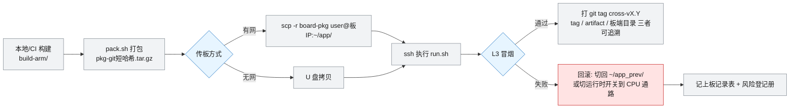

# 验证与交付

> **本页回答什么问题**：一次交付要跑哪几级验证、产物怎么传到板上、出问题怎么回滚、什么时候允许说"交付了"。
> **前置阅读**：[[验证方法学]]（L1–L4 阶梯）、[[状态源与决策记录#2.3 证据阶梯 E0–E6（状态提升的唯一通道）|状态源与决策记录——2.3 证据阶梯 E0–E6（状态提升的唯一通道）]]（证据阶梯 E0–E6）]
> **产出物去向**：交付结果写上板记录表（[[任务卡与台账规范#4.4 上板记录表|任务卡与台账规范——4.4 上板记录表]]）；未闭合项进风险登记册。

---

## 1. 验证阶梯（引用，不重复定义）

四级阶梯 **L1 静态检查 → L2 依赖检查 → L3 冒烟运行 → L4 等价性回归** 的完整定义（在哪跑、命令、通过判据、对应证据等级 E2/E5/E5/E6）只写在 [[验证方法学#三、四级验证阶梯 L1 → L4|验证方法学——三、四级验证阶梯 L1 → L4]]一处，本页不复制表格。

交付侧只加一条硬规则：**任何一次交付都至少跑到 L3**；说"交付完成"之前先回答三个问题——L3 的比对基准是哪一次 tag 冻的、误差容限定稿了没有、CI 覆盖到的那一级是不是被误当成了板端结论（CI 上限只有 E2）。

误差容限的**类别定义与比法**只在 [[验证方法学#四、黄金基线是唯一裁判|验证方法学——四、黄金基线是唯一裁判]]登记一处，**逐子模块的冻结值**只在 [[3-FPGA组件下沉#6. 下沉范围与误差容限预置（按子模块，第 ① 步冻结）|3-FPGA组件下沉——6. 下沉范围与误差容限预置（按子模块，第 ① 步冻结）]]登记一处；本页不抄数值。[[任务卡与台账规范#4.2 下沉台账（第 ③ 步，每组件每次比对一行）|任务卡与台账规范——4.2 下沉台账（第 ③ 步，每组件每次比对一行）]]下沉台账只记**实测值**（决策 D-14 的分工：容限一处、实测一处，别的页面一律用链接指过来）。

---

## 2. CI 的边界（表格不在这里）

CI 的**做法**（runner 选型、GHCR 私有镜像、触发方式、artifact 命名与保留期、uid 1001 权限坑、无公网时的根本限制）只在 [[交叉编译环节#9.3 CI 要点表|交叉编译环节——9.3 CI 要点表]]登记一处，本页不复制。

交付期只关心 CI 的**边界**这一条：CI 覆盖的上限是 **E2**（构建 + `file` 架构检查），L2~L4 全部要板端跑。所以**"CI 绿了"不等于"交付可以了"**，答辩时不要这么说；能声称的最高结论是"该 tag 的产物架构正确、可在板端继续验证"。

---

## 3. 交付与回滚流程



### 三级可追溯性

```
git tag cross-vX.Y  <->  artifact 名 board-pkg-<sha>  <->  板端 ~/app_<tag>/
```

任一环节对不上即视为交付不可复现，第 8 节检查清单不通过。

### 板端目录约定

| 目录 | 内容 |
|---|---|
| `~/app/` | 当前运行版本 |
| `~/app_prev/` | 上一版，回滚目标 |
| `~/app_<tag>/` | 按 tag 归档的历史版本（磁盘允许时保留） |
| `~/golden/` | 测试向量与基线输出，**不随版本覆盖** |

---

## 4. 回滚的两条通路

| 通路 | 适用 | 操作 | 代价 |
|---|---|---|---|
| **版本回滚** | 整包坏了、起不来 | `~/app_prev/` 切回，或直接部署上一 tag 的 artifact | 丢失该版本全部改动 |
| **通路回滚** | 单个 FPGA 组件不等价或性能不达标 | 运行时 feature flag 把该组件切回 CPU 通路，**无需重编** | 该组件的加速收益归零，功能不丢 |

第二条是两人团队的关键安全网，也是 [[3-FPGA组件下沉]] 铁律②「没有运行时开关就不算完成」的唯一兑现方式。

**回滚演练要求**：交付前至少完整演练一次通路回滚（板端实际操作 + S1~S5 回归通过），并在上板记录表勾选"回滚过?"。未演练 = 不存在。

---

## 5. 交付包内容清单

| 必含 | 说明 |
|---|---|
| 可执行文件与库 | `build-arm/` 产物，架构已由 L1 验证 |
| 模型文件与配置 | 含版本号与来源，避免"板上模型不知是哪份" |
| `deploy/run.sh` | 板端一条命令跑通 demo |
| `deploy/golden/`（或其获取方式） | L3/L4 比对基准 |
| 运行时开关配置文件 | 逐组件 CPU/FPGA 选择项 |
| 版本清单 | git tag、构建 commit、artifact 名、CI 运行链接 |
| 演示与限制说明 | 面向使用者，取本页第 9~11 节（现场操作规程）与 [[风险与完成判据#5. 已知限制与范围外（对外唯一口径）\|风险与完成判据——5. 已知限制与范围外（对外唯一口径）]]（做不到什么） |

**不含**：比赛提供的镜像与原始资料。交付包是给第三方的，与私有仓库不是同一口径（见 [[状态源与决策记录#D-21 · 取消"资料保密"类入库限制：私有仓库，内容以可读性为先|状态源与决策记录——D-21]] D-21）；凭据类一律不进任何包。

**出借方条款按 D-26 剔除**：[[外设与资金申报改成设备信息#四、板子来源与借用条款|外设与资金申报——四、板子来源与借用条款]]那张表里除了期限，还有三行金额与一条"不可对第三方透露借用规则"的约束（值不在本页复述，**D-27** 单点记账）。私有仓库里留全表，**导出给第三方的交付包只留"板子为借用"＋期限那一行**，其余行删掉——那条约束管的正是这一步。

---

## 6. 无公网场景的离线交付预案

比赛现场网络不可用是登记在册的中概率风险，但后果是"演示直接归零"级别，因此预案必须在交付期之前演练过：

- [ ] 现场用包在**赛前 48 小时**完成一次完整离线部署（U 盘 → 板 → L3 通过）
- [x] 备用 SD 卡一张：已烧写好可启动镜像 + 上一稳定版本 — **64 GB 卡已写入出厂镜像并做完全卡逐块 SHA256 回读校验**（E2，2026-09-26，`evidence/20260926-032045-sd-verify.txt`，读数见 [[操作记录#2. 唯一一件做完的实物动作：备用系统卡|操作记录——2. 唯一一件做完的实物动作：备用系统卡]]）。**未验：上电能否启动**，到板后单列一项；"上一稳定版本"随首个自建版本产生后补
- [ ] 云端依赖的降级路径已在板上验过：~~云端文本 LLM 不可用 → 本地 LLM~~——**这条兜底按 [[状态源与决策记录#D-25 · 本地 LLM 从主线交付降级为可选演示项|状态源与决策记录——D-25]] D-25 取消**，改为"云端文本 LLM 不可用 → 播固定话术并明示需要网络"（本地 LLM 是可选演示项，不能拿它当预案）；云端 TTS 不可用 → 拼音音节拼接兜底；看图问答不可用 → 明示"需网络"
- [ ] 所有依赖 API 的 Key 与端点已本地留存（端点可以进仓库，**凭据一律留在仓库外**，见 [[状态源与决策记录#D-21 · 取消"资料保密"类入库限制：私有仓库，内容以可读性为先|状态源与决策记录——D-21]] D-21）
- [ ] 演示脚本不出现任何"现在去拉一下代码/模型"的步骤

> 降级路径的**用户可见表现**（断网时每条能力还剩什么）写在 [[风险与完成判据#6.1 网络依赖：断网时的真实表现|风险与完成判据——6.1 网络依赖：断网时的真实表现]]；现场**动作**写在第 9 节。这里只管理"预案是否演练过"这一件事。

---

## 7. 交付期任务卡

| 卡 | 内容 | 验收标准 | 闭合条件 |
|---|---|---|---|
| **V** | 全量回归 | L1–L4 全通过；误差均在容限内；无静默跳过用例 | 加速期 A1–A8 全部 ✅ |
| **DEP** | 部署交付 + 回滚演练 | 交付包可复现（tag↔artifact↔板端目录）；回滚演练做过且成功；离线预案演练过 | 前一张卡 ✅ |
| **DOD** | DoD 评审 | [[风险与完成判据]] 的整机 v1.0 DoD 全勾；文档三处一致（状态源/看板/台账） | 前一张卡 ✅ |

预估：V 5d、DEP 3d、DOD 1d。

---

## 8. 交付检查清单（现场逐条问）

```
[ ] 同一 git tag 能否重现出同一 artifact？
[ ] 板端当前跑的目录，对应哪个 tag？
[ ] 每个下沉组件的运行时开关，逐一演示切过一次了吗？
[ ] 切换后 S1~S5 全跑过了吗？
[ ] 最近一次回滚演练是什么时候、成功了吗？
[ ] 离线交付包在无公网下能完整演示吗？
[ ] 性能对比数据（CPU vs FPGA）是从台账里取的，还是临时测的？
[ ] 风险登记册里还有"开放"且无应对记录的条目吗？
[ ] 状态源与看板、台账三处一致吗？
```

第 7 问最常被忽视：**性能对比必须是台账里的记录值**，现场临时测的数据既不可信也不可答辩，见 [[任务卡与台账规范#4.2 下沉台账（第 ③ 步，每组件每次比对一行）|任务卡与台账规范——4.2 下沉台账（第 ③ 步，每组件每次比对一行）]]。

---

## 9. 现场演示操作规程（到板即用）

> 本节是**现场动作的唯一规程**。凡需要真机信息才能确定的栏位都显式写成 `待填`，演示前一天必须补齐；不允许带着空栏位上场。
> **编号消歧**：本页的现场降级层级用 **F1~F6**（Fallback），与验证阶梯 L1~L4、已知限制 L1~L15 是三套不同的东西，引用时必须带前缀名。

### 9.1 板卡与外设连接清单（物理层）

| # | 部件 | 接到哪里 | 现场作用 | 状态与依据 |
|---|---|---|---|---|
| 1 | **USB 会议音箱（＝麦克风与音箱同一颗：Lenovo MCP01）** | 板载 USB 2.0 口（经板载 hub，协商到**全速 12 Mbit/s**） | 拾音，所有语音场景的入口 | **已在板并在测**：`17ef:a03b`，card0；**48000 Hz 单档／S16_LE／录音 1 声道、播放 2 声道**；1 小时连采一帧不差（[[音频#2.1 采样格式\|音频——2.1]]、[[音频#四、测试记录\|音频——T24]]）。我方**没有单独的第二台麦克风** |
| 2 | **SDI 摄像头（一路）**——不是 USB UVC | 板载 SDI 输入（4 路中的 1 路，均衡器 LMH0344） | 人脸、目标、读字、看图的画面来源 | **已在板并在跑**：**1920×1080 @30.06 fps**（厂商材料写的 60 fps 与实测不符）、交接 **RGB565**、AI 路 640×352／960×512（[[我方在板外设#一、当前在板清单（A 级实测）\|我方在板外设——一]]）。**UVC 摄像头我方没接**，它只是退路 |
| 3 | 同一颗 MCP01 的播放侧 | 同上（**不另接音箱**） | 播报回答；**听不见就等于演示失败** | 与第 1 行是**同一台设备**，`pcmC0D0p`；响度由 `numid=5` 决定（`numid=4` 实测无作用），控件值会漂、必须现读现用 |
| 4 | 网线 | 板载 eth0（**只有这一路开箱可用**） | S2/S3/云端合成**必需** | 速率口径与直连排查动作见 [[板子（除芯片）#四、源文件之间的口径差异（必须显式标注）\|板子（除芯片）——四、源文件之间的口径差异（必须显式标注）]]；连不通先按 [[os]] 第六节＋ [[板端我方代码与产物台账]] #204～#207 |
| 5 | 调试串口线 | 板载 USBUART（完整版 2 路，第 1 路在 PS 端） | 现场看日志、登录排障 | 驱动、波特率、登录与排查全部在 [[os]] 第六节与 [[工具链与素材进README]]，本页不重述 |
| 6 | 系统存储卡 | 板载卡槽，手册标 **32 GB TF／SD ＋ 32 GB eMMC** | 承载板端 Linux 与应用 | 镜像与烧写步骤原在「环境搭建与快速上手」（**2026-11-01 已作废**），现只有厂商教程页 [[157980088-[FMQL30TAI开发]SD卡启动FMQL30TAI-悟净开发板（完整版-LITE版）全流程详细讲解]]；⛔ 我方未自烧镜像。**10-05 实测读数与手册不符**：Linux 只注册了**一个** mmc 块设备 `/dev/mmcblk0`＝**58.4 GiB（64 GB 档）**，根文件系统在其 26 GB 分区上，`/dev/mmcblk1*` 不存在；**软件侧分不出它是 eMMC 还是 TF**（判 C），见 [[我方在板外设#一、当前在板清单（A 级实测）\|我方在板外设——一]] |
| 7 | ~~HDMI 线~~ | 板载 HDMI **输出** | **不作为兜底手段**：HDMI 要 PL 比特流 + 可加载的 DRM 驱动，本项目不使用 | 见 [[板子（除芯片）#四、源文件之间的口径差异（必须显式标注）\|板子（除芯片）——四、源文件之间的口径差异（必须显式标注）]] HDMI 行；投屏改用笔记本 + 第 9.4 节 F6 |
| 8 | 备用件 | — | 备用麦克风、备用摄像头、**备用已烧录卡**、备用 U 盘 | 强烈建议（风险 10 的应对措施） |

**连接顺序**：先插调试串口 → 再插供电 → 系统起来后依次插摄像头、麦克风、音箱 → **最后插网线**。一次性全插上电，出问题时分不清是哪一环。
**带宽注意**：4 个 Type-A 口共享一条 480 Mbps（1 个 DWC2 主机 + 板载 hub），麦克风 + 摄像头 + 音箱同时占用时**带宽必须合并算**，别按"4 路独立"规划；依据见 [[板子（除芯片）#四、源文件之间的口径差异（必须显式标注）|板子（除芯片）——四、源文件之间的口径差异（必须显式标注）]]。

### 9.2 演示前必须填好的"开关与回滚卡"（打印带上场）

| 项目 | 内容 | 状态 |
|---|---|---|
| 硬件通路 → 软件通路的切换方式 | 改应用配置中的通路选项，保存后重启应用；**不重编程序、不重烧硬件**（[[3-FPGA组件下沉]] 铁律②） | 原则已确认；配置文件路径与选项名 `待填` |
| 需要能单独切回的软件环节 | 音频前端 / 视觉前端（本次自研的两条链路） | 每个环节的开关名 `待填`，取自下沉台账"运行时开关"列 |
| 上一版应用退回方式 | 切到 `~/app_prev/`（目录约定见第 3 节） | 机制已定；目录名 `待填` |
| 系统卡故障时的替代 | 换用备用已烧录卡（F4） | `待填`：备用卡是否已同步到最新版本 |
| 演示机与开发机是否同一台 | `待填` | ⛔ 未到板 |

### 9.3 推荐演示脚本（约 4 分钟，S1~S5 串成一条线）

**编排原则：先演不依赖网络的，再演依赖网络的**——现场网络若在演示中途崩掉，已完成的部分仍然成立。

| 时长 | 环节 | 演示者动作与话术 | 期望终端表现 | 不通时 |
|---|---|---|---|---|
| 0:00–0:25 | 开场 | 指着麦克风、摄像头、音箱介绍："一台端云协同的异构多模态终端，四条能力主线：能听、会看、可认证、善问答" | 待机：画面持续分析、麦克风在监听 | 纯口述 |
| 0:25–1:10 | **S5 身份认证** | 已登记的演示者走进画面，不打招呼先让它认人；随后未登记的人走进画面 | 前者"通过"、后者"拒绝"，结果可见 | 认不出 → 正面顺光重演一次；仍失败则口头说明"判定链路在端侧完成、不依赖网络" |
| 1:10–1:50 | **S1 本地问答** | 明确说一句"接下来这个问题不需要联网"，提一个常识问题；条件允许时**当场拔网线**增强说服力 | 不出网即作答并播报 | 端侧模型不可用 → 跳过，改演 S4 |
| 1:50–2:35 | **S4 读文字** | 举起大字号纸张，问"这上面写了什么" | 端侧读出文字并播报 | 读不全 → 换更近更大的素材；完全失败 → 展示"识别到的文本"落盘文件，说明复杂版式是后续升级项 |
| 2:35–3:20 | **S2 复杂文本问答** | 接回网线，提一个需要推理的问题 | 文字上云、云端作答、播报 | 网络不通 → 直接跳到 3:20 的兜底话术，**不重试到冷场** |
| 3:20–4:00 | **S3 看图问答** | 把小件实物放到摄像头前，问"这个怎么用" | 拍一帧上传，云端结合图文回答并播报 | 同上；无网时改为讲解设计意图，**不谎称已跑通** |
| 收尾 15 s | 收束 | 一句话总结："端侧负责实时与隐私敏感的判断，云端负责重知识重推理，两条通路都能一键互切" | — | — |

**排演要求**：整条线至少完整排练一次并计时；单次排练中任一环失败，就为那一环补一句口头过渡词，避免现场沉默。降级动作必须两人都会独立操作（风险 11）。
**断网兜底话术（照读）**："这台设备的设计前提是断网也能干活——认人、读字、简单问答全在设备本地完成，云端只负责复杂推理和看图。我们把网络断掉再演一遍这三条。"

### 9.4 演示失败时的降级操作（按顺序执行，不要跳步）

| 级别 | 触发情况 | 操作动作 | 达到的效果 |
|---|---|---|---|
| **F1 重试** | 单次判定或回答不对 | 调整站位／距离／光线后**只重试一次** | 避免同一失败重复出现两次 |
| **F2 换通路** | 怀疑某个处理环节表现异常 | 执行第 9.2 节的通路切换：改配置走软件通路，重启应用 | 功能表现完全不变，该环节改由处理器完成；响应可能变慢，慢多少 `待实测`。**这是本项目最重要的现场安全网** |
| **F3 换版本** | 切换后仍异常 | 退回上一版应用目录并重启 | 回到最近一次通过完整回归的版本 |
| **F4 换介质** | 系统起不来 | 关机 → 换备用已烧录系统卡 | 恢复可演示状态 |
| **F5 换素材／换能力** | 某一场景本身不可用 | 跳过该场景，按第 9.3 节"不通时"列改演其他场景 | 保住整条演示线的完整性 |
| **F6 转为讲解** | 设备完全不可用 | 展示**笔记本**上的流程图与赛前录制好的运行视频／日志截图 | 保住答辩材料（**不依赖板载 HDMI**，理由见第 9.1 节第 7 行） |

**硬性纪律**：① 现场**禁止**改代码、重新编译或重烧硬件，这些动作一律留到场外；② 任何一次降级都要在演示后记入运维记录（第 11.3 节），否则等于没发生、下次照样踩；③ 降级动作排练过一遍，两个人都会独立操作。

---

## 10. 演示前检查清单

### 10.1 硬件

- [ ] 板卡正常启动，调试串口可登录（判据：串口有 shell＋[[os]] 第六节 bootargs 参数对得上；原指的验收项 4 **已随页作废**）
- [ ] 摄像头被识别，日志中能看到画面帧
- [ ] 麦克风被识别，对着说话有电平变化
- [ ] 音箱被识别，播放测试音能出声
- [ ] 网线接通，板子可访问外网
- [ ] 备用麦克风／备用摄像头已带到现场
- [ ] **备用已烧录系统卡**已带到现场

### 10.2 软件与版本

- [ ] 板端运行的版本标签已确认，并与演示脚本对应（三级可追溯性见第 3 节）
- [ ] 已确认当前每个环节走的是硬件通路还是软件通路
- [ ] 通路开关与回滚路径已填进第 9.2 节的卡
- [ ] 应用能一条命令启动、一条命令停止
- [ ] 日志可实时查看（现场排障的唯一手段）

### 10.3 网络与云端

- [ ] 云端文本问答接口可用，**已做过一次真实提问**
- [ ] 云端看图接口可用，**已传过一张真实图片**
- [ ] 云端语音合成可用，**已播过一段真实音频**
- [ ] **备用服务商**的接口也已配置好并同样实测过（不绑定单一厂商是设计原则，只在现场换等于没备）
- [ ] 账号额度已确认够用（余量 `待填`，演示前一天现场核对）
- [ ] 离线兜底播报已单独试播一次（断网时靠它）

### 10.4 素材与人员

- [ ] 提问话术清单打印或存在手机里（不要临场想词）
- [ ] S3 实物：小件、**不反光**、能被单帧看清
- [ ] S4 纸质素材：**大字号、单栏、无表格、无强反光**（首版 OCR 是轻量方案，见限制 L10）
- [ ] 身份库已预注册演示人员，并准备了 1 名未登记的对照人员（注册流程本身待定义，见限制 L12，只能人工预置）
- [ ] 三人分工到人：谁说话、谁操作、谁在失败时执行降级；两人团队时互相备份
- [ ] 现场已踩点：噪声水平、逆光情况、可用网口位置

---

## 11. 现场故障处置、口径边界与收尾

### 11.1 常见现场故障与处置

| 现象 | 先判断什么 | 现场处置 | 说明 |
|---|---|---|---|
| 完全没有声音 | 是"没生成语音"还是"没播出来" | 换测试音播放；确认音箱插在板载 USB 声卡输出；不行则换备用音箱 | 播不出与合成不出是两回事 |
| 声音很机械 | 是否走了离线兜底 | **属预期**，云端合成不可用时的兜底表现 | 不要临时改配置去"修"它 |
| 说了话完全没反应 | 麦克风是否被识别 | 看日志有无音频输入；换备用麦克风／耳机麦 | 也可能是静音判定过严，提高音量重说一次 |
| 回答被中途截断 | 播报是否被打断 | 演示时不要在播报中继续说话 | 与静音判定有关，`待实测` |
| 转写错字很多 | 现场噪声 | 靠近麦克风、降低背景噪声、放慢语速 | 端侧无语音增强，见限制 L15 |
| 摄像头无画面 | 是否被识别 | 重插 USB、换一个 USB 口、去掉集线器 | 4 口共享一条 480 Mbps，注意占用 |
| 人脸认不出 | 光线与角度 | 改为正面、顺光、缩短距离 | 侧脸与逆光是最常见失败原因 |
| 谁都"认通过"或谁都"认不出" | 身份库是否预置正确 | 重新确认注册名单；未登记人员不要提前入镜 | 误识率／拒识率**未测量且口径未定义** |
| 纸上文字读不全 | 字号、版式、抖动 | 换大字号单栏素材、双手拿稳、缩短距离 | 首版为轻量识别方案（L10） |
| 云端问答长时间不答 | 板子能否出公网 | 不重试超过一次，立即走第 6 节离线预案 | 现场网络是最脆弱的一环 |
| 云端返回鉴权或额度错误 | 服务商账号状态 | 切到备用服务商 | 不绑定厂商是设计原则 |
| 应用起不来 | 最近一次改动是什么 | 按 F3 退回上一版；再不行按 F4 换卡 | 备一张已烧好的卡是风险 10 的应对 |
| 某场景时快时慢 | 走了哪条通路 | 用第 9.2 节开关卡确认通路一致性，必要时统一切软件通路再演 | 稳定性数据 `待实测` |
| 串口连不上／没有 shell | 驱动装了没有、端口是否被占 | 按 [[os]] 第六节＋本页 D-24 排查；厂商对该现象只给"驱动 + 波特率"两条 | 同名 COM 号在不同电脑上不是同一个设备 |

### 11.2 演示中不能声称的能力

| 项目 | 状态 | 演示口径 |
|---|---|---|
| 硬件视频流编码（H.264／H.265） | 不做（O1） | 不演示、不提及 |
| 硬件 JPEG 图像压缩 | 范围外（O2） | 单帧压缩由设备侧软件完成 |
| 硬件语音合成后端 | 范围外（O3） | 播报为"云端主 + 离线兜底" |
| 网络协议卸载 | 范围外（O4） | 走系统标准网络栈 |
| 自定义硬件算子补 NPU 缺口 | 非预设必做（O5） | 只说"实测确认瓶颈后才评估" |
| 声纹身份认证 | P2 可选（L7） | 只说"方向保留、当前不作为交付项" |
| "开门／开放权限"等具体业务动作 | 未确定（L6） | 明确说明是示例，不承诺 |
| 任何性能数字（时延、吞吐、占用率） | 未测量 | 只说"测量方法与对比方案已定义，数据以真板实测为准"，**不得现场报数** |

O#/L# 编号取自 [[风险与完成判据#5. 已知限制与范围外（对外唯一口径）|风险与完成判据——5. 已知限制与范围外（对外唯一口径）]]，那张表是唯一口径来源，本表只是现场速查版。

### 11.3 演示后收尾

- [ ] 记录本次演示运行的版本号与**开关位置**
- [ ] 每一次降级／失败记一条：现象、当时的通路、执行了 F 几、临时处置
- [ ] 未解决的现场问题转成下版需求或风险条目，见 [[风险与完成判据#1. 风险登记册|风险与完成判据——1. 风险登记册]] 第 1、7 节
- [ ] 素材、身份库、云端账号额度复位，为下一次演示做准备
- [ ] 需要复盘的数据（计时、日志片段）**当场导出**，不要靠回忆；注意板子无可用 RTC，跨启动排序靠 boot id（见 [[板子（除芯片）#四、源文件之间的口径差异（必须显式标注）|板子（除芯片）——四、源文件之间的口径差异（必须显式标注）]] RTC 行）

---

## 相关页面

[[验证方法学]] · [[交叉编译环节]] · [[实施路线]] · [[任务卡与台账规范]] · [[风险与完成判据]] · [[3-FPGA组件下沉]] · [[2-CPU可用链]] · [[os]] · [[板子（除芯片）]] · [[清单]]
