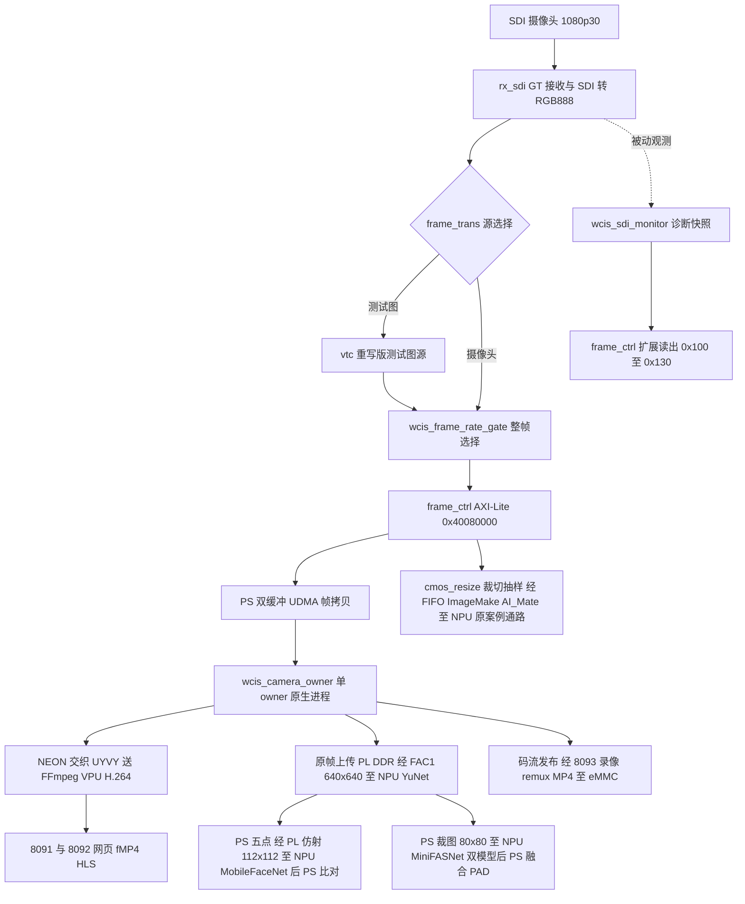

# 平台与数据流

> 依据：`repos/FPAI30TAI图像FPGA` 源码与 `docs/`、`rtl/`、`case/`、`ps_app/`、`npu_photo/`、`lan_stream/` 的实现文件；不确定处注明"以源码为准"。只写设计与实现，不写过程记录。

## 硬件平台与 SoC 结构

**定位**：悟净 FMQL30TAI 完整版开发板上的视觉系统工程。SoC 为复旦微 FMQL（对标 Zynq-7000）：PS 4 核 Cortex-A53（规格最高 1 GHz）+ PL 7 系 FPGA。开发口径是"代理器件 + 实际封装"：Vivado 工程用 `xc7z030ffg676-2` 描述（`case/fpai_demo_vivado.xpr:10`），打包时按实际器件 `JFMQL30TAI676H`（`scripts/package_boot.tcl:4`）。

**结构与接口**：

| 项 | 值 | 依据 |
|---|---|---|
| PS DDR | 1 GiB，32 位，534 MHz，MT41K256M16 RE-125 | `case/fpai_demo_vivado.srcs/sources_1/bd/ps_ai/ps_ai.bd:3687`、`:3816`、`:3825` |
| PL DDR | 2 GiB 独立 DDR3，64 位，MT41K256M16XX-125，Row15/Col10/Bank3 | `case/rtl/ip/mig_7series_0/mig_a.prj` |
| SDI | 完整版 4 入 1 出，125 Mbps–2.97 Gbps，GT 与 SFP/PCIe/SMA 互斥 | `docs/board-hardware-review-20261014.md:72` |
| 网口 | 两路千兆，软件栈现用 PS eth0 | `docs/board-hardware-review-20261014.md:74` |
| udmabuf0 | 128 MiB @ 0x30100000（帧起始实际挪至 0x30101000，首 4 KiB 留作状态块） | `docs/board-hardware-review-20261014.md:43`、`:87-88` |
| NPU 核时钟 | 1 GHz，AI_CORE_CLK PLL 固定 PLLE2_ADV_X1Y3 | `case/constrs_1/ai7030.xdc:6` |
| 板端 OS | aarch64，Ubuntu 20.04.4，Linux 5.4.52 | `docs/build-20261013.md:35` |

**特色设计**：

- PL DDR 不是 CPU 的普通内存：PS 侧经 iCraft SDK 的 udma/CustomOp 通道访问，自研 RTL 侧经厂商 512 位 UserCustomOp_0 端口接 PL DDR（`docs/face-pl-integration-20261015.md:13-14`）；原生端口按官方 27 位地址窗口限制在 128 MiB 内，且互不重叠（`ps_app/src/wcis_direct_capture.hpp:37-39`）。
- PS/PL 时钟域固定三域：`gp_clk`（PS FCLK，AXI-Lite 控制域，案例注释 50 MHz，`case/rtl/ps_ai_peripheral.sv:965`）、`hp_clk = ddr_clk`（MIG UI 200 MHz，数据域，`case/rtl/utils/demo_clkrst_wrapper.v:52`）、`cam_clk`（SDI 像素域）。跨域数据一律走 mailbox 握手，不做宽总线直跨。
- PS M_AXI_GP0 的地址窗口集中译码：厂商 `gp0_manager` 把 0x4000_0000 起的 512 KiB 按 ASP 分裂——0x4000_0000/0x4004_0000 给 host_ctrl/ai_ra（RFU），0x4008_0000 给 camera（frame_ctrl），0x400C_0000 起 256 KiB 给 user_op（自研 CustomOp）（`case/rtl/gp/gp0_manager.sv:34-48`、`case/rtl/ps_ai_peripheral.sv:735-747`）。

## 启动链与 BOOT 分区

**定位**：SD 卡单镜像四段启动：FSBL → PL 位流 → BL31 → U-Boot → Linux；启动文件身份是板端服务准入的锚。

**结构与接口**：BOOT.bin 由 Procise 按 fmql BIF 打包（`//arch = fmql; split = false; format = BIN`），分区顺序 `[bootloader]FSBL → [destination_device=pl] 位流 → bl31.elf → u-boot`，`[fsbl_config] apu_x32`（`scripts/package_boot.tcl:17-25`）。镜像头为 FMSH：0x24 处魔数 `0x464d5348`，0x98 处分区表，固定四分区（`scripts/verify_boot_payload.py:28-30`）。SD 卡 `/dev/mmcblk0p1` 存 BOOT/设备树/uEnv，p2 为根文件系统；SD 卡走 PS SDIO0（MIO 40..45，`ps_ai.bd:3441`），eMMC 走 SDIO1 EMIO（见 eMMC 页）。

**特色设计**：

- "PL 分区即位流身份"：每次打包后用 `scripts/verify_boot_payload.py` 把 .bit 有效载荷（32 位字节序互换）与 BOOT PL 分区逐字节比对，允许的分区后缀只有空或一个配置 NOP 字 `00000020`（`scripts/verify_boot_payload.py:35-42`）；离线发布包进一步要求候选与回退镜像的三个 PS 分区逐字节一致、只有 PL 分区变化（`scripts/verify_offline_release.py:30-36`）。
- 启动证明进服务准入：原生 owner 启动时读 `/proc/sys/kernel/random/boot_id` 并核对 CameraInterlock 的 deployment 与 verified_boot_id（`npu_photo/camera_owner_runtime.py:64-72`），换启动即换会话身份；boot_prepare.py 在服务 ExecStartPre 只读挂载 SD 分区核对 BOOT/DTB/uEnv 并写启动证明（`docs/release-runbook.md:44`）。
- 心跳常驻：`tools/heartbeat/wcis-heartbeat`（静态 C）每 10 s 采样 MemAvailable/CmaFree/loadavg/D 状态进程/wchan 并转发 `/dev/kmsg`，日志 1 MiB 轮转（`tools/heartbeat/wcis-heartbeat.c:13-15`、`:64-99`、`:117-128`）；systemd 单元以 `Nice=19`、`MemoryMax=16M`、`ProtectSystem=strict`、`TasksMax=1` 等硬化，保证它自身不参与资源竞争（`tools/heartbeat/wcis-heartbeat.service:7-29`）。

## SDI 采集链（PL 前端）

**定位**：把 SDI 摄像头 1080p30 变成 PS 与 NPU 共享的 RGB 帧流。自研控制只做"选择与观察"，采集主通路保留厂商案例。

**结构与接口**（信号级）：`rx_sdi`（GT 接收 + SDI 解码 + YUV→RGB，`case/rtl/sdi/rx_sdi.v`）输出 `cam_vs/cam_de/cam_rgb[23:0]`（RGB888 DVP）、`cam_clk` 与状态 `sdi_rx_flags[11:0]`（`case/rtl/ai7030_edif_top.v:219-244`）。进入 `frame_trans`（`case/rtl/display/frame_trans.sv:14`）后依次：

1. 源选择 `vtc_enable ? vtc : camera`（`frame_trans.sv:188-190`）；
2. `wcis_sdi_monitor` 无侵入挂在选帧/VTC 之前的真实 RX 流上（`frame_trans.sv:193-199`）；
3. `wcis_frame_rate_gate #(.SOURCE_FPS(30),.ACTIVE_FPS(20),.STANDBY_FPS(1))` 整帧选择，放在 frame_ctrl 之前（`frame_trans.sv:201-215`）；
4. `frame_ctrl`（AXI-Lite @ `0x40080000`，`ps_app/src/wcis_camera_owner.cpp:69`）持有抓帧/裁切控制与 WCIS 扩展寄存器；
5. NPU 分支经 `cmos_resize_24bit`（裁切 + 整数抽样 640×352 或 960×512，`docs/interface.md:47-52`）→ `axis_master` → `AI_Mate` 内 ImageMake → NPU。

GT 参考时钟按完整板修正为 Bank112 CLK1 的 U6/U5（148.5 MHz），由工程准备脚本以 LATE 顺序覆盖案例默认的 Lite R6/R5（`constraints/fmql30tai_full_sdi_refclk.xdc:1-5`、`scripts/prepare_case.tcl:19-25`）。

**特色设计**：

- 整帧选择在 PS/NPU 分叉之前：同一次取帧 PS 抓到的与 NPU 看到的是同一批 admitted 帧（`frame_trans.sv:201` 注释）。选帧按帧比例而非时间限速——Bresenham 式相位累加，`phase_sum >= SOURCE_FPS` 时保留（`rtl/wcis_frame_rate_gate.v:74-81`）；配置经"两拍同步 + payload 保持 + 帧边界提交"的 mailbox 生效，忙时写入不覆盖在传数据（`case/rtl/display/frame_ctrl.v:262-267`）。上电默认旁路，参数错配在 `initial` 块直接 `$error`（`wcis_frame_rate_gate.v:129-134`）。
- 被动诊断不改通路：SDI2 监视器复用 `rx_flags` 与 VS/DE 边沿统计帧/行/像素/宽高，192 位 payload 打包为 416 位 words 暴露到 AXI，魔数 `0x53444932`（"SDI2"）识别扩展页（`rtl/wcis_sdi_monitor.v:82`、`:118-125`）。约束只切异步第一级同步器，payload 用 `set_max_delay -datapath_only` + `set_bus_skew` 上界而非整体 false path（`case/constrs_1/impl_constraints.xdc:55-63`）。
- VTC 重写为两级寄存流水：加法分级寄存、比较结果寄存、输出两级，RGB 仅在 DE=1 时消费，消除原动态 32 位比较的长组合路径（`docs/rtl-rewrite-20261013.md:14-19`）；配置仍用原 AXI 寄存器，要求停流配置并保持至少 4 个 camera 时钟（`docs/rtl-rewrite-20261013.md:21-26`）。

**关键寄存器**（frame_ctrl 基址 0x40080000）：

| 偏移 | 读写 | 内容 | 依据 |
|---|---|---|---|
| 0xB8 | 写/读 | 选帧配置 {enable,active}，写 1 旁路/2 待机/3 工作；读回 bit2 为忙时拒绝标记 | `case/rtl/display/frame_ctrl.v:950` |
| 0xBC | 读 | 已应用配置 + bit3 pending | `case/rtl/display/frame_ctrl.v:951` |
| 0xC0 | 只读 | `0x57434953`（"WCIS"）扩展 ID | `case/rtl/display/frame_ctrl.v:952` |
| 0x100..0x130 | 只读 | SDI2 诊断 13 字（魔数/序列号/age/新鲜度等） | `case/rtl/display/frame_ctrl.v:953-965` |
| 0x00..0xB4 | — | 原案例寄存器全部保留 | `docs/interface.md:22` |

配套 PS 契约：`include/wcis_rate_gate.hpp` 的 `wcis::set_vision_mode` 校验扩展 ID、忙与帧边界 ACK；待机 1 fps 时取帧等待须改 `camera.wait(1500)`（`docs/interface.md:30-39`）。

## 自研视觉 RTL 与 FAC1 预处理

**定位**：PL 视觉交付物分两层——已进现役位流的前端（选帧/VTC/监视/FAC1 人脸预处理），与独立交付或原型（letterbox、PL JPEG、PL 网口、PL PAD 裁图）。

**结构与接口（FAC1）**：`rtl/wcis_face_customop.v` 顶层替换原加法器案例的 `U_adder_top` 位置（`case/rtl/ai7030_edif_top.v:250-281`），采样核心为 `wcis_affine_sampler.v` + `wcis_pixel_read_axi.v`。寄存器页 `0x400C2000`：0x00 ID `0x46414331`/启动位，0x04 busy/completed/rejected/error，0x08..0x48 为 frame_id/输入基址/pitch/输出基址/原图与画布尺寸/replicate 与 RGB565 标志/输出到原图的六个 Q16.16 仿射系数（`docs/face-pl-integration-20261015.md:29-47`）。

**特色设计**：

- 描述符启动即锁定；范围校验拆成乘法、加法、比较三拍后才启动核心，避免 100 MHz 下串接长组合路径；输出按 64 字节对齐且与输入不重叠（`docs/face-pl-integration-20261015.md:44-47`）。DDR 读写仲裁在反压时锁定 owner，完成状态等待最终输出写请求被 DDR 接口接受，板端再检查全部输出像素的哨兵字节（`docs/face-pl-integration-20261015.md:21-25`）。
- 跨时钟全部走 `wcis_cdc_mailbox`（toggle 双拍同步 + payload_hold 保持至 ACK，`rtl/wcis_cdc_mailbox.v:5-33`）：FAC1 用三个 mailbox 分别传读请求/读响应/写请求。约束侧只切第一级同步器，对 payload 加 max-delay/bus-skew（`case/constrs_1/impl_constraints.xdc:65-91`）。
- letterbox 补边模块（`rtl/wcis_stream_letterbox.v:7-14`）：valid/ready 全握手，`m_sof/m_eol/m_eof` 随像素携带且反压时保持；参数 CONTENT/CANVAS/PAD/PAD_RGB，默认 640×360 → 640×640、右下补 114（`24'h727272`）。只补边不缩放，要求上游每帧精确送 CONTENT_W×CONTENT_H 像素（`docs/interface.md:61-65`）。
- 原型（设计存在、未接入现役位流，以源码为准）：`rtl/wcis_jpeg_compressor.v` 等 JPEG 核（CustomOp 页 0x400c2100、ID 0x4a504731，`docs/pl-jpeg-board-20261016.md:30-32`）；`rtl/wcis_jpeg_network_tx.v` + `rtl/wcis_rgmii_tx_serdes.v` + `rtl/wcis_mdio_clause22.v` 的 PL 千兆 UDP 发送（约束 `constraints/fmql30tai_pl_ethernet*.xdc`）；`rtl/wcis_pad_preprocess.v` 的 PL PAD 裁图（`docs/engineering-flow-architecture-20261031.md:45`）。

## PS 软件运行时与单 owner 仲裁

**定位**：所有 SDK/采集/VPU 硬件访问收敛到一个原生进程；Python 只做 HTTP、调度与校验。

**结构与接口**：

- 原生 `ps_app/src/wcis_camera_owner.cpp`：唯一 iCraft SDK 所有者；固定采集线程 + 预分配 ping-pong 相机缓冲（`wcis_camera_owner.cpp:85` 的 `capture_mode=preallocated_ping_pong`），识别取"最新可用帧"不排队；帧以 lease + 前后 64 B 哨兵保护，每次分配检查与驻留帧区间不重叠（`wcis_camera_owner.cpp:32-43`）。
- Python `npu_photo/camera_owner_runtime.py` 的 `CameraOwner`：启动前核对 boot_id、CameraInterlock 准入（deployment/verified_boot_id）、模型与可执行散列；以 `npu.lock`/`camera.lock` 两把 fcntl 排他锁并把锁 FD 传给子进程（`camera_owner_runtime.py:64-95`）。
- HTTP 三服务：8091 `serve_photos.py`（主页/登记/识别/摄像头状态/H.264 媒体）、8092 `vpu_live_server.py`（只读预览，共享 owner 不另起采集）、8093 `recording_service.py`（独立录像，不持 SDK）。路由速查 `docs/api-index.md:17-64`。

**特色设计**：

- "一个 SDK、一条采集线程"：识别与预览不再互停；模型加载属于 owner 启动的一部分，由启动准入与就绪接口表达。
- 同帧绑定：所有结果携带 boot/session/frame_id/frame_token，Python 侧 `command()` 校验回执身份一致（`camera_owner_runtime.py:34-40`）；网页分开呈现实时画面与检测帧，避免旧框叠新画面。
- 并发请求合并：相同摄像头请求共享同帧结果，避免多页面重复推理（`docs/engineering-flow-architecture-20261031.md:51`）。
- 故障隔离：owner 出错时写 boot_id 绑定的隔离标记并退出（`wcis_camera_owner.cpp:70-75`）；带当前启动标记时拒绝重开硬件。

## NPU 与 VPU 加速

**定位**：NPU 跑模型算子，VPU 跑视频编码，两者都由 owner 进程统一调度。

**模型链**（检测 → 身份 → 防伪共用一次原帧，`docs/engineering-flow-architecture-20261031.md:19-43`）：

- FAC1 缩放/补边至 640×640 → NPU YuNet → PS 解码框与五点（最多 4 脸）；
- PS 求逆变换 → PL 从同一原帧仿射采样 112×112 → NPU MobileFaceNet 512 维特征 → PS 归一化 + 余弦比对；
- PS 按双尺度裁 80×80 → NPU MiniFASNetV2/V1SE → PS 融合防伪分数。
- 身份与 PAD 是逻辑分支：先身份检测，PAD 只处理身份链已选的脸；无人脸不进模型链。

**VPU 编码链**（960×540 现役）：

- 原生侧 NEON 把 I420 交织为 UYVY 直送 `/dev/video0`（V4L2 UYVY→H264，固定输入 6/输出 4 缓冲，`ps_app/src/wcis_owner_h264.hpp:19`、`docs/h264-ffmpeg-20261030.md:9`）；
- 外部 FFmpeg×2：一个跑 `h264_v4l2m2m` 硬编，一个只 `-c:v copy` 封装 fMP4/HLS，不做第二次视频编码（`docs/h264-ffmpeg-20261030.md:20`）；
- 采集时间以 native 日志的真实捕获时刻为准，媒体 PTS 不冒充采集时刻（`docs/h264-ffmpeg-20261030.md:34`）。

## 网口

- PS eth0：fmql-dwmac/st_gmac，两个以太网节点 phy-mode 均为 rgmii；识别/预览/录像现役都走 PS 网口，`boot_prepare.py` 每次启动把 eth0 写回 192.168.1.113/24、网关 192.168.1.1（`docs/ps-ethernet-negotiation-20261024.md:64-66`）。
- PL 网口（原型，未进现役位流）：YT8521 RGMII + verilog_ethernet UDP/MAC + 自研 ODDR/MDIO（`rtl/wcis_rgmii_tx_serdes.v`、`rtl/wcis_jpeg_network_tx.v`），配套独立 TX 约束 `constraints/fmql30tai_pl_ethernet_tx.xdc`；时序合同以源码与约束为准。

## 整体数据流

| 模块 | 链路位置 | 状态 |
|---|---|---|
| rx_sdi / YCbCr→RGB | 采集最前端 | 现役（厂商） |
| wcis_sdi_monitor | 选帧/VTC 之前的真实 RX 流 | 现役 |
| wcis_frame_rate_gate | PS/NPU 分叉之前 | 现役 |
| frame_ctrl + 0xB8/0xBC/0xC0/0x100..0x130 | 采集控制与扩展读出 | 现役 |
| cmos_resize → ImageMake → AI_Mate | 原 YOLOv5 PLIN 通路 | 保留兼容 |
| wcis_face_customop（FAC1） | PS↔PL-DDR 预处理 | 现役 |
| wcis_camera_owner | PS 唯一硬件所有者 | 现役 |
| FFmpeg/VPU H.264 | PS 编码 | 现役（540p） |
| wcis_jpeg_* / PL 网口 / PAD 裁图 RTL | PL 旁路原型 | 未接入现役位流 |
