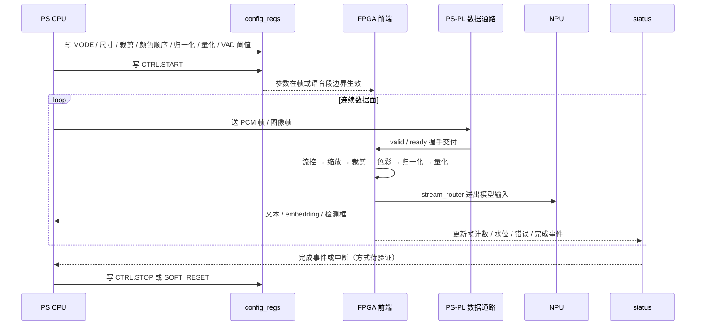

# 接口契约与数据通路

本页回答一个问题：**CPU 与 FPGA、FPGA 与 NPU、模块与模块之间到底用什么信号和寄存器说话。**
它是组件下沉循环第②步"接口契约冻结"的唯一输入材料（见 [[3-FPGA组件下沉]]）。

## 契约冻结状态总览

| 契约项 | 当前状态 | 冻结条件 |
|---|---|---|
| valid／ready 流式握手语义（含背压与同拍读写） | **已验证** ✅ | 已由 1-entry 握手缓存 RTL + 自检 testbench 证实，作为全项目基线 |
| 视觉侧**源帧与交接位深** | **已实测** ✅：1920×1080、**30.06 fps**（不是手册／厂商 Demo 说的 60）、PS→PL 交接为 **RGB565（16 bit）**，喂 AI 的那路是 640×352 或 960×512 且**隔 3 像素抽样**裁出 | [[我方在板外设#三、从时序侧能确定的摄像头规格（A＋C 混合，逐条标级）|我方在板外设——三]] |
| 视觉侧 AXI4-Stream 位宽／tlast／tuser | **待验证**（这条是我方自研 IP 要**定**的，不是板子给的，别再挂着"等实测"） | 接口评审时定，与板卡无关 |
| 音频侧 PCM 参数 | **已实测** ✅：双向只有 **48000 Hz** 一档、**S16_LE**，播放 **2 声道**、录音 **1 声道**（原生单声道，**没有下混这一步**）；16 kHz 由板端 `plughw` 重采样得到，代价单核 **0.17 %** | [[音频#2.1 采样格式|音频——2.1]]（正本，逐条 A 级） |
| ASR 侧输入要求（期望速率／是否要参考信号消除） | **速率／位宽／声道已核到**＝16 kHz／单声道／int16（FunASR 官方三档 ONNX 真装载跑出来的，见第 4 节那一行）。**"要不要参考信号消除"从 2026-10-29 起是真问题**：旧理由"本轮不出声、设备录不到自己放的声音"已被实测推翻——满音量下播放确实进了采集流，扫频带内比同带对照高 **+31.4／+44.6 dB**，判据见 [[音频#^t29-sweep|音频——^t29-sweep]]、作废的旧断言见 [[音频#^t29-overturn|音频——^t29-overturn]]。**这一行的取舍还没定，等她拍**：半双工（放音期间不采或丢弃，代价最小）vs 软件 AEC（要 far-end 参考信号 ＋ 在 993 MB／CMA 256 MB 的板子上多出一份 CPU／内存）。**三条边界条件别忽略**：低增益档漏多少、人声漏成什么形状、设备侧那套处理能不能关掉——**全都没测**（[[音频#^t29-limits|音频——^t29-limits]]） | [[板端我方代码与产物台账]] §九（模型侧）＋[[音频#^t29|音频——T29]]（外设侧，2026-10-29 改判） |
| PS↔PL 数据通路、DMA、DDR 归属、时钟复位 | **待验证** | 读官方参考工程 + 上板试跑。**HP 口的水位信号与复位语义已外部取证**（Xilinx UG1085 v2.5 逐字，E1），但逐端口复位位与 AFIFM 是否在本芯片实现须问厂商 → [[PS-PL_AXI_HP口与复位语义]] |
| **寄存器面访问方式**（UIO 还是自建字符设备） | **提案，待验证** | 到板确认 configfs overlay 可用 + `/dev/uio*` 能造出来 → D-18 |
| **比特流上板方式**（U-Boot `loadbit` 还是 `fpga_manager`） | **待验证**（前者疑为空转） | 到板 `printenv`、`cat /sys/class/fpga_manager/fpga0/state`、试 `echo` 一次 |
| config_regs 寄存器映射 | **设计提案，待冻结** | 两人在接口评审会上共同签字冻结 |
| status 上报字段与事件 | **设计提案，待冻结** | 同上 |

## 1 流式握手协议（唯一已验证的部分）

### 1.1 信号与语义

| 信号 | 方向 | 语义 |
|---|---|---|
| valid | 上游→下游 | 本拍 `data` 有效，上游愿意交付 |
| ready | 下游→上游 | 下游本拍可以接收 |
| data | 上游→下游 | 载荷（一个样本、一个像素或一拍多像素） |
| 时钟 | — | 单时钟域内同步采样，上升沿有效 |
| 复位 | — | 复位期间 valid=0，缓冲置空 |

**握手成立条件**：`valid && ready` 同时为 1 的那个时钟沿，数据被下游接收。其余一切行为都由下面三条规则约束。

### 1.2 规则

| 规则 | 内容 | 违约后果 |
|---|---|---|
| R1 保持 | `valid` 一旦置起，在握手成立前不得撤销，且 `data` 必须保持不变 | 丢样／错值，最难查的一类 bug |
| R2 独立 | `ready` 可任意时刻变化，不得依赖 `valid` 的组合逻辑回环（避免组合路径跨模块成环） | 综合后时序／功能不确定 |
| R3 同拍 | 同一拍内允许"取走旧数据 + 写入新数据"，二者互不阻塞 | 吞吐折半，实时链路失配 |

### 1.3 背压规则

| 场景 | 要求 |
|---|---|
| 下游 `ready=0`（停顿） | 上游必须能无限期保持当前数据；缓冲内数据不得被覆盖 |
| 缓冲深度 = 1 | 最多吸收 1 个在途样本；第 2 个样本到达时若仍无消费，上游 stall，**不允许丢样** |
| 持续背压 | 溢出必须被计数并通过 status 上报，不得静默丢弃或产生非法写 |
| 上游无新输入 | 缓冲回落到空状态，`valid=0`，不产生伪样本 |

### 1.4 参考实现：1-entry valid／ready 握手缓存 ✅

这是项目里目前**唯一 ✅ 的自研模块**，作为所有流控模块的行为基线。

| 项 | 内容 |
|---|---|
| 契约 | 输入侧 `in_valid/in_data/in_ready`，输出侧 `out_valid/out_data/out_ready`；内部 1 个寄存器槽 |
| 保证 | 输入侧看到的行为严格满足 R1–R3；输出侧数据与输入顺序一致、不重复 |
| 证据 | Icarus 编译退出码 0；`vvp` 运行退出码 0；testbench 输出 `PASS`；生成 VCD |
| 已覆盖边界（5 项自动检查） | ① 复位后为空且 `valid=0`；② 空缓冲接收；③ 下游停顿时数据保持；④ 同拍取走旧数据并写入新数据；⑤ 无新输入时回到空状态 |
| 尚未覆盖（后续 testbench 需补） | 长时间随机背压下的吞吐统计、溢出计数语义、多深度泛化（需调厂商 FIFO／BRAM IP） |

> 样板意义：任何新流控模块的 testbench 必须复刻这 5 项检查，并自动输出 PASS／FAIL（见 [[验证方法学]]）。

### 1.5 常见违约模式与检测手段

| 违约模式 | 症状 | 谁来检测 |
|---|---|---|
| `valid` 在 `ready=0` 时被撤销 | 偶发丢样，输出样本计数少于输入 | 输入／输出计数比对（不丢判据）+ 断言：`valid` 拉高后在握手成立前必须持续为高 |
| `data` 在等待期被覆盖 | 输出出现"半个新半个旧"的值 | 同拍读写专项用例（样板第 4 项） |
| `ready` 组合依赖 `valid` | 综合后出现组合环，仿真看不出 | 结构检查（禁止性约定）+ 综合告警复核 |
| 上游 stall 时仍持续写缓冲 | 溢出被静默吞掉，事后无痕迹 | `CNT_DROP` 必须随溢出递增，testbench 校验计数守恒 |
| 帧尾丢失或 `tlast` 位置错 | 帧计数与行计数错乱，末行残缺 | 帧／行计数与参考比对 + 帧完整性标志上报 |
| 帧中途改配置 | 同一帧内出现两套尺寸，输出尺寸非法 | 参数生效点断言（只在帧／语音段边界改变） |

## 2 视觉侧：AXI4-Stream 约定（待验证）

下列约定是**提案骨架**，具体数值与时序必须到板核对悟净板官方参考工程后才允许写入 RTL。

| 项 | 提案内容 | 状态 | 核对方法 |
|---|---|---|---|
| 数据位宽 | 每拍承载的像素数由参考工程 DMA／AXI 位宽决定（候选 32／64／128 bit） | **待验证** | 读 ICraft v3.36.1「悟净开发板」参考实现工程网表与约束，确认 AXI-Stream 数据宽度 |
| `tvalid`／`tready` | 与第 1 节 R1–R3 完全一致 | **已确认**（复用已验证语义） | 仿真平台复用握手缓存 testbench |
| `tlast` | 标记**帧尾**一拍；前端据此产生帧结束事件、刷新帧计数 | **待验证**（帧尾 vs 行尾粒度未定） | 参考工程实际用法 + 采集实测 |
| `tuser` | 承载边带信息（候选：帧同步／行同步／像素通道标识） | **待验证** | 参考工程定义；未确认前 RTL 内不得依赖具体位含义 |
| 时序 | 边带信号与 `tdata` 同拍有效，随 `valid` 一起保持 | **提案** | 板端抓波形比对 |
| 背压 | 由 `tready` 逐拍反压；帧中途不得插入无效拍 | **提案** | 长时随机背压仿真 |
| 分辨率／帧率 | 摄像头实际输出未定 | **待验证** | V4L2 `v4l2-ctl --list-formats`／`--get-fmt-video` 实测 |
| **前端→NPU 的字节格式基准** | 官方示例工程里的 **`img2ftmp.py`** 定义了 NPU 输入张量的字节布局（尺寸、颜色顺序、量化后的字节序）。**视觉前端的验收判据 = 前端输出与 `img2ftmp.py` 的输出逐像素（逐字节）一致**，不是目视"看着一样"，也不是与浮点预处理近似 | **已确认（基准文件存在）／参数待冻结** | 以 `image_cls_resnet18` 工程为模板跑一遍：同一张输入图，前端 golden model 与 `img2ftmp.py` 产物做逐字节 diff |

**入流来源（10-05 更新，旧口径作废）**：这条 AXI4-Stream 是"**PS 解码之后的原始帧 → PL 前端**"这一段，**不是**摄像头到 PL 的直连。**但本页原先那句"当前唯一可用的摄像头是 USB UVC"已经过期**：完整版**没有 MIPI 座子**、板载 HDMI **只出不进**这两条仍然成立，而 **SDI 这条路 2026-09-30 起就在跑**——厂商位流把 1080p 帧交进 PL，实测交付 **30.06 fps、满 1920×1080、交接位深 RGB565（16 bit）**，喂 AI 的那路裁成 640×352 或 960×512（A，见 [[我方在板外设#一、当前在板清单（A 级实测）|我方在板外设——一]]、[[我方在板外设#三、从时序侧能确定的摄像头规格（A＋C 混合，逐条标级）|三]]）。USB UVC 作为**退路**依然成立（四个口共用一条 480 Mbps），但我方没接 UVC 摄像头。因此第 2 节的位宽与带宽预算**按 1920×1080@30 fps 算，不按"640×480 量级"**；BRAM／带宽余量要按前者复核。

## 3 音频侧：PCM 流约定

| 项 | 当前口径 | 状态 |
|---|---|---|
| 采集接口 | Linux ALSA（USB Audio）→ PS 音频采集 → DMA → FPGA 音频流控 | **已确认**（链路形态） |
| 采样率 | **实测：设备侧只有 48000 Hz 一档**（描述符 `bSamFreqType=1 Discrete`）。16 kHz 由板端 `plughw` 重采样得到，实测在推理满载时仍**几乎不要钱**（`arecord` 自身单核 0.17 %）；**别对 `hw:` 提非 48k**——它不报错，静默按 48k 跑并把 `-d` 的秒数折算掉 | **已实测** ✅ |
| 位宽 | **实测：双向 `S16_LE`**，没有 32 bit 候选这一档 | **已实测** ✅ |
| 声道 | **实测：播放 2、录音 1**，且 `MCP01 Consumer Control` 之外没有阵列——**这是一颗单声道会议麦，不存在"阵列声道数与交织顺序"这个问题**，也不存在下混 | **已实测** ✅ |
| ASR 输入要求 | **10-10 核到模型侧了**：FunASR 官方三档 ONNX（离线／流式 Paraformer-large int8、SenseVoiceSmall int8）仓库名都带 `16k`，实际装载运行确认输入＝**16 kHz／单声道／int16 PCM**（我方链路喂的就是这一档；`funasr_onnx` 内部要 float `-1..1`，因为 `utils/frontend.py` 会 `waveform * (1<<15)`，量纲喂错会当场炸，这层换算由后端做）。**外设侧那一行严丝合缝**：`plughw` 出来的正好是 16k／单声道／16 bit，**不需要 FPGA 侧再加 SRC**（除非要把重采样从 CPU 挪走，那是第三节 SRC 行的归属问题） | **已核对** ✅（依据＝板上真装载真推理，见 [[板端我方代码与产物台账]] §九／`#107`／`#119`～`#121`） |
| FPGA 侧握手 | 与第 1 节 valid／ready 完全一致（样本粒度 = 一个采样点或一个交织帧） | **已确认**（复用已验证语义） |
| 交接粒度 | ALSA 周期缓冲 → DMA 块传输 → 流控节拍的映射 | **待验证** |
| 备选入流：PL 侧 I²S 直采 | HEADER 只有 **4 根 3.3V**，按"共用 BCLK／LRCLK + 各一根 DATA"算，**恰好**放得下 1 收 + 1 发；再挂第三个 I²S 设备放不下 | **候选，未排期**。走这条路时 ALSA 整体被绕开（内核 `# CONFIG_SND_SOC is not set`），上表"采集接口"那行要改写成"PL I²S RX → DMA → 用户态环形缓冲"，`arecord` 系列验证手段全部失效 → [[板载接口与内核改造收纳进dev#十、"能不能全在 PL 端处理"——板级直采外设的判定\|板载接口与内核改造——十、"能不能全在 PL 端处理"——板级直采外设的判定]]、[[外设与资金申报改成设备信息#八、如果要把外设从 USB 挪到 PL 直连：买什么、什么时候才值得买\|外设与资金申报——八、如果要把外设从 USB 挪到 PL 直连：买什么、什么时候才值得买]] |

**SRC 是否出现在数据通路中，完全由上表第 2、5 行的实测结果决定**（条件 P0，见 [[FPGA自研模块清单]]）。

## 4 PS↔PL 数据通路、DMA、DDR、时钟复位（全部待验证）

| 项 | 板上已知规格 | 设计口径 | 状态与核对方法 |
|---|---|---|---|
| PS 侧内存 | PS DDR3 1 GB | Linux 与用户态缓冲的归属地 | **待验证**：PS 侧分配、PL 可见性与 cache 一致性由参考工程决定 → 读工程 + 板上试跑 |
| PL 侧内存 | PL DDR3 2 GB | 帧缓存／音频缓存的候选落点 | **待验证**：帧缓存是否必须落 PL DDR、带宽预算 → MIG／DDR 控制器示例 + 综合报告 |
| DMA | 配置表"8 通道 DMA"（PS 侧 DW DMA，dtb `dma@e004b000` = okay，`snps,dma-spear1340`）；**PL 侧另有 `dma@f0010000` = okay，`snps,axi-dma-1.01a`，驱动 `CONFIG_XILINX_DMA=y` 内建** | PS→PL 送流、PL→PS 回传的主通路；通道需在契约里静态分配 | **待验证**：通道数、描述符格式、完成中断语义 → 读官方参考工程与手册。**已排除一项**：`u-dma-buf` 本板已加载（见 [[os#二、内核模块（含一条对镜像取证结论的更正）\|os——二、内核模块（含一条对镜像取证结论的更正）]]），但它与 PL 侧 AXI DMA 按候选并列、契约仍**不以它为前提**（见 [[板载接口与内核改造收纳进dev#十、"能不能全在 PL 端处理"——板级直采外设的判定\|板载接口与内核改造——十、"能不能全在 PL 端处理"——板级直采外设的判定]]） |
| AXI 基础设施 | 平台提供 | 一律复用，不自研 | **待验证**：地址映射与中断号分配 |
| **寄存器面（PS 侧怎么看懂 `config_regs`）** | 内核 `CONFIG_UIO=y`、`UIO_PDRV_GENIRQ=y`、`UIO_DMEM_GENIRQ=y` 全内建；`GPIO_SYSFS=y`、`GPIO_XILINX=y` 内建 | **提案**：PL 侧 AXI-Lite 寄存器区通过一个 `compatible="uio_pdrv_genirq"` 的节点暴露成 `/dev/uioN`，用户态 `mmap` 读写寄存器、`read()` 阻塞等中断 → **不写内核驱动、不重编内核** | **待验证**：需运行时设备树 overlay 可用（`OF_CONFIGFS=y`，见 D-18）；到板先 `ls /dev/uio*` |
| **比特流上板方式** | `CONFIG_FPGA=y`、`FPGA_MGR_FMQL_FPGA=y`、dtb `devcfg@e0040000` = okay；U-Boot `loadbit` 那行确认空转 | ~~**提案**：`.bit` 放 `/lib/firmware`，启动脚本里 `echo > /sys/class/fpga_manager/fpga0/firmware`，不依赖 U-Boot、不依赖 JTAG~~ → **2026-10-10 实测推翻**：恒 `Timeout waiting for PCFG_DONE`（**用出厂位流做对照同样失败**）。当前唯一可用通道是 FSBL 从 BOOT.bin 灌位流 | **已实测为坏**，待厂商答复 → [[PL位流重载通道失效]] |
| 时钟 | PS 侧 50 MHz、PL 侧 200 MHz 时钟源 | 视频像素时钟、音频采样时钟的派生方式待确定 | **待验证**：PLL 配置与约束 → Procise 约束文件 + 时序报告。旁证：可编程时钟驱动 `SI5324`／`SI570`／`CDCE706`／`CLKWZRD`／`DGLNT_DYNCLK` 全部 `=y` 内建，但它们服务于 **GT**，且要走 I2C 编程而两路 I2C 在 dtb 里是 disabled |
| 复位 | `CONFIG_RESET_CONTROLLER=y` 内建；PS_JTAG／PL_JTAG 调试接口存在 | 建议软复位由 `config_regs` 触发、与平台复位分层 | **待验证**：复位极性与同步释放方式 → 参考工程。**PS 侧 HP 口的事务计数与复位语义已由厂商书面答复**（E1，2026-10-12 客户说明，**针对本芯片**）：本芯片**没有 AFI**、不提供 `RCOUNT`/`RACOUNT`；复位落在哪一层决定在途事务的结局，**任一侧非空闲被复位会把另一侧等死**；寄存器复位清不掉下游残留 —— 正本见 [[PS-PL_AXI_HP口与复位语义#四、复位语义：复位落在哪一层，结局完全不同\|PS-PL_AXI_HP口与复位语义——四]]；**仍未闭合**：`AXI_HP_RST_CTRL`／`FPGA_RST_CTRL`／`USER_LEVEL_SHIFT` 的地址与位定义（本地无 UG602）→ [[PS-PL_AXI_HP口与复位语义#九、必须由厂商／复旦微确认的清单（本页的正本，逐条勾）\|——九]] |
| 跨时钟域 | — | 明确禁止自研 CDC；异步界只允许放在厂商 FIFO／异步 FIFO IP 内 | **已确认**（团队设计禁令，源自复用边界） |

> 上表所有 **待验证** 项此前共同的阻塞原因是"尚未拿到悟净板"，**该口径已于 2026-09-28 作废**（[[状态源与决策记录#D-24 · 板子已在手上并且能登进去：全库"尚未拿到悟净板"口径作废|状态源与决策记录——D-24]] **D-24**：板子已可经串口与 SSH 登录）。现在的解锁条件＝**上板跑采集表 + 拿到可编译的官方参考工程**，前者已无外部依赖。

## 5 config_regs 寄存器映射（设计提案，待冻结）

访问宽度、总线接口（AXI-Lite 或平台自定义寄存器）与地址基址**待验证**；下表只冻结"需要哪些字段、谁写谁读"的语义。位宽列为提案占位，评审时定稿。

| 偏移 | 名称 | 字段 | 写／读 | 说明 |
|---|---|---|---|---|
| 0x00 | CTRL | START／STOP／SOFT_RESET | W（各 1 bit 触发） | 启动／停止／软复位；软复位只清前端与状态，不动平台 |
| 0x04 | MODE | FACE／OCR／VLM／AUDIO | W | mode_router 与 stream_router 的联合模式字 |
| 0x08 | SRC_SIZE | 输入宽／输入高（各 16 bit） | W | 供 video_frame_ctrl 校验实际流 |
| 0x0C | DST_SIZE | 目标宽／目标高（各 16 bit） | W | resize 与模型输入尺寸 |
| 0x10 | CROP_XY | x0／y0（各 16 bit） | W | 裁剪起点 |
| 0x14 | CROP_WH | w／h（各 16 bit） | W | 裁剪尺寸，ROI 生成依据 |
| 0x18 | PIX_FMT | 颜色顺序（RGB／BGR／YUV）+ 字节序 | W | color_convert 参数，禁止硬编码 |
| 0x1C | NORM_MEAN | mean（定点 Q 格式） | W | Q 位宽与舍入方式在定点化步骤确定后一并写入本表 |
| 0x20 | NORM_STD | std 或其倒数（定点） | W | 用倒数避免硬件除法；饱和策略随定点化冻结 |
| 0x24 | QUANT_SCALE | scale（定点） | W | INT8 量化标度 |
| 0x28 | QUANT_ZP | zero-point | W | 非对称量化时用 |
| 0x2C | VAD_CFG | 能量阈值／hangover | W | VAD 判定与挂起长度 |
| 0x30 | AUDIO_FRAME | 帧长／帧移 | W | frame_ctrl 参数 |
| 0x34 | ROUTE_CFG | 输出去向选择／目标通道 | W | stream_router 通路表 |
| 0x38 | BUF_CFG | 缓存深度／水位阈值 | W | 溢出告警门限 |
| 0x40 | STATUS | 帧状态汇总（见第 6 节） | R | 可轮询 |
| 0x44 | CACHE_STATUS | 各级缓存满／空／水位 | R | — |
| 0x48 | ERR | 错误类型位（溢出／下溢／乱序／参数非法／帧不完整） | R | 只增不清，由 CTRL 复位清 |
| 0x4C | EVT | 完成事件位（帧完成／语音起止／DMA 完成） | R（读清） | 同时可映射到中断线 |
| 0x50 | CNT_FRAME | 已处理帧数 | R | 性能测量用 |
| 0x54 | CNT_SAMPLE | 已接收样本数 | R | 不丢判据 |
| 0x58 | CNT_DROP | 丢弃样本／帧数 | R | 不丢判据的反证 |
| 0x5C | ID_VER | IP 标识与版本 | R | 上板核对位流是否为预期版本 |

**提案的三条约束**：① 参数只在帧／语音段边界生效，不允许帧中途改尺寸；② 所有 R 位段复位后有确定默认值；③ 计数字段不得自动清零，避免事后取证丢失。

## 6 status 上报与事件

| 上报项 | 内容 | 用途 |
|---|---|---|
| 帧状态 | 当前帧计数、帧内像素／行进度、帧完整标志 | 判断是否丢帧、卡帧 |
| 缓存状态 | 各级 FIFO／Buffer 水位、满／空标志、溢出计数 | 背压是否发生的直接证据 |
| 错误 | 溢出／下溢／乱序／参数非法／分辨率与配置不符 | 现场定位，避免"看起来卡住" |
| 完成事件 | 一帧预处理完成、VAD 起始／结束、一次 NPU 输入就绪、DMA 完成 | 驱动 CPU 调度下一步 |
| 性能观测 | 处理耗时／有效吞吐计数 | P1 的 CPU vs FPGA 对比数据来源 |

中断与轮询的关系：**建议**事件位同时映射到中断线与可读寄存器，具体中断号与触发方式（电平／边沿、DMA 完成中断形态）**待验证**，以官方参考工程的中断连接为准。

## 7 控制面与数据面分离

这张图回答：**一次"配置 → 处理 → 送 NPU → 回事件"的完整往返中，哪些走寄存器、哪些走流。**

| 面 | 走什么 | 频率 | 违约代价 |
|---|---|---|---|
| 控制面 | 寄存器读写、事件与中断 | 每模式切换一次 | 参数不一致 → 结果错但不报错 |
| 数据面 | valid／ready 流式握手（像素流／PCM 流） | 每拍 | 丢样／乱序 → 不可复现，必须靠自检暴露 |

## 8 冻结流程与分工

1. **接口契约由两人共同冻结**：甲（系统／应用侧）代表 CPU 侧消费者，乙（硬件／加速侧）代表 PL 侧实现者；任一方单独改表无效。
2. 冻结产物：本表（含定稿位宽、Q 格式、中断连接）+ 测试向量清单 + 运行时开关位（FPGA↔CPU 双通路）。
3. **冻结后各自独立推进**，不互相等待：甲继续 CPU 参考实现与黄金基线，乙继续 RTL 与 testbench；争议一律以比对黄金参考为准。
4. 变更规则：冻结后的任何改动必须同时更新本页与任务卡，并重新跑一遍受影响模块的等价性回归（见 [[验证与交付]]）。

> 本页对应下沉循环第②步：第①步冻结黄金参考与误差容限，第②步冻结接口契约，之后才允许定点化与 RTL 实现（见 [[3-FPGA组件下沉]]）。

## 相关页面

[[FPGA自研模块清单]] · [[板端提取件台账]] · [[板级管线详图]] · [[验证方法学]] · [[板子（除芯片）]] · [[芯片]] · [[os]] · [[3-FPGA组件下沉]] · [[1-NPU模型部署]] · [[交叉编译环节]]
