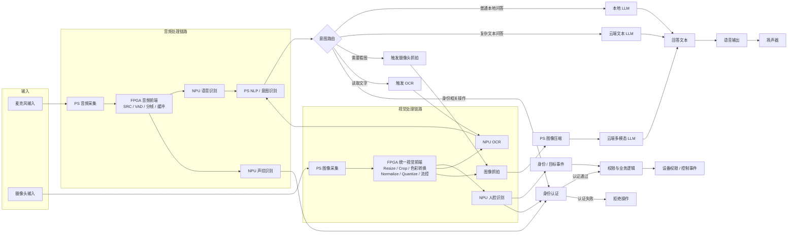
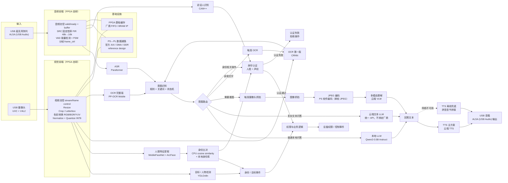

# 系统架构总览

本页回答一个问题：**整个系统在复旦微悟净板上长什么样、数据怎么流、三类算力怎么分工。**
进度、任务卡、完成判据、周会节奏与排期不在本页，见 [[实施路线]]、[[进度计算与实时看板]]、[[排期与分工]]。

## 状态标记约定

| 类别 | 标记 | 含义 |
|---|---|---|
| 结论可信度 | **已确认** | 由团队明确决定，或已有记录与验证支持 |
| 结论可信度 | **候选** | 架构方向已确定，具体组件仍需编译、实测或接口核对 |
| 结论可信度 | **待验证** | 必须依赖板卡、参考工程、模型编译或实际运行才能确认 |
| 执行进度 | ⬜ / 🔄 / ⛔ / ✅ | 未开始 / 进行中 / 阻塞（须写明解锁条件）/ 已完成（有验收记录） |

> 两套标记不得混用：一句结论的**可信度**不等于它的**完成进度**。全部依据来自项目状态源（见 [[状态源与决策记录]]）。

## 一、总体形态（已确认）

系统是**事件驱动的异构多模态处理管线**：音频与视觉两条感知链路并行运行，后端由 NLP／意图路由统一调度本地与云端推理路径。

| 已确认要点 | 对架构的约束 |
|---|---|
| 目标是 CPU＋FPGA＋NPU 异构多模态智能终端，不是"部署几个现成 AI 模型" | 必须有自研数据通路，且能测出加速收益 |
| FPGA 对连续音视频流做实时预处理；NPU 执行 AI 感知模型；CPU 按语义与事件选择推理路径 | 三类算力的职责边界不可互相替代（见第三节分工表） |
| 当前以图像处理链路为重点，音频链路同时保留并实现 | 视觉流水线是主要 FPGA 成果与答辩主线；音频前端是第二条必要链路 |
| 不继续扩张功能范围，优先把双链路做成可验证、可上板、可测性能、可解释的完整系统 | 新需求一律进下版 backlog，不改当前架构 |

## 二、两条链路的端到端数据流

### 音频链路

| # | 节点 | 归属 | 内容 | 可信度 |
|---|---|---|---|---|
| 1 | USB 麦克风 → ALSA | 外部设备 / PS | USB Audio 原始 PCM 流 | **已确认**（输入方式） |
| 2 | PS 音频采集 | PS | Linux ALSA 读流、对齐采样帧 | **已确认** |
| 3 | FPGA 音频前端 | PL | 流控（valid／ready）→ 缓冲 → SRC（条件性）→ VAD → 分帧 | **已确认**（范围）／**待验证**（SRC 是否必需） |
| 4 | NPU ASR | NPU | Paraformer（候选），须先过 iCraft 编译与算子支持验证 | **候选** |
| 5 | PS NLP／意图识别 | PS | 规则 + 关键词 + 状态机 | **已确认**（首选） |

链路完整走向：麦克风输入 → PS 音频采集 → FPGA 音频前端（SRC、VAD、分帧、缓冲、流控）→ NPU ASR → PS NLP／意图识别；NLP 再按意图选择本地小模型、云端文本 LLM、视觉抓拍、多模态 VLM、OCR 或身份／权限逻辑。

### 视觉链路

| # | 节点 | 归属 | 内容 | 可信度 |
|---|---|---|---|---|
| 1 | USB 摄像头 → V4L2 | 外部设备 / PS | UVC 视频流 | **已确认**（输入方式） |
| 2 | PS 图像采集 | PS | V4L2 取帧、送 PL | **已确认** |
| 3 | FPGA 统一视觉前端 | PL | 流控 → Resize → Crop／Letterbox → 色彩转换 → Normalize／Quantize → 帧控制 | **已确认**（范围） |
| 4a | NPU 人脸／目标识别 | NPU | YOLOv8n + MobileFaceNet／ArcFace（候选） | **候选** |
| 4b | NPU OCR | NPU | CRNN（第一版）／PP-OCR Mobile（完整版，候选） | **候选** |
| 4c | 按需抓拍 | PS | 单帧 JPEG（软件编码）→ 云端 VLM | **已确认**（方案） |
| 5 | 身份与权限 | PS | 人脸 embedding → CPU 比对 → 身份／目标事件 → 权限与业务逻辑 | **已确认**（链路）／**待验证**（触发的具体业务动作） |

链路完整走向：摄像头输入 → PS 图像采集 → FPGA 统一视觉前端；前端同时服务人脸／目标识别、OCR 与按需抓拍三个去向；识别文字走 OCR → 文本 → NLP／LLM，理解场景则抓拍单帧由 PS 做 JPEG 压缩后发送云端多模态 VLM。

### 回答与输出路由（已确认）

| 请求类型 | 路径 |
|---|---|
| 普通本地问答 | 本地小 LLM（Qwen2-0.5B-Instruct **候选**） |
| 复杂文本问答 | 云端文本 LLM（统一 API，不绑定厂商） |
| 「这是什么／这个怎么用」 | 触发图像抓拍 → PS JPEG → 云端多模态 VLM |
| 「这上面写了什么」 | 触发 OCR → 文本 → LLM |
| 身份相关操作 | 人脸／目标事件 → 身份认证 → 权限与业务逻辑 |
| 回答输出 | 回答文本 → 云端 TTS（主）／拼音音节拼接（离线兜底）→ USB 音箱 |

## 三、计算资源分工

| 单元 | 承担什么 | 不承担什么 |
|---|---|---|
| **FPGA／PL** | 连续音视频流的确定性实时预处理、可配置数据通路、流控与硬件加速 | 神经网络本体、视频／JPEG 编码、TTS 后端、网络协议卸载（本周期范围外） |
| **NPU** | ASR、人脸／目标识别、OCR、本地 AI 模型等矩阵乘加密集型推理 | 逐像素流式前后处理、严格节拍的数据面流控 |
| **PS／CPU** | Linux 设备驱动、采集、NLP／意图识别、模型调度、身份库比较、权限逻辑、网络、JPEG 压缩、文本处理与输出 | 长时间占用 CPU 做连续像素级预处理（这正是下沉 FPGA 的动机） |
| **云端** | 复杂文本 LLM、多模态 VLM，以及必要时的云端 TTS | 任何必须离线可用的功能（身份认证、简单问答、兜底播报） |

> OpenCV 定位（已确认）：采集、显示与调试，**不承担核心实时预处理**。
> 永久回退原则：CPU 通路始终保留、可一键切回，FPGA 版本出问题当场切回（见 [[3-FPGA组件下沉]]）。

## 四、跨链路系统控制模块（C 组，已确认）

四个模块（`config_regs` / `stream_router` / `status` / `top`）不属于任何单条链路，是双链路的公共控制与集成层。**它们的职责、关键设计点与状态只写在 [[FPGA自研模块清单#C 系统控制与集成|FPGA自研模块清单——C 系统控制与集成]] 的"C 系统控制与集成"一节**，寄存器契约在 [[接口契约与数据通路]]，验收判据在 [[3-FPGA组件下沉#13. C 类控制与集成（卡 A8）的验收判据：不走 8 步循环|3-FPGA组件下沉——13. C 类控制与集成（卡 A8）的验收判据：不走 8 步循环]]——本页作为架构图层不复制表格（决策 D-20）。

架构层只需要记住一句话：**A1~A7 的运行时开关（铁律②）物理上由 C 组提供**，所以 C 组没做完全链路开关就等于没有开关。

## 五、与旧版方案的差异（冲突消解）

本页架构图已按 **D-02** 修正三处旧口径：FPGA 下沉范围（JPEG／FPGA TTS 后端／TOE 移出本周期）、链路优先级（视觉主线 + 音频第二链路）、CustomOP 降级为条件项。**三处的决策原文、理由与"什么条件下会变成做"只写一处**：决策见 [[状态源与决策记录#D-02 · 收缩 FPGA 下沉范围（本 Wiki 编制时消解的最大冲突）|状态源与决策记录——D-02]] D-02，技术清单见 [[组件选型与复用边界#十一、明确不采用／暂不采用的技术（负面清单）|组件选型与复用边界——十一、明确不采用／暂不采用的技术（负面清单）]]，下版评估输入见 [[全链路逻辑基线#6. 若未来上 FPGA 时的原设想（候选，不是计划）|全链路逻辑基线——6. 若未来上 FPGA 时的原设想（候选，不是计划）]]。本页不复述。

> 与 [[全链路逻辑基线]] 的关系：本节两张图是**全 Wiki 拓扑（节点集合与连线）的唯一出处**，那一页第 2 节的图沿用同一拓扑，只是把颜色语义换成"最终计算归属"。旧画法（JPEG／FPGA TTS／TOE 为橙色 FPGA 节点）只存在于已归档的《开发流程与生命周期管理》《立项说明》里，那一页第 1 节逐节点登记了"原画法→改法"，它的**现行图例已按修正上色**，按颜色读那张图不会读错。要增删节点或连线，先改本节，再去那张页同步——两图之间有 22 条同形连线，属于已登记的耦合（D-22 第 8 条）。

## 六、工作流程图

### 6.1 粗粒度基本视图（无具体组件名）

这张图回答：**不指定任何具体模型和 IP 时，双链路与意图路由的最小完整拓扑是什么？**

粗读要点：

| 观察 | 结论 |
|---|---|
| 两个前端（音频／视觉）各有一条到 NLP／事件的出口 | 双链路是并行而非串行，NPU 输出统一交给 PS 侧语义层 |
| 意图路由只有一个入口（NLP）和五个出口 | 所有业务分支集中在 PS 一处决策，FPGA 不参与语义判断 |
| 抓拍路径回写到图像采集节点 | 抓拍复用同一采集通路，不新增独立硬件链路 |

### 6.2 组件级视图（标注具体选型）

这张图回答：**上面每个节点当前分别用什么组件／IP 实现，以及哪些属于 FPGA 自研范围？**

组件级视图的两处口径提示（不得从图上误读）：

| 图上元素 | 正确解读 |
|---|---|
| `JPEG 编码 PS 软件编码（单帧 JPEG）` | 当前方案；FPGA JPEG 不在本周期自研范围（见 [[板级管线详图]]） |
| `说话人识别 CAM++` | **候选、P2 可选**；身份主线是人脸链路，声纹仅在确定需要"声音身份"时加入 |
| `OCR 第一版 CRNN` / `OCR 完整版 PP-OCR Mobile` | 两阶段策略：先用平台依据更强的 CRNN 跑通识别链，完整版待 iCraft 验证 |
| `PS↔PL 数据通路 官方 AXI / DMA / DDR` | **待验证**：具体接口方式必须到板核对官方参考工程 |

## 七、架构级待验证清单

| 待验证项 | 影响面 | 核对方法 |
|---|---|---|
| 参考工程实际提供的 PS↔PL／NPU 数据路径、DDR 用法、DMA、时钟、复位与接口约束 | 视觉／音频流控与 top 集成 | 到板后读 ICraft v3.36.1 悟净板参考实现工程源码（工程位置见 [[工具链与素材进README]]） |
| 摄像头实际输出格式、分辨率、帧率；人脸／OCR／VLM 三路目标尺寸与颜色顺序 | resize／crop／color_convert 参数与 config_regs 字段 | V4L2 实测 + Netron 核对模型输入 |
| 麦克风实际采样率、位宽、声道数与 ASR 输入格式 | SRC 是否必需（条件 P0） | ALSA `arecord` 实测 + ASR 模型输入要求 |
| 各候选模型在当前 iCraft／Runtime／位流组合下的真实编译与运行结果 | NPU 侧节点是否成立 | 逐个模型编译 + 板端推理，记录进模型台账 |
| 悟净板到板时间 | 所有板端验收（L2／L3／性能测量） | 申请／借用／采购路径确认；当前 ⛔ 阻塞 |

## 相关页面

[[板级管线详图]] · [[FPGA自研模块清单]] · [[接口契约与数据通路]] · [[组件选型与复用边界]] · [[验证方法学]] · [[板子（除芯片）]] · [[芯片]] · [[全链路逻辑基线]] · [[3-FPGA组件下沉]] · [[状态源与决策记录]]
